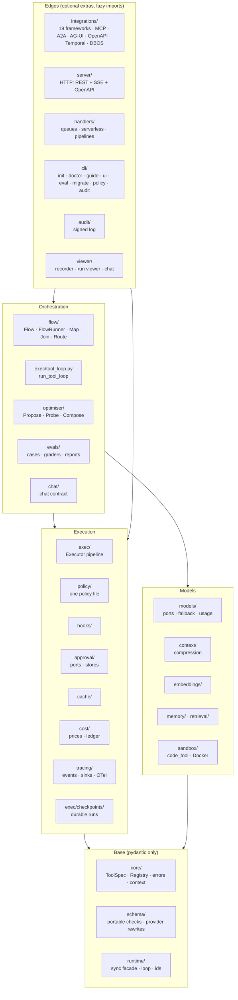
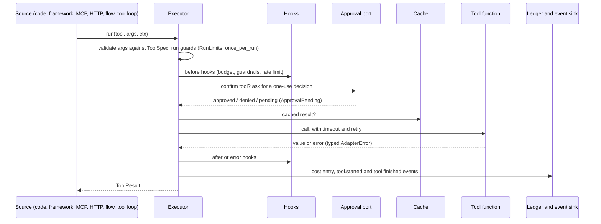

# Agent Adapter: codebase map

A handover for anyone, human or AI agent, who works **on** this code. Read this first; it
should save you reading the whole tree. For **using** the SDK, read `README.md` and the
generated `AGENTS.md` instead.

## 1. What it is, in five lines

- An open-source (Apache-2.0), framework-independent Python SDK (Python ≥ 3.11, version 1.1.0, on PyPI as `agent-adapter`).
- Plain functions become checked LLM tools (`@tool`, `Registry`, `ToolSpec`).
- Every call, from any source, runs through one `Executor` pipeline: validation, hooks,
  budgets, one-use approval, cache, retries, ledger, events.
- Around it: portable graph `Flow`s, a built-in agent loop (`run_tool_loop`), model ports,
  context compression, 19 framework integrations, MCP, an HTTP tool server, A2A, AG-UI, a
  TypeScript client, a local run viewer with a chat page, evals, and an offline optimiser.
- The core depends only on pydantic. Every framework is an optional extra, imported lazily.

Design rules that never bend:

- **No framework required.** The adapter can be the whole agent stack.
- **One executor.** Integrations are thin; they never re-implement safety.
- **Safe by default.** No approval port means denied. A framework's own "approved" never
  counts alone. Logs never carry secrets or `confirm` tool arguments.
- **Model-independent.** The user brings the model, embedder and prices (`CallableModel`,
  `CallableEmbedder`, `Prices`). There are no provider-specific shortcuts.

## 2. Architecture

Import rules are enforced by an AST test (`tests/test_boundaries.py`, rules in
`tests/boundary_rules.py`):

- `core` and `schema` never import `integrations` or any framework.
- The base-layer modules (`core.errors`, `core.context`, `core.types`, ...) import only each
  other. `core.error_base` is the leaf.
- `core.registry` is the only `core` module that imports `schema`.
- `integrations.<x>` imports its framework only inside functions or under `TYPE_CHECKING`.
- No dynamic imports.

## 3. Package map

Every sub-package of `agent_adapter/`, with its entry files. A leading `_` marks a private
module.

| Package | Does | Start reading at |
|---|---|---|
| `core/` | `ToolSpec`, `Registry`, `ToolContext`, messages, ports, the error hierarchy | `tool.py`, `registry.py`, `errors.py`, `ports.py` |
| `schema/` | portable JSON-schema checks; OpenAI, Gemini and Anthropic rewrites | `portable.py`, `transforms.py` |
| `runtime/` | `run_sync`, a long-lived loop for sync code, ids, the current context | `__init__.py` |
| `exec/` | the `Executor`: run, run_many, plans, parallel, retry, guards, resume; the tool loop; agents as tools and handoffs; checkpoint stores and crash-safe runs (`checkpoints/`, `_durable.py`) | `executor.py`, `_call_steps.py`, `tool_loop.py`, `agents.py`, `handoffs.py`, `checkpoints/__init__.py` |
| `hooks/` | before, after and error hooks: `LoggingHook`, `BudgetHook`, `GuardrailHook`, `RateLimitHook`; content guards (`PIIGuard`, `CallableGuard`, Presidio, NeMo) in `builtin/guards/`; shared budget counters (`BudgetStore`, SQLite, Redis, SQLAlchemy) in `builtin/budgets/` | `__init__.py`, `builtin/guards/base.py`, `builtin/budgets/__init__.py` |
| `approval/` | ports (`AutoApprove`, `CallbackApproval`, `DeferredApproval`), batches; stores in memory, SQLite, Redis, SQLAlchemy and DynamoDB; approval memory (past decisions, proposed rules) | `builtin.py`, `deferred.py`, `store.py`, `memory.py`, `rules.py` |
| `cache/` | backends, keys, the tool and LLM caches, the prompt-prefix layout | `__init__.py` |
| `cost/` | the price table (`prices_default.json`), the ledger, its sinks, summaries | `ledger.py`, `prices.py` |
| `models/` | model ports: OpenAI (Chat and Responses), Gemini, Anthropic, `CallableModel`, `FallbackModel`, instrumentation, usage, stream events incl. partial structured output | `_port.py`, `callable.py`, `instrument.py` |
| `embeddings/` | `EmbeddingPort`, `CallableEmbedder`, the embedding cache | `__init__.py` |
| `memory/` | `MemoryPort`, SQLite and callable backends, Mem0/Zep/Graphiti adapters, `memory_tools`, retention | `__init__.py`, `sqlite.py`, `tools.py` |
| `chat/` | the chat agent contract (`ChatMessage`, `ChatSession`, `Attachment`, `ChatAgent`), shared by the viewer and evals | `contract.py` |
| `sandbox/` | `SandboxPort`, `DockerSandbox`, `CallableSandbox` (hosted), the dev-only `LocalSubprocessSandbox`, `code_tool` (always approved) | `port.py`, `_base.py`, `docker.py`, `tool.py` |
| `policy/` | one policy file (YAML, TOML, JSON or dict) applied to an executor: access, approvals, guards, budgets, limits per tool, team and env | `__init__.py`, `policy.py`, `model.py`, `condition.py` |
| `audit/` | the signed, hash-chained audit log of security events (a leaf sink like the viewer), `verify`, `export`, stores | `__init__.py`, `sink.py`, `verify.py` |
| `retrieval/` | `RetrieverPort`, `Document`, callable, embedding, LlamaIndex and LangChain retrievers, `retriever_tool` | `__init__.py`, `_base.py`, `tool.py` |
| `context/` | context compression: a policy of steps (trim, cut, shrink, de-duplicate, rank, summarise) under fixed invariants; `compress_for` per framework | `__init__.py` |
| `flow/` | the `Flow` builder, merge rules, sub-flows (`SubFlow`), the node cache (`NodeCache`), the validated graph, the local `FlowRunner`, pause and resume, mermaid | `spec.py`, `runner.py`, `actions.py`, `state.py` |
| `tracing/` | the event catalogue, sinks (`EventLog`, logging), OpenTelemetry GenAI spans | `events.py`, `sinks.py`, `otel.py` |
| `integrations/` | one module per framework or protocol, plus `attach()` discovery; Temporal and DBOS durable engines | `base.py`, `_attach.py`, `discovery.py`, `temporal.py`, `dbos.py`, `_durable_flows.py` |
| `server/` | the HTTP tool server: ASGI and WSGI, auth, approvals over REST, SSE, idempotency, OpenAPI, budgets (`GET /budget`) | `service.py`, `asgi.py`, `auth.py` |
| `handlers/` | run tool calls from queue messages, serverless events and pipelines | `__init__.py` |
| `optimiser/` | an offline loop over eval cases that writes a reviewable diff | `__init__.py` |
| `evals/` | eval cases, targets, graders, `run_eval`, reports (JUnit, Markdown, JSON), saved reports, the pytest plugin; cases from recorded runs (`from_runs.py`); the cost advisor (`advisor.py`, `StepModels`) | `runner.py`, `graders.py`, `report.py`, `store.py`, `advisor.py` |
| `viewer/` | records runs to JSONL, the local web viewer, exports, the chat page, the Evals view of saved reports, run search and tags (`_search.py`, `_tags.py`), OTLP JSON import (`_otlp_import.py`), save a run as an eval case (`_case_routes.py`, `static/runcases.js`) | `recorder.py`, `server.py`, `serving.py`, `assets.py`, `_evals.py` |
| `viewer/chat/` | the chat contract (re-exported from `chat/`), the turn host, sessions, uploads, one-use approvals, routes, SSE | `contract.py`, `host.py`, `routes.py` |
| `viewer/static/` | the page: plain JS and CSS, no build step, no CDN | `index.html`, `data.js`, `chat.js`, `graph*.js`, `runsearch.js` |
| `cli/` | `agent-adapter init / doctor / guide / ui / eval / migrate / policy / audit` | `__init__.py`, `ui.py`, `doctor_features.py`, `migrate.py` |
| `_guide/` | the packaged copy of `AGENTS.md` and `llms-full.txt` (generated) | — |

Public API:

- The top level `agent_adapter` exposes about 55 names lazily (`__all__` in `__init__.py`).
  `tests/test_public_api.py` and `tests/test_exports.py` pin them.
- Every error is importable from `agent_adapter.errors`. They all subclass `AdapterError`.
- Renaming or removing a public name is a breaking change: update `CHANGELOG.md`.

## 4. How a call flows

Other paths reuse it:

- **Flow run.** `FlowRunner.run(flow, state)` validates the graph, then runs supersteps.
  - Each node is a function, `Call`, `Map` (fan-out) or `Join` (fan-in).
  - `Merge` rules combine parallel writes.
  - `Route` picks the next node.
  - `pause=` parks the run and resume continues it.
  - With `checkpoints=`, each superstep saves a sealed checkpoint and tool calls are logged;
    `recover` continues a crashed run.
  - `SubFlow` runs a child graph as one node; `cache=` reuses a node's updates.
  - Each tool call goes through the executor. It emits `flow.*` and `node.*` events; with
    `trace_state=True`, `node.finished` carries the changed values.
- **Tool loop.** `run_tool_loop(model, registry, messages)` asks the model, runs its tool
  calls through the executor, appends the results and repeats until there is an answer or
  `max_steps` is reached. A pending approval pauses it.
- **Model calls.** `executor.model(port)` wraps any model port with hooks, the response
  cache, the ledger and `llm.*` events.
- **Viewer.** `viewer.record(executor)` adds a `Recorder` sink. A writer thread appends
  JSONL segments under `.agent_adapter/runs`. `agent-adapter ui` serves them on
  127.0.0.1 with a token. Saved eval reports (`.agent_adapter/evals`) show in the Evals tab;
  each case links to its run.
- **Chat turn.** The page posts a turn to the chat host. The host calls the agent
  `fn(message, session)`, whose tool calls use `ctx=session.context()`. Events stream back
  over SSE as tool and approval cards plus text chunks; tool arguments stream into a draft
  card (`tool_draft` events). The turn is recorded as a run, so
  the inspector shows its graph, timeline, events, state and cost.

## 5. Where to change what

| Task | Files | Then |
|---|---|---|
| add a checkpoint store | `exec/checkpoints/<name>.py` | the conformance suite in `tests/exec/checkpoints/` |
| add a framework integration | `integrations/<name>.py`, an extra in `pyproject.toml`, `examples/<name>_tools.py`, `docs/integrations/<name>.md` | a contract test in `tests/integrations/`, a nox contract session, the support matrix |
| add an executor feature | `exec/` (keep `executor.py` thin; steps live in `_call_steps.py` and friends) | tests in `tests/exec/`; the event catalogue if you emit new events |
| add or rename an event | `tracing/events.py` | the docs page on events, OTel mapping (`tracing/_genai.py`), viewer folding (`viewer/_fold.py`) |
| add a public name | the sub-package `__init__.py`, and the top-level lazy table if it belongs there | `tests/test_public_api.py`, reference layout, `CHANGELOG.md` |
| change the viewer or chat page | `viewer/static/*.js`, `*.css`, `index.html`; list new files in `viewer/assets.py` | JS tests in `tests/viewer/js/` (Node, `fakedom.mjs`); regenerate both docs demos |
| add a CLI command | `cli/` | `tests/cli/`, the agent guide (`gen_agent_guide.py`) |
| add a docs page | `docs/...md` and the `nav` in `mkdocs.yml` | ≤ 150 lines, mermaid where there is flow, examples through snippets |
| add an example | `examples/<name>.py`, runnable offline | a test that runs it; regenerate the Examples gallery |

## 6. Generated files: never edit by hand

Each generator has a `--check` mode, and a test fails when its output is stale.

| Output | Regenerate with |
|---|---|
| `AGENTS.md`, `docs/llms-full.txt`, `docs/llms.txt`, `agent_adapter/_guide/*` | `python scripts/gen_agent_guide.py` |
| `docs/examples.md`, `docs/examples/*.md` | `python scripts/gen_examples_gallery.py` |
| `docs/reference/*.md` | `python -m tests.docs.reference_layout` |
| `docs/assets/demo/sample-run.html` (run viewer demo) | `python scripts/gen_docs_demo.py` |
| `docs/assets/demo/chat-demo.html` (replayable chat demo) | `python scripts/gen_docs_chat_demo.py` |

The demos are byte-stable: ids, times, process ids and versions are normalised. Change
anything in `viewer/static/`, the examples they run, or the event shapes, and you must
regenerate them.

## 7. Tests and gates

- `tests/` mirrors the package: `tests/exec/` tests `agent_adapter/exec/`, and so on.
  - `tests/docs/` holds the docs and example tests.
  - `tests/viewer/js/` holds the Node tests for the page, run by `tests/viewer/test_js.py`.
  - Shared fakes live in `tests/fakes/`.
- Tests are offline. They need no network and no API keys; providers are faked.
- `python scripts/check.py` runs every gate in order and stops at the first failure:
  1. pytest with coverage ≥ 90%, where warnings are errors (currently about 7,260 tests and
     98% coverage);
  2. `ruff check`;
  3. `ruff format --check`;
  4. `mypy --strict`;
  5. `mkdocs build --strict`.
- `noxfile.py` runs the same suite per Python version (3.11, 3.12, 3.13) and per integration:
  - `core` and `core_floor` (lowest pins);
  - `lint`, `typecheck` and `docs`;
  - `models`, `docs_examples` and `server`;
  - one `contract` session per framework;
  - `ts` (the TypeScript client);
  - `coverage`.

Guard tests that catch common mistakes:

| Test | Stops |
|---|---|
| `tests/test_boundaries.py` | a forbidden import between layers |
| `tests/test_log_hygiene_scan.py` | logging exception text, arguments or secrets |
| `tests/docs/test_generic_domain.py` | domain-specific wording in examples and docs; examples stay generic (shops, museums, tickets) |
| `tests/docs/test_no_internal_refs.py` | internal paths, spec names or build jargon in published docs |
| `tests/docs/test_page_length.py` | a docs page over 150 lines (the README and this file: 350) |
| `tests/docs/test_logo.py`, `test_vendored_mermaid.py` | logo drift; a changed vendored Mermaid |

## 8. Code rules

- **Size.** Keep files under 500 lines, and split one at about 400 by responsibility.
  Functions should stay under about 50 lines.
- **Comments.** A docstring is one line, with Args and Returns only for a non-obvious
  public API. A comment says *why*, never *what*. No change history in comments.
- **Errors.** Raise typed errors from the `AdapterError` tree. Never swallow an error; if
  you must ignore one, log a WARNING saying why.
- **Logs.** Use `logging.getLogger(__name__)`. Log the exception type, never its text.
  Never log arguments, tokens or PII.
- **Docs.** Every new module gets a docs page with a mermaid diagram, kept up to date in
  the same change.
- **Security-sensitive areas need human review:**
  - approval (ports, stores, bridges);
  - the HTTP server's auth;
  - the viewer's token, CSRF and Origin checks;
  - chat approvals.
- **Changelog.** Every user-visible change gets a `CHANGELOG.md` entry. The docs changelog
  is `docs/changelog.md`.

## 9. Security model, briefly

- **Approval.** A decision is used once, by the call it answers: the same run, call id,
  tool and argument digest. A stop, timeout or error denies.
- **HTTP server.** It refuses to start without an authenticator, unless anonymous mode is
  explicit. Ids are scoped to the caller.
- **Viewer and chat.**
  - It binds 127.0.0.1 only, behind a `#token=` link.
  - POST requests are checked for Origin, the `X-AA-CSRF` header and a JSON content type.
  - The page has a CSP of `default-src 'none'`, and exports carry an inline CSP.
  - Chat is off unless `--agent` or `--model` is given. When on, it runs the agent and
    its tools in-process.
  - Uploads are sniffed by their bytes and capped at 10 MB per file and 50 MB per chat.

## 10. Releasing

- **Version.** It lives in `agent_adapter/_version.py`. The steps are in
  `docs/contributing/release.md`.
- **Build.** `python -m build` produces the wheel and the sdist. The sdist holds only
  `agent_adapter/`, `README.md`, `PYPI.md` (the PyPI page), `CHANGELOG.md`, `LICENSE` and
  `NOTICE`. Then run `twine check --strict`.
- **Publish.** Push a tag `vX.Y.Z`: `.github/workflows/release.yml` builds and uploads to
  PyPI with trusted publishing. `.github/workflows/ci.yml` runs `scripts/check.py` on Linux on every
  push and pull request to `main` (free on a public repo).
- **Docs.** `bash scripts/deploy_docs.sh` builds the site and publishes it to `site_url`
  (nginx on the Veloce AI web server, over SSH).
- **Still open:** the nox matrix in CI. The maintainer list is `NEXT_STEPS.md`.

## 11. Other files at the root

| File | Is |
|---|---|
| `README.md` | the front page for users |
| `AGENTS.md` | the generated guide for AI agents that *use* the SDK |
| `CHANGELOG.md` | every release's changes |
| `LICENSE`, `NOTICE` | Apache-2.0 and the copyright notice |
| `.github/workflows/` | `ci.yml` (every gate) and `release.yml` (tag → PyPI) |
| `NEXT_STEPS.md` | open work for maintainers, by priority |
| `mkdocs.yml`, `overrides/`, `docs/` | the docs site (Material for MkDocs, offline Mermaid, `scripts/docs_hooks.py`) |
| `clients/typescript/` | the TypeScript client for the HTTP server (private, 0.1.0) |
| `scripts/deploy_docs.sh` | builds the docs and publishes them to `agent-adapter.veloceai.in` |
| `scripts/bench_overhead.py` | the executor overhead benchmark (not in the suite; smoke test in `tests/docs/test_bench_overhead.py`) |
| `docs/superpowers/` | internal design specs and the interface contract; excluded from the site |

## 12. Notes for the two workstations

Skip this section on any other machine.

- **The laptop with git** (`C:\VeloceAI\agent_adapter`). The repository is
  `VeloceAI/agent-adapter` (public), branch `main`; pushing needs the repo-local credential
  override for the Veloce-AI account. Everything lives on C:; do not use D:.
- **The build machine** (no git). Venvs, nox envs, caches and builds live under `D:\aa`.
  Work done there reaches the repository as an archive that is merged on the laptop: keep
  the Apache-2.0 and PyPI changes (`LICENSE`, `NOTICE`, `pyproject.toml` metadata, the
  install docs) when merging.
- **Memory.** Both have 16 GB of RAM: run the full suite and nox sessions one at a time.
  Run nox with `.venv\Scripts\python.exe -m nox --reuse-existing-virtualenvs -s <session>`
  and `NO_MKDOCS_2_WARNING=1`.
- **Parallel work.** Run at most three parallel agents or heavy jobs. Never run
  `mkdocs serve` during agent work: build with `mkdocs build --strict -d <folder>` and
  serve that folder.
- **Internal ledger.** The build history and every design ruling are in
  `.superpowers/build/progress.md` (not in git).
