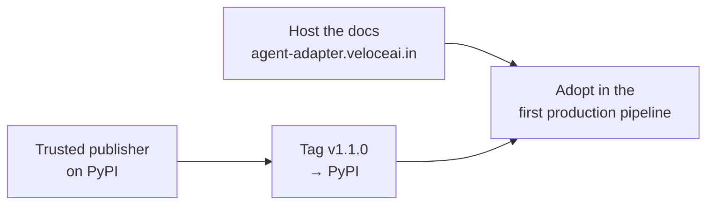

# Next steps (maintainers)

What is still open after 1.1.0, ordered by priority. This file is for maintainers; it is
not part of the docs site or the sdist. The public plan is the Roadmap page
(`docs/roadmap.md`).

## 1. Before the first public install

| Task | Why | Done when |
|---|---|---|
| Add the PyPI trusted publisher (owner `VeloceAI`, repo `agent-adapter`, workflow `release.yml`, no environment) | `release.yml` uploads with OIDC; no token is stored | a pending publisher exists for `agent-adapter` |
| Push tag `v1.1.0` | runs `release.yml`: build, `twine check --strict`, upload | `pip install agent-adapter==1.1.0` works in a fresh venv |
| Host the docs at `https://agent-adapter.veloceai.in/` | `site_url`, the PyPI project links and the agent guide point there | `mkdocs build --strict` output is served on that host |
| Absolute logo and screenshot URLs in `README.md` | PyPI shows relative images as broken; GitHub is fine | the images load on the PyPI page |

## 2. Decisions waiting on the owner

| Decision | Options | Recommendation |
|---|---|---|
| Make the repository public | stays private; public when the docs are live | public: free branch protection and unlimited CI minutes |
| TypeScript client version | keep `0.1.0` (private), or bump it to `1.0.0` with the Python release | bump it when the client is first used outside this repo |
| Review the security changes | read CHANGELOG `[1.0.0]` → Security | approval bridges, HTTP approve, MCP auth, loopback guard and approval stores touch auth logic |

## 3. Later

| Task | Why |
|---|---|
| CrewAI, Strands, Semantic Kernel, ADK and CAMEL-AI in `all` | when their pins allow `mcp>=2.3`, current pydantic and the `otel` extra |
| The nox matrix in CI | `ci.yml` runs `scripts/check.py` on 3.12 only; the per-framework contract sessions still run by hand |
| A docs toolchain after Material for MkDocs | Material reaches end of life on May 5, 2027; Zensical is its successor |
| npm publishing for the TypeScript client | it stays `private: true` until a registry is chosen; the one item left on the public Roadmap |
| `context_window` caps in `prices_default.json` | compression reads the window from the caps; no default row has one yet, so percent policies need `model_max_tokens` (values must come from vendor docs) |

## How to keep this file true

- Remove a row in the same change that finishes it.
- Add a row when a task is deferred, with one line on why.
- Keep `docs/roadmap.md` in step: it lists only the user-facing items of section 3.
