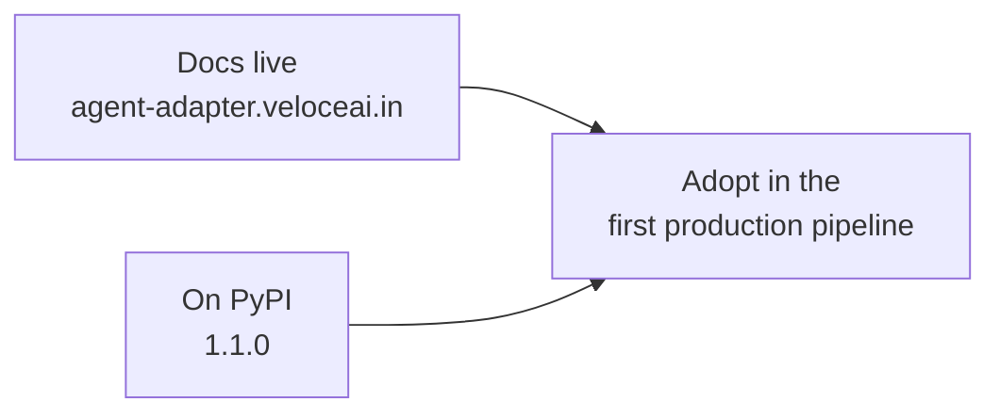

# Next steps (maintainers)

What is still open after 1.1.0, ordered by priority. This file is for maintainers; it is
not part of the docs site or the sdist. The public plan is the Roadmap page
(`docs/roadmap.md`).

1.1.0 is on PyPI (2026-11-08): `pip install agent-adapter`. The docs are live at
`https://agent-adapter.veloceai.in/` (2026-11-08); redeploy with `bash scripts/deploy_docs.sh`.

## 1. Next

| Task | Why | Done when |
|---|---|---|
| Make the two "worst case stays fast" subtests in `tests/viewer/js/` count work | they time an 80 KB markdown input and fail when the machine is busy (seen 2026-11-08) | they pass while another suite runs beside them |
| Bump the workflow actions (`checkout`, `setup-python`, `upload-artifact`, `download-artifact`) | GitHub warns they target the deprecated Node.js 20 | the release run shows no Node.js warning |

## 2. Decisions waiting on the owner

| Decision | Options | Recommendation |
|---|---|---|
| TypeScript client version | keep `0.1.0` (private), or bump it to `1.0.0` with the Python release | bump it when the client is first used outside this repo |
| Review the security changes | read CHANGELOG `[1.0.0]` → Security | approval bridges, HTTP approve, MCP auth, loopback guard and approval stores touch auth logic |

## 3. Later

| Task | Why |
|---|---|
| CrewAI, Strands, Semantic Kernel, ADK and CAMEL-AI in `all` | when their pins allow `mcp>=2.3`, current pydantic and the `otel` extra |
| The nox matrix in CI | `ci.yml` runs `scripts/check.py` on 3.12 only; the per-framework contract sessions still run by hand |
| A docs toolchain after Material for MkDocs | Material reaches end of life on May 5, 2027; Zensical is its successor |
| npm publishing for the TypeScript client | it stays `private: true` until a registry is chosen; the one item left on the public Roadmap |
| `context_window` caps in `prices_default.json` | compression reads the window from the caps; no default row has one yet, so percent policies need `model_max_tokens` (values must come from vendor docs) |

## How to keep this file true

- Remove a row in the same change that finishes it.
- Add a row when a task is deferred, with one line on why.
- Keep `docs/roadmap.md` in step: it lists only the user-facing items of section 3.
