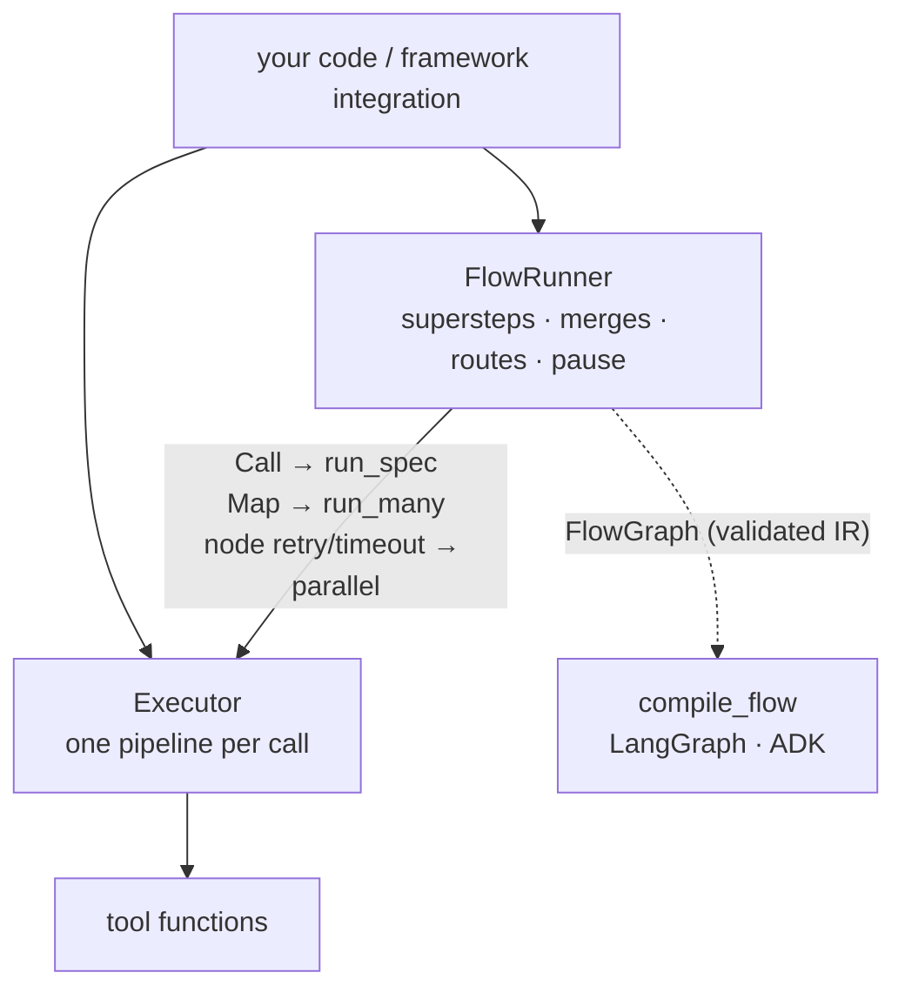
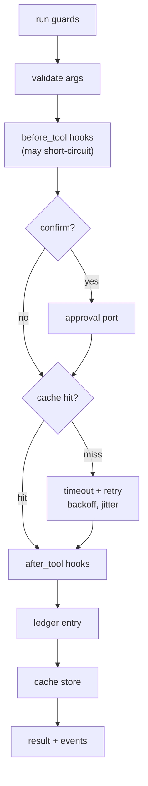
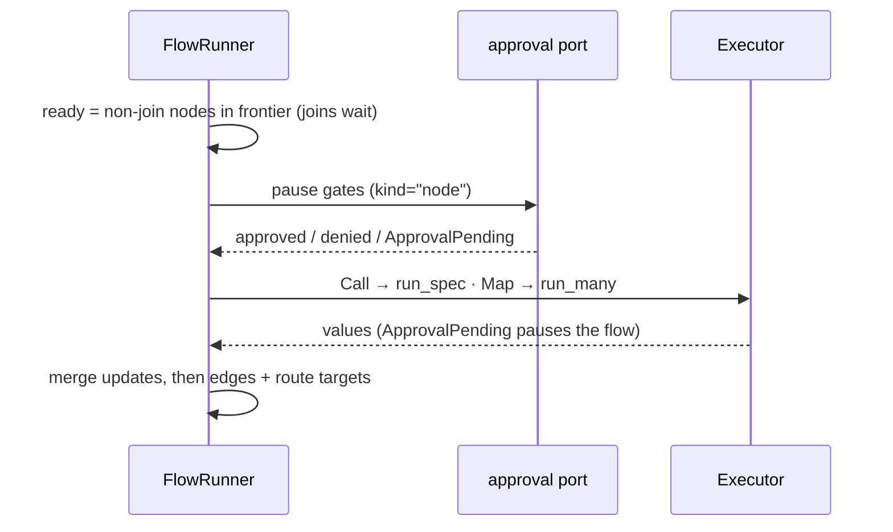

# Executor and flows

Every tool call runs through one `Executor` pipeline. Flows sit on top: the local
`FlowRunner` turns each node into executor work, so guards, approval, cache, retries,
ledger and events apply inside flows too.

## One call through the executor

Retries never catch `CancelledError`, LangGraph `GraphBubbleUp` or `ApprovalPending`.
Details: [Executor](../concepts/executor.md), [Executor policies](../concepts/executor-policies.md).

## Fan-out, fan-in and waves

| API | Shape |
|---|---|
| `run_many(calls, concurrency=8)` | independent calls in parallel; results in input order |
| `as_completed(calls)` | results as they finish |
| `run_plan(steps)` | `depends_on` waves (Kahn layers); cycles rejected before running |
| `parallel(*work)` | non-tool work with the same timeout, retry and cancellation |

No batch raises an `ExceptionGroup`: the first escaping error is re-raised as itself.

## Flows on the executor

A flow runs in **supersteps**, as in LangGraph. The frontier starts at the start node.
Each superstep runs the ready nodes concurrently, then merges their updates by each
field's rule (`replace`, `append`, `sum`, `keyed`). See [Flows](../concepts/flows.md).

| Concept | Local runner | LangGraph | ADK 2.x `Workflow` |
|---|---|---|---|
| Superstep | ready set run together | Pregel superstep | one driver node runs each ready set (`ctx.run_node`) and merges |
| Static parallel branches | same superstep | multiple edges | same ready set |
| `Map` | one node, `executor.run_many` | one node calling `executor.run_many` | one node calling `executor.run_many` |
| `Join` | deferred until no other node is pending | `defer=True` node | deferred by the driver |
| `Route` | `fn(input state + own updates)` | `add_conditional_edges` | evaluated by the driver |
| Merge rules | node-name order | reducers; `replace` / `keyed` as a channel that sees all of a superstep's writes | merged by the driver |
| Loop cap | per-route counter, `on_exhausted` | `aa_loop_counts` / `aa_visits` in state | `aa_loop_counts` / `aa_visits` |
| `pause` gate | port asked before the superstep; nothing in it runs | `interrupt_before` the gated nodes | confirmation before the ready set |
| Tool approval in a node | checkpoint keeps finished siblings; paused node re-runs | `interrupt()`; pending writes kept | node re-runs on resume |
| Calls a resumed node already finished | replayed from the node's journal (intended improvement) | run again | run again |
| Node retry, timeout | `Executor.parallel` rules | `RetryPolicy`, `timeout=` | `RetryConfig`, `timeout` |
| Concurrency cap | `FlowRunner(concurrency=)`, node `concurrency` | `max_concurrency` | `max_concurrency` |
| Run limit | `max_steps` | `recursion_limit` | the driver's step counter |

The compilers consume `flow.validate()` (the `FlowGraph`), never the builder. Parity
fixtures in `tests/flow/parity.py` hold the canonical cases (fan-out, loops, pauses, merge
order, routes, joins) with their expected final states; every target must reproduce them.

## Ids that tie it together

| Id | Form | Why |
|---|---|---|
| run | `ctx.run_id` (`run_…`) | guards, ledger and approvals scope to it; a resumed flow keeps it |
| node visit | `"<flow>:<node>:<visit>"` | node events and the node context |
| tool call in a node | `"<flow>:<node>:<visit>:<i>"` | a resumed node re-enters the same calls |
| node approval | `tool="node:<flow>.<node>"`, `kind="node"` | approval stores keep node and tool requests apart |

The local runner has no persistence: a paused run returns a `FlowCheckpoint` you resume
in the same process. Durable pause and resume come from the compiled targets.
