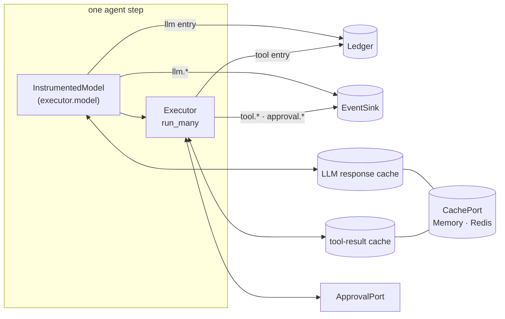
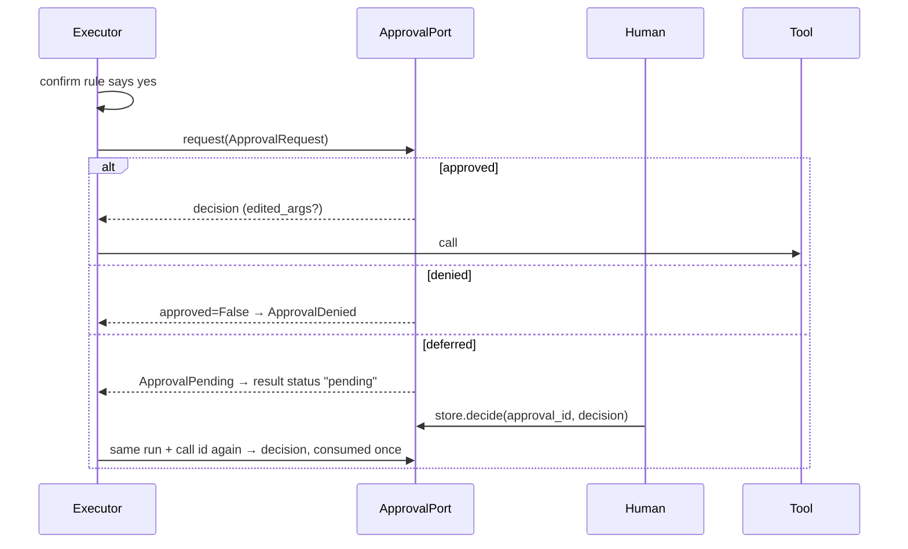
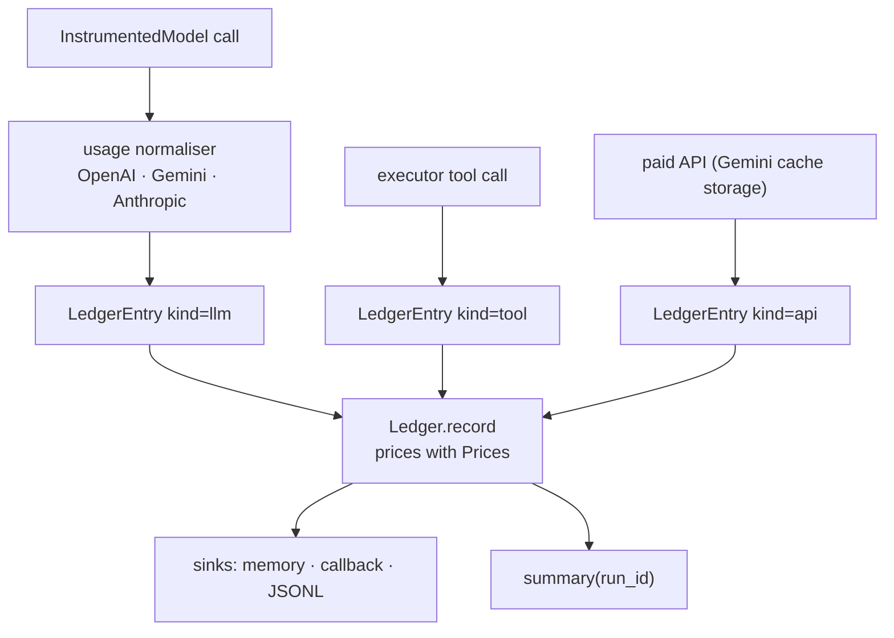
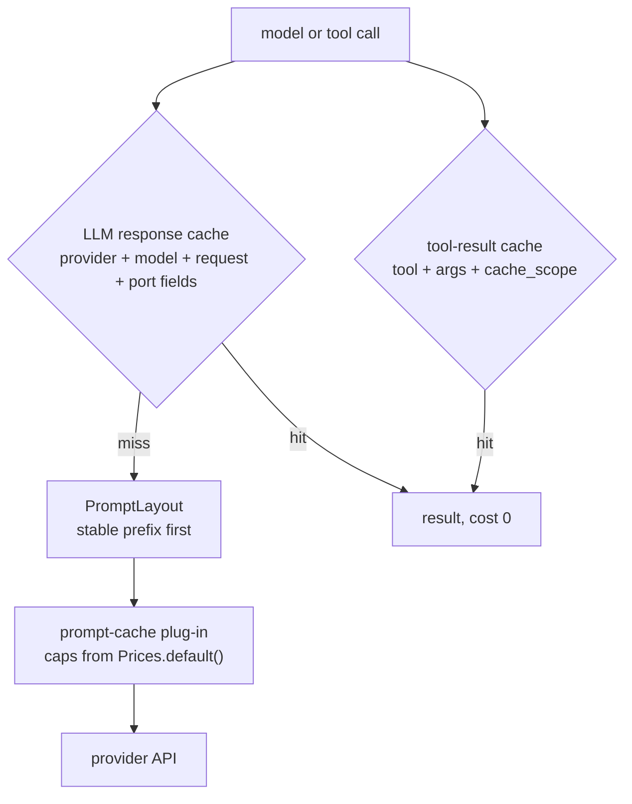

# HITL, cost and cache

How approval, the cost ledger, the caches and the model ports fit together around one
agent step. Each layer has a concept page with the details; this page shows the wiring.

## Approval (HITL)

A tool with `confirm=True` (or a rule) goes through the executor's `ApprovalPort` after the
`before_tool` hooks; the decision may edit the arguments, which are validated again.
Details: [Approval](../concepts/approval.md).

| Outcome | Executor | Tool loop |
|---|---|---|
| approved | runs with `edited_args` if given | the result goes back to the model |
| denied | `ApprovalDenied` (an error result in batches) | the error goes back to the model |
| pending | `ApprovalPending` / `status="pending"` | stops with `finish="pending"`; resume with the same `ctx` |

Approval records are bound to the tool and a digest of the original arguments, so an
approval never covers other arguments. Framework bridges (LangGraph, ADK, Agents SDK,
Pydantic AI, …) only add a gate: a call is approved by the executor's port or by a
one-use token the adapter issued after that port approved
([one-use rule](../how-to/human-in-the-loop.md#the-one-use-rule)). One opt-in exception: an MCP
server built with `client_approval=True` makes the MCP client's user the approver
([MCP approval](../integrations/mcp.md#approval)).

## Cost ledger

| Who records | `kind` | Entry id | Cost |
|---|---|---|---|
| `InstrumentedModel` | `llm` | `{call or run id}:llm:{stage}:{n}` or `metadata["call_id"]` | tokens × the price row; `0` on a response-cache hit |
| Executor | `tool` | the tool call id | `0` |
| `GeminiExplicitCache` | `api` | `gcache:{name}` | `cache_storage_per_hour` × token-hours |

Entries are idempotent on `(run_id, entry_id)`: a re-run with the same ids replaces them.
`BudgetHook` reads `ledger.total_usd(...)` before each tool and model call. Details:
[Cost](../concepts/cost.md), [Instrumented models](../concepts/tool-loop.md).

## Cache layers

| Layer | Where | Saves |
|---|---|---|
| Tool-result cache | executor, tools with `cache_ttl` | repeated retrievals, paid reranks |
| LLM response cache | `InstrumentedModel` with `cache=` (`executor.model`) | regenerations, eval re-runs: a second identical loop costs 0 |
| Prompt layout | `PromptLayout(static=..., dynamic=...)` | makes the provider's prefix cache hit |
| Provider plug-ins | `cache_plugin=` on a port | `prompt_cache_key` / `prompt_cache_options` (OpenAI), `cachedContent` (Gemini), `cache_control` (Anthropic) |

Details: [Cache](../concepts/cache.md).

## Model ports and the tool loop

Every port implements `LLMPort` (`generate`, `stream`, `cache_key_fields`): `OpenAIModel`,
`GeminiModel`, `AnthropicModel`, `CallableModel(fn)` for a host function, and
`FallbackModel([a, b])` for ordered fallback on transient errors. `InstrumentedModel` adds
the layers above to any of them. `run_tool_loop(model, registry, messages)` is the minimal
loop for apps without a framework; tool calls run through `executor.run_many`. There is no
model gateway (no LiteLLM). Details: [Model ports](../concepts/models.md),
[Instrumented models and the tool loop](../concepts/tool-loop.md).
