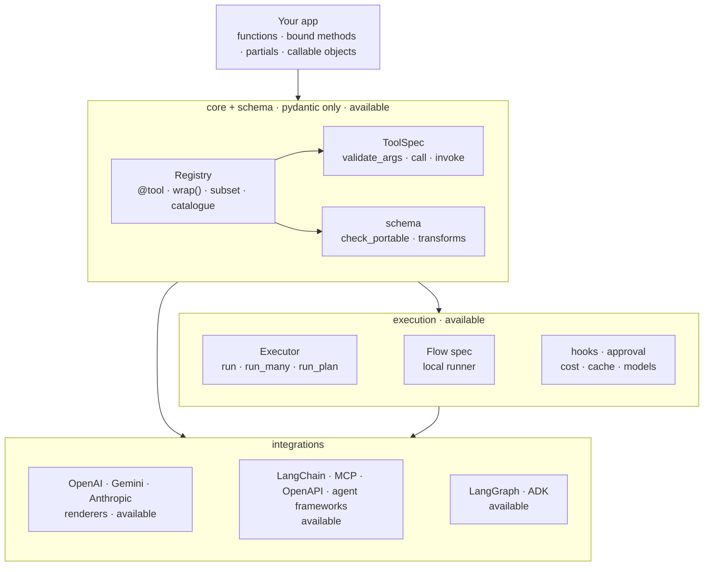
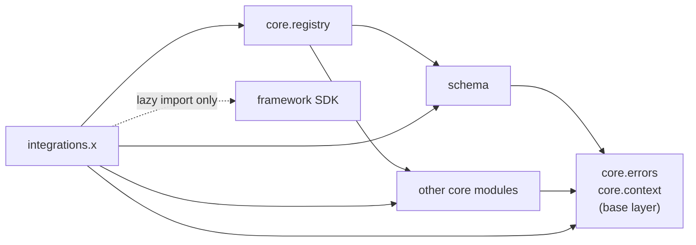

# Architecture

The core is small and depends only on pydantic. Everything else plugs in around it.

## Layers

## Package map

| Path | Holds | Status |
|---|---|---|
| `core/tool.py` | `ToolSpec`, `build_spec` | :material-check-circle:{ .status-ok } Available |
| `core/registry.py` | `Registry`: add, get, remove, subset, catalogue | :material-check-circle:{ .status-ok } Available |
| `core/context.py` | `ToolContext` | :material-check-circle:{ .status-ok } Available |
| `core/errors.py` | `AdapterError` and subclasses | :material-check-circle:{ .status-ok } Available |
| `core/error_base.py`, `model_errors.py` | the `AdapterError` root and logging helpers; the `ModelError` family (both re-exported by `core/errors.py`) | :material-check-circle:{ .status-ok } Available |
| `core/_signature.py`, `_docstring.py`, `_policy.py`, `_nulls.py` | signature → fields, docstrings, policy checks, strict nulls | :material-check-circle:{ .status-ok } Available (private) |
| `schema/portable.py` | `check_portable` | :material-check-circle:{ .status-ok } Available |
| `schema/transforms.py` | `to_openai_parameters`, `to_gemini_parameters`, `to_anthropic_input_schema` | :material-check-circle:{ .status-ok } Available |
| `integrations/openai.py`, `gemini.py`, `anthropic.py` | renderers | :material-check-circle:{ .status-ok } Available |
| `exec/`, `hooks/`, `approval/`, `runtime/` | executor, hooks, approval port, `run_sync` | :material-check-circle:{ .status-ok } Available |
| `cost/`, `cache/`, `models/` | ledger, caches, model ports, `InstrumentedModel` | :material-check-circle:{ .status-ok } Available |
| `flow/` | flow spec, local runner | :material-check-circle:{ .status-ok } Available |
| `integrations/langchain.py`, `mcp/`, `openapi/`, `openai_agents.py`, ... | framework bridges and importers | :material-check-circle:{ .status-ok } Available |
| `integrations/langgraph/` | LangGraph tool node, approval bridge, flow compiler | :material-check-circle:{ .status-ok } Available |
| `integrations/adk/` | ADK tools, confirmation bridge, flow compiler | :material-check-circle:{ .status-ok } Available |
| `server/` | HTTP tool server, WSGI app, server CLI | :material-check-circle:{ .status-ok } Available |
| `tracing/` | events, OpenTelemetry | :material-check-circle:{ .status-ok } Available |
| `optimiser/` | offline harness optimiser | :material-check-circle:{ .status-ok } Available |

## Import rules

An AST test (`tests/test_boundaries.py`) enforces these rules on every run.

- `core` and `schema` never import `integrations` or any framework. No dynamic imports.
- Base-layer modules (`core.errors`, `core.context`, `core.types`, ...) import only the base layer.
  The error modules import only each other: `core.error_base` is the leaf.
- `schema` imports only the base layer from `core`.
- `core.registry` is the only `core` module that imports `schema`.
- `integrations.<x>` imports its framework lazily: inside functions or under `TYPE_CHECKING`.

## Read next

| Page | Shows |
|---|---|
| [Tool lifecycle](tool-lifecycle.md) | function → registry → render → LLM → tool call → executor |
| [Schema pipeline](schema-pipeline.md) | portable check and per-provider rewrites |
| [Executor and flows](executor-and-flows.md) | the executor pipeline, fan-out, waves and the flow runner |
| [HITL, cost and cache](hitl-cost-cache.md) | how approval, the ledger, the caches and the model ports wire together |
