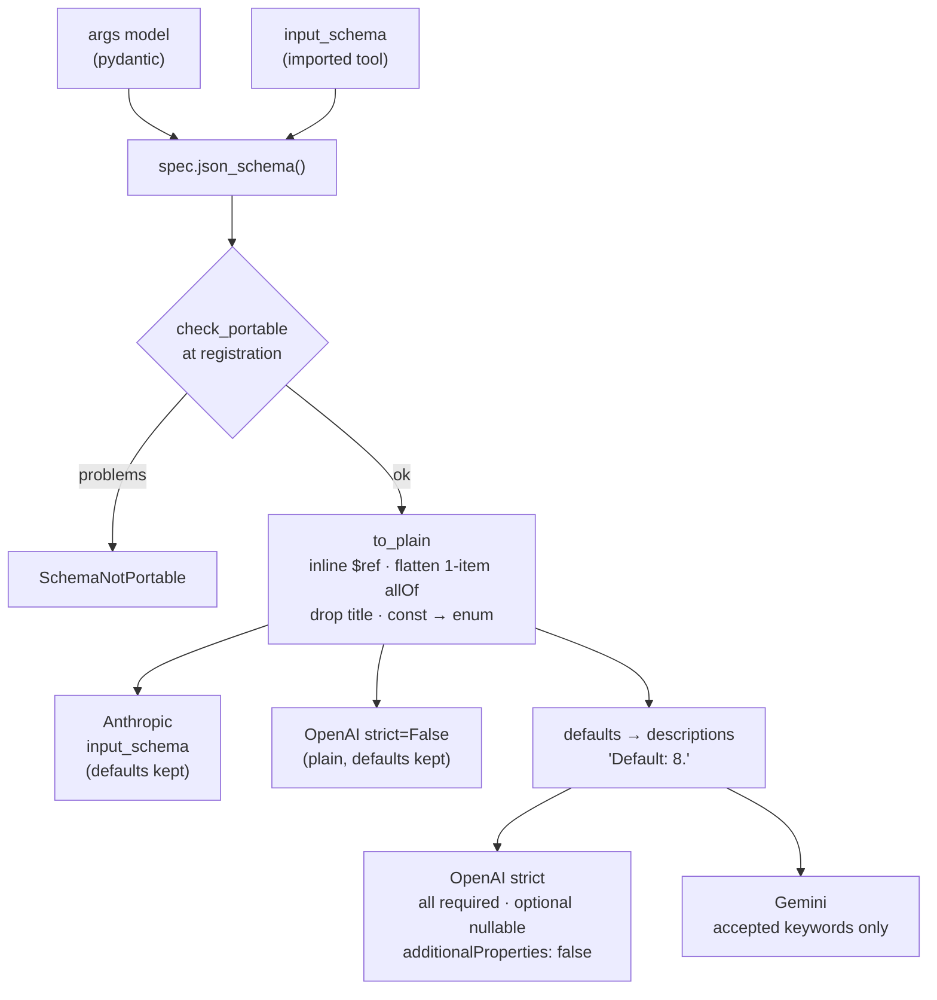
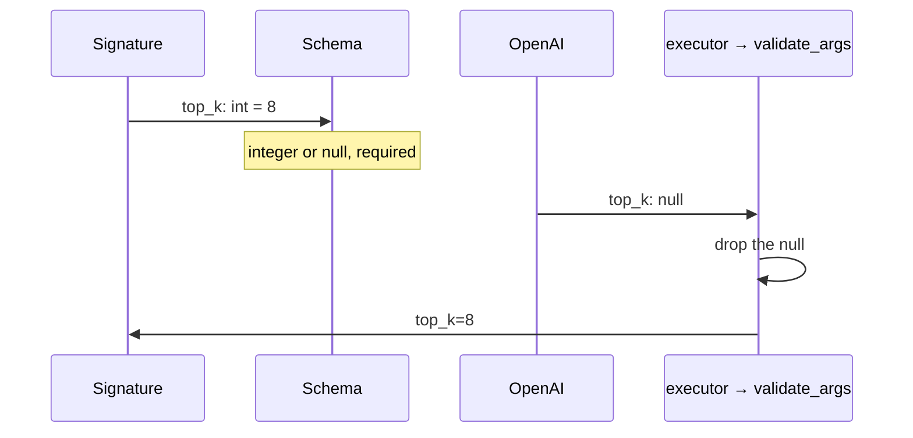

# Schema pipeline

Each tool has one JSON schema, built by pydantic from its args model. Each provider gets
a rewritten copy. You never call the transforms yourself; the renderers do.

## The pipeline

| Function (`schema.transforms`) | Used by |
|---|---|
| `to_plain` | every renderer |
| `to_openai_parameters(schema, strict=True)` | `chat_tool(s)`, `responses_tool(s)` |
| `to_gemini_parameters` | `function_declaration(s)`, `genai_tool` |
| `to_anthropic_input_schema` | `anthropic_tool(s)` |

`json_schema()` returns `input_schema` unchanged when a tool was built by
`spec_from_schema`; otherwise the args model's schema. Every renderer first narrows the
registry with `for_target`. One rule turns strict off: an imported schema that is not
portable renders with `strict: false` on OpenAI and in `ToolSpec.tool_def()`.

## Strict mode, step by step

Strict mode makes every field required. An optional field becomes nullable. The model
then sends `null` to mean "not given". The executor runs the call, and `validate_args`
turns that `null` back into the default.

| Field declared as | Model sends `null` | Function receives |
|---|---|---|
| `top_k: int = 8` | dropped before validation | `8` |
| `region: str | None = None` | kept | `None` |
| `query: str` (required) | kept | `ToolArgsInvalid` |

The rule applies at any depth: nested models, and models inside lists. Details on
[Strict mode and nulls](../concepts/strict-mode.md).

## Where defaults go

| Target | `default` keyword | Argument default in the description |
|---|---|---|
| OpenAI strict | removed | yes: `Default: 8.` |
| OpenAI `strict=False` | kept | no |
| Gemini | removed | yes: `Default: 8.` |
| Anthropic | kept | no |

Every property gets the note, at any depth — including fields of models inside lists.
A `default` placed directly on a list item type or a union branch (which pydantic
ignores) is dropped without a note.

## Why validation stays safe

Validation always uses the tool's own pydantic model. A keyword dropped for a provider
never weakens checking on our side.
