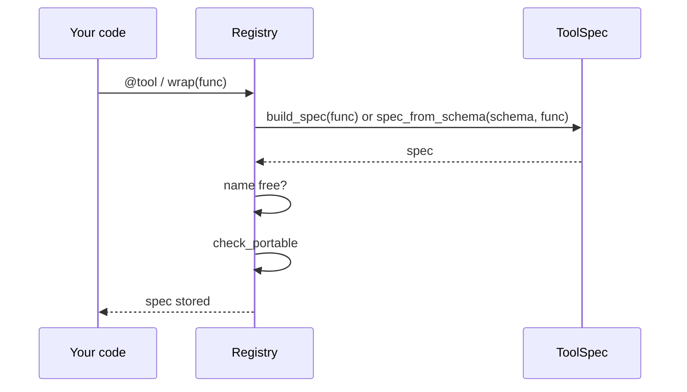
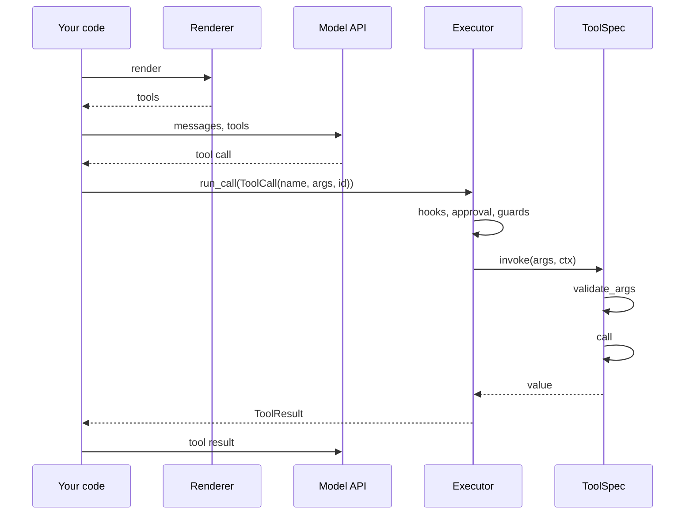
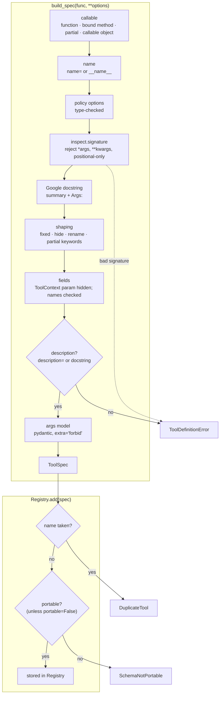

# Tool lifecycle

A tool goes through two phases. At **startup** a function becomes a checked `ToolSpec`.
At **request time** the spec is rendered for a model, and the model's call is validated
and run.

## Startup: registration

## Request time: a tool call

| Step | What happens |
|---|---|
| `build_spec` | reads signature, docstring and options; builds the args model (or checks a given `args_model=`) |
| `spec_from_schema` | for imported tools: keeps the raw schema as `input_schema`, builds a loose args model |
| name free? | `DuplicateTool` if the name is taken |
| `check_portable` | `SchemaNotPortable` if a provider would reject the schema |
| render | `chat_tools`, `function_declarations` or `anthropic_tools` over `registry.for_target(...)`; uses a cached copy of `json_schema()` |
| `run_call` | `executor.run_call(ToolCall(name=..., arguments=..., id=...))`: hooks, approval, budgets and guards, then `invoke`; failures come back in `result.error` |
| `invoke` | the raw tool body, which the executor calls as `spec.invoke(...)`; never call it yourself for a model's tool call (it skips every policy) |
| `validate_args` | strict nulls → defaults, then pydantic validation |
| `call` | maps renamed args back, adds `fixed`, injects `ToolContext`, applies `result=` |

## Inside `build_spec`

Every check runs once, at registration. A bad tool stops the app at startup.

## Request time: `invoke`

| Step | Method | On failure |
|---|---|---|
| Copy args, drop strict-mode nulls | `validate_args` | — |
| Validate against the args model | `validate_args` | `ToolArgsInvalid` |
| Check the model belongs to this tool | `call` | `ToolUsageError` |
| Map LLM names back (`llm_to_python`), add `fixed`, inject `ToolContext` | `call` | — |
| Imported tools instead: set values by property name, no rejected nulls | `call` | — |
| Await async functions; run sync ones in `asyncio.to_thread` | `call` | the tool's own exception |
| Apply `result=` | `call` | the transform's own exception |

`invoke(args, ctx)` is `call(validate_args(args), ctx)`. Use the two halves to validate
early and run later.

## In an application

`spec.invoke(...)` is the raw tool body: argument validation and the call, nothing else.
The executor wraps it with hooks, approval, budgets and run guards, cache, timeout, retry
and the cost ledger, and validates edited arguments again. Call `invoke` directly only in
unit tests. See [Executor and flows](executor-and-flows.md).
