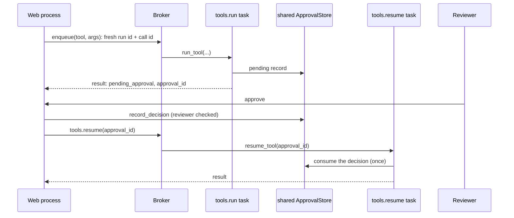

# Celery

:material-check-circle:{ .status-ok } Available · `pip install agent-adapter celery`

Celery tasks are sync functions. A task runs the async executor with `run_sync`. A call that
needs approval parks in a shared store; a second task runs it after a reviewer decides.

| File | Does |
|---|---|
| `examples/backend_common.py` | the shared service layer (see [FastAPI](fastapi.md#the-service-layer)): `build_backend`, `call`, `record_decision` |
| `examples/backend_celery.py` | task bodies `run_tool` and `resume_tool`, `make_celery`, `enqueue`, `review` |
| `tests/docs/test_backend_examples.py` | runs the task bodies directly, then the Celery app eagerly (`task_always_eager`) |

Data enters as task arguments (JSON: tool, arguments, run id, call id), goes through
`run_sync(call(...))` to the executor, and leaves as the task result (a JSON dict).

## One Executor per worker process

```python
--8<-- "examples/backend_celery.py:backend"
```

`functools.cache` builds it on first use, so each prefork child builds its own after the
fork. Build nothing loop-bound at import time: every `run_sync` call is a new loop.

## Tasks

```python
--8<-- "examples/backend_celery.py:tasks"
```

| Task | Does |
|---|---|
| `tools.run(tool, arguments, run_id, call_id)` | runs one call; `{"status": "ok", "result"}` or `{"status": "pending_approval", "approval_id"}`; other errors fail the task |
| `tools.resume(approval_id)` | reads the record, runs the call with its own ids and arguments; the store answers it once |

## Approvals parked across tasks



```python
--8<-- "examples/backend_celery.py:review"
```

The store must be shared by the web process and every worker: `SQLiteApprovalStore(path)`
on one host; `RedisApprovalStore(...)`, `SQLAlchemyApprovalStore` or `DynamoDBApprovalStore`
across hosts ([Approval stores](../concepts/approval-stores.md),
[Database stores](../concepts/approval-stores-db.md)); or your own `ApprovalStore`.
`SHARED_STORE = MemoryApprovalStore()` only works in eager tests.

## Retries and idempotency

| Layer | Retries | Use for |
|---|---|---|
| the executor (`retries=`, `timeout=` on the tool) | inside one task, with backoff: exceptions the tool raised and retryable adapter errors (`ToolTimeout`) | transient failures of one call |
| Celery `autoretry_for=(ToolTimeout,)` | the whole task, after the executor gave up | longer outages |
| Celery `acks_late=True` | the task again after a worker crash | not losing work |

| Rule | Why |
|---|---|
| pick `run_id` and `call_id` before sending the task (`enqueue`) | a retried or redelivered task is the same call: a `confirm` tool finds its own record instead of asking twice |
| make side-effecting tools idempotent (`idempotent=True` only when true; pass `call_id` to the external API as its idempotency key) | `acks_late` and retries can run a tool again after it did its work |
| never auto-retry `tools.resume` | its decision is consumed when the call starts; a redelivery raises `ApprovalAlreadyDecided` and runs nothing |
| an approved call that failed | its decision is spent: a retry with the same ids parks a new approval |

## Budget per task

Each `call` is one run, so `BudgetHook(max_usd)` caps one task. To cap a chain of tasks,
pass the same `run_id` through the chain (the ledger then sums them) or a `thread_id` with
`BudgetHook(scope="thread")`. The ledger is per process: a cap across workers needs a
shared ledger sink and your own check.

## Logging and tracing

Celery logs task failures with the exception. `LoggingHook()` adds one line per tool call
(arguments redacted). For spans, `sink=OTelSink()` alongside Celery's own instrumentation.

## Pitfalls

| Pitfall | Fix |
|---|---|
| `asyncio.run(...)` or `loop.run_until_complete(...)` in a task | `run_sync(work, timeout=...)`: a timeout, and `LoopLocal` clients closed with the loop |
| a client built at import time, used across tasks | `LoopLocal(factory, close=...)`; `run_sync` closes it per task |
| new ids on every retry | ids come from the sender, never from inside the task |
| `MemoryApprovalStore` across processes | `SQLiteApprovalStore` (one host), or `RedisApprovalStore`, `SQLAlchemyApprovalStore`, `DynamoDBApprovalStore` (many hosts) |
| eager mode in production | only for tests: `task_always_eager` runs tasks in the caller |
| `run_sync` timeout longer than Celery's `time_limit` | keep it below, so `TimeoutError` fails the task before Celery kills the worker |

See also: [scripts](scripts.md), [Flask](flask.md), [Runtime](../concepts/runtime.md),
[Approval](../concepts/approval.md).
