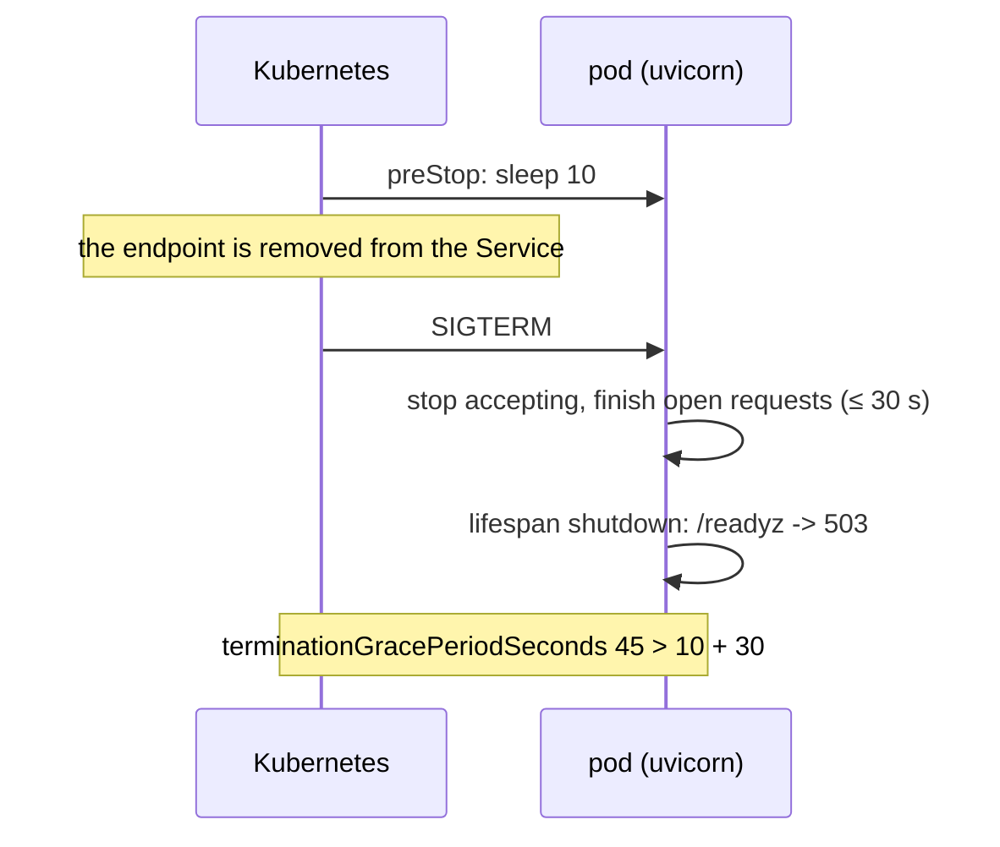

# Deploy: Docker, Kubernetes and probes

Run the HTTP tool server (`create_app`) in a container. This page gives a tested
Dockerfile, a Kubernetes Deployment with liveness and readiness probes, and the rules for
state that must be shared between pods.

| File | Does |
|---|---|
| `examples/deploy/app.py` | the ASGI app: bearer token from a Secret, Redis stores when `REDIS_URL` is set |
| `examples/deploy/Dockerfile` | slim image, non-root user, `uvicorn` with a graceful shutdown |
| `examples/deploy/k8s.yaml` | Deployment + Service: `/healthz`, `/readyz`, a `preStop` sleep |

The test suite builds the app, calls both probes and checks the files agree (ports,
probe paths, the grace period).

## The app

```python
--8<-- "examples/deploy/app.py"
```

Data enters through `POST /tools/{name}/invoke` and the approval routes. It leaves as JSON
results. Approvals and `Idempotency-Key` replays go to Redis, so any pod can resume a run.

## The image

```dockerfile
--8<-- "examples/deploy/Dockerfile"
```

- One uvicorn process per container. Scale with replicas, not workers.
- `--timeout-graceful-shutdown 30` lets open requests finish after `SIGTERM`.

## Probes

| Route | Auth | 200 | 503 |
|---|---|---|---|
| `GET /healthz` | none | the process is alive | never |
| `GET /readyz` | none | ready for new requests | starting (an MCP app before its lifespan ran), or draining |

`/readyz` turns 503 when the lifespan starts shutting down, or when you call
`app.state.readiness.drain()` yourself (a `SIGTERM` handler, a parent app's lifespan).
Other routes keep serving while it drains. Both probes obey `allowed_hosts`: the kubelet
sends the pod IP as `Host`, so set a probe `Host` header that is on the list, or the probe
gets 421.

```yaml
--8<-- "examples/deploy/k8s.yaml"
```



## gunicorn and `fork()`

| Setup | Rule |
|---|---|
| `gunicorn -k uvicorn.workers.UvicornWorker` | fine; build the executor at import, nothing loop-bound |
| `gunicorn --preload` with uvicorn workers | never: loops and clients made before `fork()` leak into every worker |
| a module-level `LoopRunner` | safe before `fork()`: its loop starts on the first `run()`, a child starts its own |
| `LoopLocal` values | a forked child forgets the parent's values and builds new ones |

## Per process vs shared

Each worker process has its own copy of anything in memory. With more than one replica,
pass a shared backend for each row that matters to you.

| State | Default (per process) | Shared choice |
|---|---|---|
| parked approvals | `MemoryApprovalStore` | `RedisApprovalStore`, `SQLAlchemyApprovalStore`, `DynamoDBApprovalStore` ([Database stores](../concepts/approval-stores-db.md)); `SQLiteApprovalStore` only on one host |
| `Idempotency-Key` replays | `MemoryIdempotencyStore` | `RedisIdempotencyStore` |
| run events (SSE) | `MemoryEventStream` | your own `EventStream`; else pin a run to one pod |
| cost ledger | `Ledger` | a `LedgerSink` that writes to your database |
| run guards, rate limits, budgets | in the `Executor` | per process by design: size limits per replica |
| tool cache | `MemoryCache` | any `CachePort` over Redis |
| `LoopLocal` clients | per loop | not shareable: each process opens its own |

`Executor`, `Registry` and `Ledger` refuse to be pickled (`ToolUsageError`). Build them in
each process; never send them to another one.
