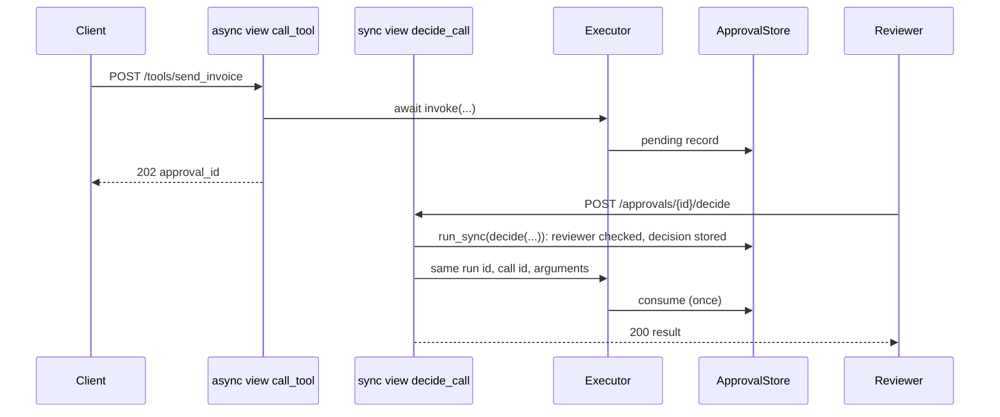

# Django

:material-check-circle:{ .status-ok } Available · `pip install agent-adapter django` · add
`'agent-adapter[server]'` to serve the HTTP tool server beside Django

Async views `await` the service. Sync views call `run_sync`. Both work under ASGI
(uvicorn, daphne) and WSGI (gunicorn); Django runs async views under WSGI on a loop of its
own.

| File | Does |
|---|---|
| `examples/backend_common.py` | the shared service layer (see [FastAPI](fastapi.md#the-service-layer)) |
| `examples/backend_django.py` | a one-file project: settings, two async views, one sync view, URLs, an ASGI app with the tool server |
| `tests/docs/test_backend_examples.py` | runs it offline with Django's `Client`, `AsyncClient` and Starlette's `TestClient` |

Data enters as `request.body` (JSON), goes through `invoke` / `decide` / `ask` to the
executor, and leaves as a `JsonResponse` with the reply's status.

## One Executor per process

```python
--8<-- "examples/backend_django.py:backend"
```

Build it at module import (in a real project, an `apps.py` or a `services.py` module).
Django imports it once per worker process. Never build one per request: run guards, the
ledger and the budget hook live on it.

## Async and sync views

```python
--8<-- "examples/backend_django.py:views"
```

| View | How it calls the service | Under ASGI | Under WSGI |
|---|---|---|---|
| `async def` | `await invoke(...)` | on the server's loop | Django runs it with `async_to_sync` (a loop per request) |
| `def` | `run_sync(decide(...), timeout=30)` | Django runs it in a thread (`sync_to_async`); `run_sync` starts a fresh loop there | in the request thread; `run_sync` starts a fresh loop |

`asgiref.sync.async_to_sync(invoke)(...)` also works in a sync view, but it does not close
`LoopLocal` values when its loop ends (they are only dropped later). `run_sync` closes them.

## Approvals in a request/response cycle



| Rule | Why |
|---|---|
| keep the store outside the process: `SQLiteApprovalStore` (one host), `RedisApprovalStore`, `SQLAlchemyApprovalStore` on your database ([Database stores](../concepts/approval-stores-db.md)), or an `ApprovalStore` over a Django model | workers and restarts must see the same records |
| `create` and `consume` must be atomic (a unique constraint, `select_for_update`, or an `UPDATE ... WHERE consumed = false`) | each decision is used exactly once; `find` returns only the unconsumed record |
| decide only as a reviewer | the invoker should not approve itself |
| never set `ToolContext(approval=...)` from request data | it skips the approval port |

## Budget per request

Each view call is one run, so `BudgetHook(max_usd)` caps one request (`ask` answers 429
over it). For a per-user cap, pass `thread_id=str(request.user.pk)` to `run_scope` and use
`BudgetHook(max_usd, scope="thread")`.

## The HTTP tool server beside Django

```python
--8<-- "examples/backend_django.py:asgi"
```

Put this in `asgi.py`. Starlette routes `/agent/...` to the tool server and everything else
to Django. Under WSGI use `create_wsgi_app(registry, **options)`, a path dispatcher in
`wsgi.py` and `atexit.register(tools.close)` (as in
[Flask](flask.md#mount-the-http-tool-server)); events (SSE) then need ASGI.

## Logging and tracing

Add the `agent_adapter` logger to `LOGGING["loggers"]`; `LoggingHook()` writes one line
per tool call there (arguments redacted). Executor events go to `sink=LoggingSink()` or
`sink=OTelSink()`.

## Pitfalls

| Pitfall | Fix |
|---|---|
| two host checks | Django's `ALLOWED_HOSTS` guards Django; the tool server's `allowed_hosts=` guards `/agent` (default: local names) |
| CSRF on the JSON API | token-authenticated JSON views need no session, so no CSRF; with session auth keep `CsrfViewMiddleware` |
| ORM calls inside an async tool | wrap them in `sync_to_async`, or make the tool sync (the executor runs sync tools in a thread) |
| `run_sync` inside an `async def` view | `await` instead; `run_sync` would block the loop |
| `MemoryApprovalStore` with several workers | `SQLiteApprovalStore`, `RedisApprovalStore`, `SQLAlchemyApprovalStore`, `DynamoDBApprovalStore`, or your own `ApprovalStore` |
| `Idempotency-Key` on the tool server with several workers | `idempotency=RedisIdempotencyStore(...)` |
| a loop-bound client used by tools | `LoopLocal` (each WSGI request and each `run_sync` call is a new loop) |

See also: [FastAPI](fastapi.md), [Flask](flask.md), [Celery](celery.md),
[Runtime](../concepts/runtime.md), [HTTP server](../cross-language/http-server.md).
