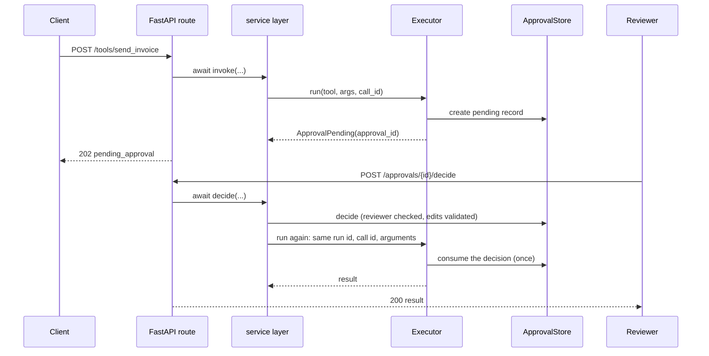

# FastAPI

:material-check-circle:{ .status-ok } Available · `pip install agent-adapter fastapi` · add
`'agent-adapter[server]'` to mount the HTTP tool server

FastAPI runs on an event loop, so routes `await` the executor directly. No `run_sync`.

| File | Does |
|---|---|
| `examples/backend_common.py` | the service layer every backend guide shares: tools, `build_backend`, `invoke`, `decide`, `resume`, `ask` |
| `examples/backend_fastapi.py` | the FastAPI app: three routes, auth dependency, the tool server under `/agent` |
| `tests/docs/test_backend_examples.py` | runs both offline with FastAPI's `TestClient` |

Data enters as a JSON body, goes through `invoke` / `decide` / `ask` to the executor, and
leaves as a JSON reply with an HTTP status (an RFC 9457 problem on errors).

## One Executor per process

```python
--8<-- "examples/backend_common.py:build"
```

Build it once, in `make_app()`, not per request. Run guards, the ledger, the approval
store and the budget hook live on it. Each uvicorn or gunicorn worker is its own process,
so each builds its own; anything workers must share goes in a shared store.

```python
--8<-- "examples/backend_fastapi.py:app"
```

## The service layer

Views stay thin. All tool work is in `backend_common.py`:

```python
--8<-- "examples/backend_common.py:service"
```

| Function | Returns |
|---|---|
| `invoke(backend, tool, arguments)` | 200 `{"status": "ok", "result"}`, 202 `{"status": "pending_approval", "approval_id"}`, or a problem |
| `record_decision(...)` | checks the reviewer, validates edits, stores the decision; runs nothing |
| `decide(...)` | `record_decision`, then `resume` when approved |
| `resume(backend, approval_id)` | re-runs the call with its original run id, call id and arguments; 409 when already used |
| `ask(backend, question)` | the tool loop under a per-run budget, with the run's cost |

Errors map to statuses with `problem_for`, the same table the HTTP tool server uses:
`tool-args-invalid` 422, `forbidden` 403, `approval-already-decided` 409, `budget-exceeded`
429, `tool-timeout` 504.

## Approvals in a request/response cycle

A `confirm=True` tool never runs inside the request that asked for it. The executor's
`DeferredApproval` parks it in the store and raises `ApprovalPending`; the route answers
202. A reviewer's later request decides it, and the call runs then, once.



| Rule | Why |
|---|---|
| resume with the record's `run_id`, `call_id` and original `arguments` | the decision is bound to them; edits come from the decision |
| only a reviewer may decide (`REVIEWERS`; use your own roles) | the invoker should not approve itself; see the four-eyes rule in [HTTP server](../cross-language/http-server.md) |
| never set `ToolContext(approval=...)` from a request body or a header | it skips the port; only adapter-issued one-use tokens may set it |
| never call `spec.invoke(...)` for a tool with `confirm` | it bypasses the executor, so no approval, budget or ledger |

## Budget per request

`BudgetHook(max_usd)` checks the ledger total of the current run before each tool and
model call. Each request is its own run (`run_scope()`), so the cap is per request. Over
it, `ask` answers 429.

```python
--8<-- "examples/backend_common.py:ask"
```

`RunLimits(max_calls=20)` also caps tool calls per run. For a cap across one user's
requests, pass the user as `thread_id` (`run_scope(thread_id=...)`) and use
`BudgetHook(max_usd, scope="thread")`; the ledger keeps its latest `max_runs` runs.

## Mount the HTTP tool server

```python
--8<-- "examples/backend_fastapi.py:mount"
```

`create_app` gives you the REST routes (`/agent/tools`, `/agent/approvals`, events, cost)
with authentication, run ownership and approval rules built in. It shares the executor
(hooks, budget, ledger) but keeps its own approval store, decided only through its own
`/agent/approvals/{id}/decide`.

## Logging and tracing

| Need | Use |
|---|---|
| a log line per tool call | `LoggingHook()` (arguments redacted; `confirm` tools' arguments never logged) |
| events as logs | `Executor(..., sink=LoggingSink())` |
| OpenTelemetry spans | `Executor(..., sink=OTelSink())` (`agent-adapter[otel]`) |
| correlated logs across workers of the tool server | `set_log_key(secret)` in every worker |

## Pitfalls

| Pitfall | Fix |
|---|---|
| `run_sync(...)` inside an `async def` route | `await` instead; `run_sync` would block the loop with a worker thread |
| a sync `def` route | FastAPI runs it in a thread: there `run_sync` is right |
| a loop-bound client (httpx, Redis) used from async routes and from `run_sync` code or tests | keep it in a `LoopLocal`; the lifespan closes them with `LoopLocal.aclose_all()` |
| `MemoryApprovalStore` with several workers | a decision lands in one worker only: use `SQLiteApprovalStore` (one host), or `RedisApprovalStore`, `SQLAlchemyApprovalStore` or `DynamoDBApprovalStore` (many hosts); see [Approval stores](../concepts/approval-stores.md), [Database stores](../concepts/approval-stores-db.md) |
| `Idempotency-Key` on the mounted server with several workers | `idempotency=RedisIdempotencyStore(...)` |
| `TestClient(app)` gets 421 on `/agent/...` | by default the tool server allows local `Host` names only; set `allowed_hosts=[...]` for a public host, or test with `base_url="http://localhost"` |
| `Location` from the mounted server lacks `/agent` | it is relative to the mount; prefix it in the client |
| `mcp=True` on a mounted app | Starlette does not run a mounted app's lifespan: keep `mcp=False`, or enter `tools.router.lifespan_context(tools)` in your lifespan |

See also: [Flask](flask.md), [Django](django.md), [Celery](celery.md), [scripts](scripts.md),
[Runtime](../concepts/runtime.md), [Approval](../concepts/approval.md).
