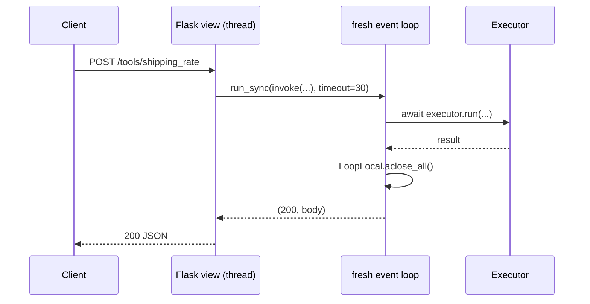

# Flask

:material-check-circle:{ .status-ok } Available · `pip install agent-adapter flask` · add
`'agent-adapter[server-wsgi]'` to mount the HTTP tool server

Flask views are sync. Each view runs the async service with `run_sync`, which starts a
fresh event loop for the call and closes it after.

| File | Does |
|---|---|
| `examples/backend_common.py` | the shared service layer (see [FastAPI](fastapi.md#the-service-layer)): tools, `build_backend`, `invoke`, `decide`, `ask` |
| `examples/backend_flask.py` | the app factory: three views, a token check, the tool server under `/agent` |
| `tests/docs/test_backend_examples.py` | runs it offline with Flask's `test_client()` |

Data enters as a JSON body, goes through `run_sync(invoke(...))` to the executor, and
leaves as `jsonify(body), status`.

## One Executor per process

```python
--8<-- "examples/backend_common.py:build"
```

Build it in the app factory and keep it on `app.extensions`. gunicorn's sync and gthread
workers are processes; each runs the factory once. Threads inside one worker share the
executor safely: run guards, `MemoryApprovalStore`, the ledger and `BudgetHook` lock their
state with `threading.Lock`.

```python
--8<-- "examples/backend_flask.py:app"
```

## Sync views and `run_sync`



| Rule | Why |
|---|---|
| pass `timeout=` to `run_sync` | a stuck tool must not hold a worker forever (`TimeoutError` after it) |
| loop-bound clients (httpx, Redis) in a `LoopLocal` | every `run_sync` call is a new loop; a client from an old loop breaks |
| no `asyncio.run` in a view | `run_sync` does the same and also works when a loop already runs in the thread |
| Flask `async def` views (`flask[async]`) | Flask runs each in its own loop too: the same `LoopLocal` rule applies |

## Approvals in a request/response cycle

A `confirm=True` tool parks in the store: the view answers 202 with an `approval_id`. A
reviewer's `POST /approvals/<id>/decide` stores the decision and re-runs the call with its
original run id, call id and arguments; the store answers it once. A second decide is 409.

| Rule | Why |
|---|---|
| decide only as a reviewer (here `REVIEWERS`) | the invoker should not approve itself |
| edits are validated before the decision is stored (422) | a bad edit leaves the record pending |
| never build a `ToolContext(approval=...)` from request data | it skips the approval port |
| several workers share one durable `ApprovalStore` (`SQLiteApprovalStore`, `RedisApprovalStore`, `SQLAlchemyApprovalStore`, `DynamoDBApprovalStore`) | a `MemoryApprovalStore` decision lands in one worker only |

## Budget per request

Each view call is one run, so `BudgetHook(max_usd)` caps one request. `ask` turns
`BudgetExceeded` into 429 with the same problem body as the HTTP tool server.

## Mount the HTTP tool server

```python
--8<-- "examples/backend_flask.py:mount"
```

`create_wsgi_app` wraps the Starlette app in `a2wsgi` and keeps its lifespan running on
a2wsgi's loop thread until `tools.close()`. The example calls it from `atexit`, and keeps
`tools` in `app.extensions` so tests can close it first. It shares
the executor and keeps its own approval store (decided over `/agent/approvals/{id}/decide`).

## Logging and tracing

`LoggingHook()` logs each tool call with redacted arguments. Add `sink=LoggingSink()` or
`sink=OTelSink()` to the executor for events or spans. `run_sync` copies contextvars, so a
request id you set in a contextvar is visible inside tools.

## Pitfalls

| Pitfall | Fix |
|---|---|
| no `timeout` on `run_sync` | always pass one |
| a module-level client used across views | `LoopLocal(factory, close=...)` |
| SSE (`/agent/runs/{id}/events`) under WSGI | WSGI servers buffer streams: follow events over ASGI |
| `/agent/...` answers 421 | by default the tool server allows local `Host` names: set `allowed_hosts=["api.example.com"]` |
| several gunicorn workers and `Idempotency-Key` | `idempotency=RedisIdempotencyStore(...)` in the tool server options |
| `MemoryApprovalStore` with several workers | use `SQLiteApprovalStore` (one host), or `RedisApprovalStore`, `SQLAlchemyApprovalStore` or `DynamoDBApprovalStore` (many hosts); see [Approval stores](../concepts/approval-stores.md), [Database stores](../concepts/approval-stores-db.md) |
| the tool server's records decided from your own views | do not: decide them through `/agent/approvals`, which re-checks run ownership and `authorize` |

See also: [FastAPI](fastapi.md), [Django](django.md), [Celery](celery.md),
[Runtime](../concepts/runtime.md), [HTTP server](../cross-language/http-server.md).
