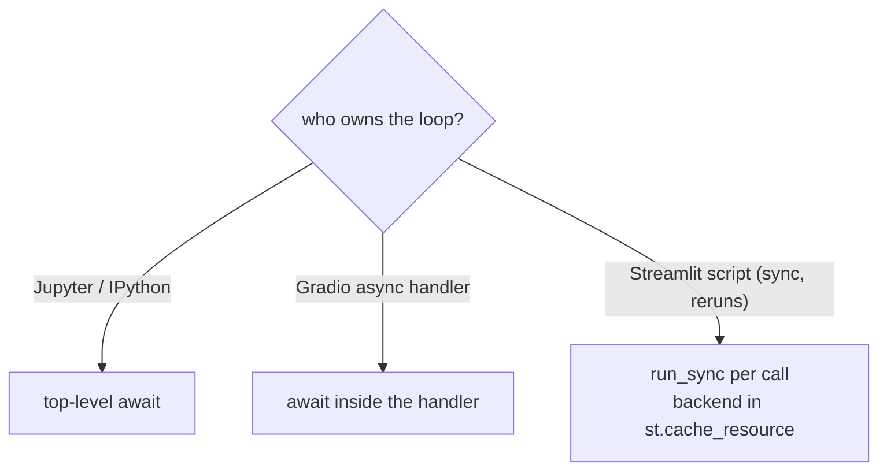

# Notebooks and apps

:material-check-circle:{ .status-ok } Available · `pip install agent-adapter` (no extra)

Jupyter, Streamlit and Gradio already run an event loop, each in its own way. Pick the
call that fits it: `await`, or `run_sync`.

| File | Does |
|---|---|
| `examples/backend_common.py` | the shared tools and `call(backend, tool, arguments, run_id=, call_id=)` |
| `examples/backend_notebook.py` | a Jupyter cell body, a Streamlit page, a Gradio handler |
| `tests/docs/test_backend_handler_examples.py` | runs them offline (Streamlit through a fake `st`) |

Data enters as a widget value or a cell, goes through `call` to the executor, and leaves
as the value you display.



## Jupyter

```python
--8<-- "examples/backend_notebook.py:jupyter"
```

A cell already runs inside IPython's loop: write `await shipping_rate(...)` at top level. Never
`asyncio.run` there (it raises), and no `nest_asyncio`. In a sync helper, `run_sync`
works too: it runs the work in a worker thread and blocks the cell until done.

## Streamlit

```python
--8<-- "examples/backend_notebook.py:streamlit"
```

| Rule | Why |
|---|---|
| `st.cache_resource` for the backend | the script reruns on every widget change; the executor and store live for the server process |
| `run_sync(work, timeout=)` per call | the script is sync; each call gets a fresh loop and its `LoopLocal` clients closed |
| many calls per rerun | put them in one `run_sync` (`run_many`), or cache a long-lived loop (`LoopRunner`) with `st.cache_resource` |
| `st.cache_resource` is shared by every session | per-user state goes in `st.session_state`, never in the backend |

## Gradio

```python
--8<-- "examples/backend_notebook.py:gradio"
```

Gradio awaits `async def` handlers on its own loop, so `await` directly. Sync handlers run
in Gradio's thread pool: use `run_sync` there.

## Approvals

A notebook or app with a person in front of it can decide at once: build its executor
with `CallbackApproval` and ask in the UI. For review by someone else, park with
`DeferredApproval` and a shared store, as the [web guides](fastapi.md) do.

See also: [Runtime](../concepts/runtime.md), [Sync code and backends](../how-to/sync-backends.md).
