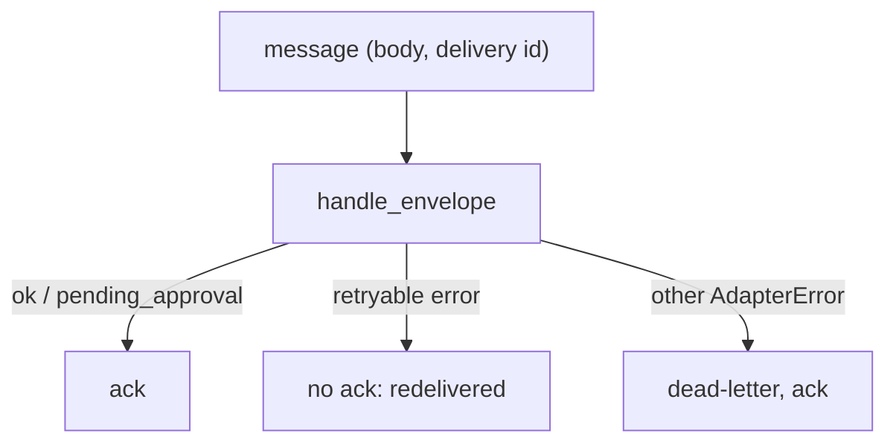

# Queues and consumers

:material-check-circle:{ .status-ok } Available · `pip install agent-adapter` (no extra)

Every queue gives you a message body and a delivery id. `handle_envelope` takes both, runs
one call (or one resume) through the executor, and returns a JSON reply. It imports no
broker library, so the same function serves SQS, Pub/Sub, Kafka, RQ, Dramatiq, Arq and
Temporal.

| File | Does |
|---|---|
| `agent_adapter/handlers/envelope.py` | `parse_envelope`: strict keys, ids from the delivery id |
| `agent_adapter/handlers/consume.py` | `handle_envelope(executor, payload, *, tools=, message_id=, source=)` |
| `examples/backend_queue.py` | an async consumer, a sync job, a Temporal activity, a Pub/Sub push body |
| `tests/docs/test_backend_handler_examples.py` | runs them over a fake queue, offline |

Data enters as the message body (JSON object, text or bytes), goes to the executor, and
leaves as the reply you ack with. The envelope format is on [Serverless](serverless.md#the-envelope).

## An async consumer

```python
--8<-- "examples/backend_queue.py:consumer"
```



| Reply or error | Do |
|---|---|
| `ok` | ack |
| `pending_approval` | ack: the call waits in the store; a resume message runs it |
| `already_done` | ack: a redelivered resume; its decision already ran, nothing runs again |
| `exc.retryable` (`ToolTimeout`, model rate limits) | do not ack; the broker redelivers |
| any other `AdapterError` (bad envelope, denied, unknown tool) | dead-letter; retrying cannot help |

## Sync jobs and Temporal

```python
--8<-- "examples/backend_queue.py:jobs"
```

## Pub/Sub push

```python
--8<-- "examples/backend_queue.py:pubsub"
```

## Per broker

| Broker | Loop | Body and delivery id | Notes |
|---|---|---|---|
| SQS on Lambda | sync | use `tool_handler` ([Serverless](serverless.md)) | partial batch failures built in |
| SQS (aiobotocore) | async | `Body`, `MessageId` | delete after the reply; visibility timeout > the tool's timeout |
| Pub/Sub pull | async or callback threads | `message.data`, `message.message_id` | callback threads: `run_sync`, then `message.ack()` |
| Pub/Sub push | HTTP | `pubsub_push` above | keep the push endpoint authenticated (OIDC token) |
| Kafka (aiokafka, confluent AsyncIO) | async | `msg.value`, `f"{topic}:{partition}:{offset}"` | commit the offset after the reply |
| RQ | sync, fork per job | `tool_job(payload)` | the executor is built in the child (`functools.cache`) |
| Dramatiq, Huey | sync threads | `tool_job(payload)` | a long-lived loop (`LoopRunner`) saves a loop per job |
| Arq, Taskiq | async | `await handle_envelope(...)` | the job id as `message_id` |
| Celery | sync | see [Celery](celery.md) | |
| Temporal | async activities | `tool_activity` | never in workflow code; a pending approval becomes a signal wait, then a resume activity |

## Idempotency

| Rule | Why |
|---|---|
| pass the delivery id as `message_id`, or put `run_id` and `call_id` in the envelope | a redelivered message is the same call: a `confirm` tool finds its own record instead of asking twice |
| use one `source` per broker | ids from two brokers never collide |
| make side-effecting tools idempotent (pass `call_id` to the external API) | a crash after the tool ran, before the ack, runs it again |
| a resume is safe to redeliver | its decision is used once; a duplicate replies `already_done` and runs nothing |

## Security

Anyone who can publish to the queue can run the tools you serve. Restrict publish rights,
pass `tools=` to `handle_envelope`, and keep destructive tools behind `confirm`: a message
never approves anything ([framework approvals](../guides/security.md#framework-approvals)), only a reviewer's decision in the shared store
does. Records the HTTP tool server parked are refused (`ToolUsageError`), whether a
message names their `approval_id` or their `run_id` and `call_id`; they resume over the
server's own `/approvals` routes. Logs name tools, ids and error kinds, never arguments or results.

See also: [Serverless](serverless.md), [Pipelines](pipelines.md),
[Approval stores](../concepts/approval-stores.md).
