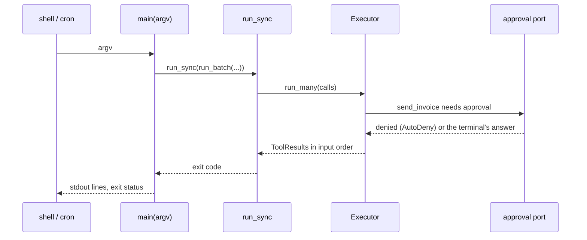

# Scripts and batch jobs

:material-check-circle:{ .status-ok } Available · `pip install agent-adapter` (no extra)

A CLI or a cron job owns its process and its loop. Build one executor, run the whole batch
as one run, print results, exit non-zero when a call failed.

| File | Does |
|---|---|
| `examples/backend_common.py` | the tools and the price table, shared with the web backends |
| `examples/backend_script.py` | `main(argv)`: argparse, the approval port, `run_batch` through `run_many`, the exit code |
| `tests/docs/test_backend_examples.py` | runs `main([...])` offline, unattended and with a faked terminal answer |

Data enters as command-line arguments, goes through `run_many` to the tools, and leaves on
stdout (one line per call, then the cost). Logs go to stderr.

```text
$ python examples/backend_script.py eu us --invoice cus_1024 49.5
eu ok 5.0
us ok 18.0
invoice error approval-denied
calls=3 cost=$0.0
$ echo $?
1
```

## The batch

```python
--8<-- "examples/backend_script.py:batch"
```

| Choice | Why |
|---|---|
| one `run_scope()` for the batch | one run id: guards, the ledger summary and events cover the batch; the run ends with the block |
| `run_many(calls, ctx, concurrency=4)` | calls run at once (`parallel_safe=True` tools share the run; others take it alone) and come back in input order |
| `on_error="collect"` (the default) | a failed call is a `ToolResult` with `error.kind`; the rest still finish |
| exit code 1 on any failure | cron and CI see it |

## Approvals without a reviewer

```python
--8<-- "examples/backend_script.py:approval"
```

| Mode | Port | A `confirm` tool |
|---|---|---|
| unattended (default) | `AutoDeny` | `approval-denied`, never runs |
| `--interactive` | `CallbackApproval(ask_on_terminal)` | runs only after `y` on the terminal |
| a reviewer elsewhere | `DeferredApproval(store)` | parks; re-run the job with the same run and call ids after the decision (see [Celery](celery.md)) |

Never use `AutoApprove` for tools with side effects in a batch: it approves everything.

## Running it

```python
--8<-- "examples/backend_script.py:main"
```



`run_sync` works in a plain script and in a notebook cell (inside Jupyter's loop it runs the
work on a fresh loop in a worker thread). In a script you may also call `asyncio.run`.

## Budgets, logging, cost

| Need | Do |
|---|---|
| stop a runaway batch of paid calls (models, or tools that record a `LedgerEntry`) | `hooks=[BudgetHook(max_usd)]` with a priced `Ledger`; over it a call fails with `budget-exceeded` |
| cap the number of calls | `Executor(..., limits=RunLimits(max_calls=500))` |
| a log line per call | `LoggingHook()`; `logging.basicConfig(stream=sys.stderr)` keeps stdout clean |
| the run's cost and latency | `ledger.summary(run_id)`: `total_usd`, `by_stage`, `by_kind`, `parallelism` |
| a cost file per job | `Ledger(prices=..., sinks=[JsonlSink(path)])` |

## Pitfalls

| Pitfall | Fix |
|---|---|
| one `asyncio.run` per item | build one coroutine for the batch: one loop, shared clients, real concurrency |
| tools not `parallel_safe` | they run one at a time within the run; mark read-only tools `parallel_safe=True` |
| the same call id twice in one batch | ids must be unique within a run (`run_many` rejects duplicates) |
| `input()` in an async approval callback | `await asyncio.to_thread(input, ...)` so the loop keeps running other calls |
| a timeout per item | `timeout=` on the tool; `run_sync(..., timeout=)` caps the whole batch |

See also: [Celery](celery.md), [Runtime](../concepts/runtime.md),
[Executor](../concepts/executor.md), [Cost](../concepts/cost.md).
