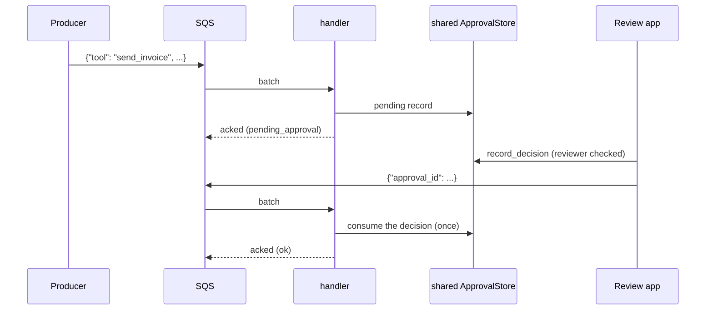

# Serverless functions

:material-check-circle:{ .status-ok } Available · `pip install agent-adapter` (no extra)

A function host gives you a sync or async entry point and kills the container between
invocations. `tool_handler` turns an executor into a Lambda `handler(event, context)`.
`handle_envelope` is the same logic for async hosts.

| File | Does |
|---|---|
| `agent_adapter/handlers/serverless.py` | `tool_handler`: SQS batches, EventBridge, direct events; time budget from the context |
| `agent_adapter/handlers/consume.py` | `handle_envelope`: one call or one resume, a JSON reply |
| `examples/backend_serverless.py` | the Lambda `handler`, an async HTTP function, the review step |
| `tests/docs/test_backend_handler_examples.py` | runs them with fake events, offline |

Data enters as an event (JSON), goes through `handle_envelope` to the executor, and leaves
as the return value: a reply dict, or `{"batchItemFailures": [...]}` for SQS.

## The envelope

| Envelope | Means |
|---|---|
| `{"tool", "arguments", "run_id"?, "call_id"?}` | run one call |
| `{"approval_id"}` | run a call a reviewer already decided, once |

Any other key is refused (`ToolUsageError`), so a message can never carry a decision.
Without ids, the ids come from the source's delivery id (SQS `messageId`, EventBridge `id`,
Lambda `context.aws_request_id` on a direct invoke), which stays the same on redelivery and
retry: a redelivered call finds its own approval record.

| Reply `status` | Has |
|---|---|
| `ok` | `tool`, `run_id`, `call_id`, `result` (JSON-safe) |
| `pending_approval` | the same ids and `approval_id`; the call is parked in the store |
| `already_done` | the same ids and `approval_id`; a redelivered resume whose decision already ran |

Other failures raise a typed `AdapterError`.

## AWS Lambda

```python
--8<-- "examples/backend_serverless.py:lambda"
```

| Event | What `handler` does | Returns / on error |
|---|---|---|
| SQS batch (`Records`) | each message in order | `batchItemFailures` lists failed and unreached messages; turn on `ReportBatchItemFailures` |
| SQS FIFO batch | stops at the first failure | that message and all later ones are failed, so order holds |
| EventBridge (`detail-type`, `detail`) | the envelope in `detail` | the reply; errors raise, Lambda retries, then your on-failure destination |
| anything else | the event is the envelope (direct invoke) | the reply; errors raise |

Each invocation runs for `min(timeout, remaining time - margin_s)`. Messages not done when
time runs out are reported as failed, so SQS delivers them again. Set each tool's own
`timeout=` below the Lambda timeout: a blocking sync tool cannot be cancelled.

For HTTP on Lambda, serve `create_app` with Mangum or the Lambda Web Adapter instead
(see [HTTP tool server](../cross-language/http-server.md)).

## Approvals across invocations



```python
--8<-- "examples/backend_serverless.py:review"
```

The container is gone between the two invocations, so the store must be shared:
`SQLiteApprovalStore` does not work here; use Redis, a SQL database or DynamoDB (see
[Approval stores](../concepts/approval-stores.md)). A redelivered resume runs nothing:
the decision is used, so the reply is `already_done` and the message is acked (not sent to
the dead-letter queue).

## Cloud Run functions, Azure Functions, Modal

```python
--8<-- "examples/backend_serverless.py:function"
```

| Host | Entry | Call |
|---|---|---|
| Cloud Run functions | `functions_framework.aio` handler | `await tool_function(await request.json())` |
| Cloud Run functions, sync | `@functions_framework.http` | `handler(request.get_json())` |
| Azure Functions v2, `async def` | runs on the worker's loop | `await tool_function(req.get_json())` |
| Azure Functions v2, `def` | runs in a thread pool | `handler(req.get_json())` |
| Modal `@app.function` | plain Python | `await` or `handler(...)`; `@modal.asgi_app` serves `create_app` |
| Vercel Python | ASGI apps deploy as is | mount `create_app` (see [FastAPI](fastapi.md)) |

An HTTP function has no auth of its own. Keep it private (Cloud Run IAM, Azure function
keys or Entra, Modal proxy auth), or serve `create_app`, which authenticates every caller.

## Security

| Rule | Why |
|---|---|
| only trusted producers may send to the queue or invoke the function | anyone who can send can run any tool you serve |
| pass `tools=` | the handler runs only those tools, even if the registry has more |
| `confirm` tools still park | a message never approves; only a reviewer's decision in the store does |
| records parked by the HTTP server are refused, by `approval_id` and by their `run_id` + `call_id` | the server resumes them itself after re-checking the invoker |
| logs carry tool names and ids only | arguments, results and error text stay out of WARNING logs |

## Warm starts

| Edge | Rule |
|---|---|
| invocations share the process's sync loop (`LoopRunner`, see [Runtime](../concepts/runtime.md)) | keep clients in `LoopLocal`: they stay open across warm invocations |
| a fresh loop per invocation instead | pass `runner=RunSync()`; nothing loop-bound survives the call |
| the ledger and memory stores are per container | budgets cap one run; shared state needs a shared store |

See also: [Queues](queues.md), [Celery](celery.md), [Approval](../concepts/approval.md).
