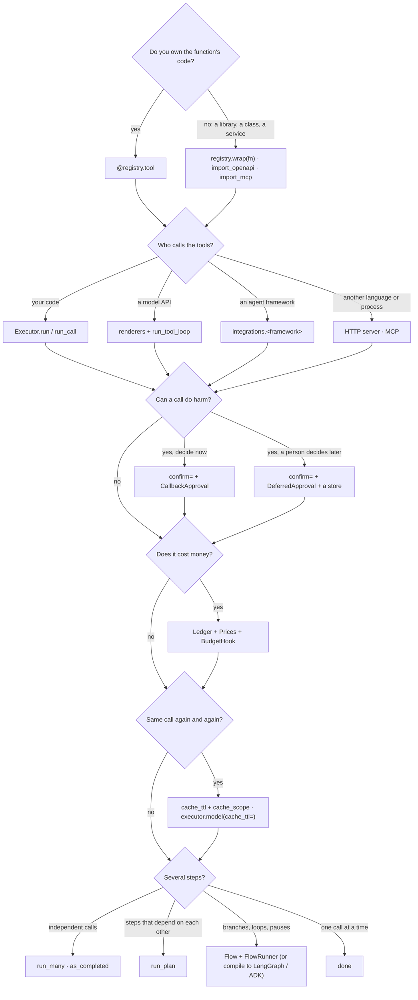

# Which feature do I need?

Answer the questions top to bottom. Each leaf is a page. Most apps need the first three
rows only: a registry, an executor, and the surface that calls it.

## Where each leaf is explained

| Leaf | Page |
|---|---|
| `@registry.tool` | [Quickstart](get-started/quickstart.md), [Tools](concepts/tools.md) |
| `registry.wrap`, importers | [Wrap existing code](get-started/wrap-existing-code.md), [OpenAPI](integrations/openapi.md), [MCP](integrations/mcp.md) |
| `Executor.run`, `run_call` | [Executor](concepts/executor.md) |
| renderers, `run_tool_loop` | [OpenAI](integrations/openai.md), [Anthropic](integrations/anthropic.md), [Tool loop](concepts/tool-loop.md) |
| a framework | [Integrations](integrations/index.md), [support matrix](support-matrix.md) |
| another language | [HTTP server](cross-language/http-server.md), [MCP](cross-language/mcp.md) |
| a non-Python framework or a hosted agent | [Connect anywhere](connect/index.md) |
| `CallbackApproval`, `DeferredApproval` | [Human in the loop](how-to/human-in-the-loop.md), [Approval over Slack or email](cookbook/approval-notify.md) |
| ledger and budgets | [Budgets](how-to/budgets.md), [Cap spend per user](cookbook/spend-per-user.md) |
| caching | [Caching](how-to/caching.md) |
| batches and plans | [Parallel retrieval](how-to/parallel-retrieval.md) |
| flows | [First flow](get-started/first-flow.md), [Flows](concepts/flows.md) |
| sync code (Flask, Celery, scripts) | [Sync code and backends](how-to/sync-backends.md) |
| a queue, a Lambda or a pipeline | [Queues](backends/queues.md), [Serverless](backends/serverless.md), [Pipelines](backends/pipelines.md) |
| see what ran: flow graph, timeline, approvals (any framework) | [See your runs](how-to/see-your-runs.md) |

## Always on

Whatever you pick, every call through the executor gets these:

| You get | Without asking |
|---|---|
| argument validation | before the tool runs; errors safe to send back to the model |
| typed errors with stable `kind`s | [Errors](concepts/errors.md) |
| events for tracing | [Observability](guides/observability.md) |
| a denied call when a `confirm` tool has no approval port | [Security](guides/security.md) |
