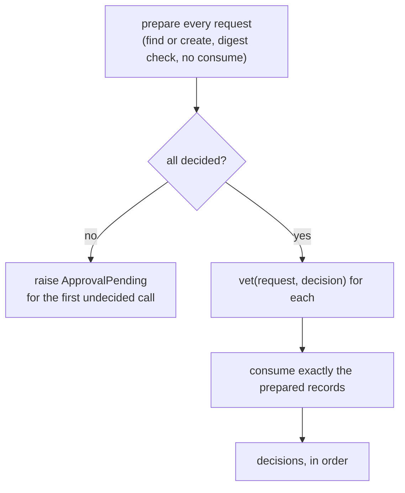

# Approval batches

:material-check-circle:{ .status-ok } Available · `agent_adapter.approval`

A framework that pauses a run for several tool calls at once (the
[Agents SDK](../integrations/openai-agents.md), [Pydantic AI](../integrations/pydantic-ai.md))
asks the approval port about the whole batch. `ask_each` does that safely, also when the
answers arrive out of band through a [`DeferredApproval`](approval.md#deferred-approval)
store.

## API

| Name (`agent_adapter.approval`) | What it is |
|---|---|
| `PreparedApproval` | runtime-checkable protocol: `async prepare(request) -> ApprovalRecord`, `async consume(record, request) -> ApprovalDecision` |
| `async ask_each(port, requests, *, vet=None) -> list[ApprovalDecision]` | one decision per request, in order |

`DeferredApproval` is a `PreparedApproval`. A port is two-phase only when its **class**
defines `prepare` and `consume` (the protocol check looks attributes up statically): a
wrapper that forwards them through `__getattr__` is not detected and is asked sequentially.

## Two phases

| Rule | Why |
|---|---|
| Nothing is consumed while any call is undecided | a pass that ends pending loses no decision; the next pass finds the same records |
| `vet` runs before anything is consumed | a bridge can refuse a decision (e.g. an edit it cannot apply) and the store keeps it |
| Only the phase-1 records are consumed, never looked up again | a record replaced between the phases (a concurrent resume) is not applied |
| A record someone else consumed denies its call | fails closed; no new pending record is created |
| `DeferredApproval.consume` re-reads the record from the store | a forged or stale record copy cannot approve: pending stays pending, a changed decision denies, another run, call or arguments raise `ToolUsageError` (nothing consumed) |
| `ask_each` denies when `consume` returns another decision than the vetted one | defence in depth for any `PreparedApproval` |
| `prepare` is advisory | act only on what `consume` returns |

Two workers resolving the same pass at once: one consumes the records; the other's
`consume` is denied. If the loser starts a *new* pass after the winner consumed, its
`prepare` finds no unconsumed record and opens new pending ones (a call id may be reused
after its approval was consumed), so reviewers see a second prompt for those calls.
Run one resolver per paused run.

Ports that are not a `PreparedApproval` get `request` once per call, in order; their
`ApprovalPending` is raised after every call was asked.

## Passes

Resolve again after each decision. Build the requests identically on every pass: same
`run_id`, call ids, tools and arguments (the record's ids and digest must match). With one decision
per pass, two calls finish in three passes and leave exactly two records.

If a pass is cancelled during phase 2, the next pass asks again about every call it had not
consumed yet (their records are still decided). A call it had consumed has no unconsumed
record left, so the next pass opens a new pending record for it: decide it again, or reject
that item on the run state yourself.
