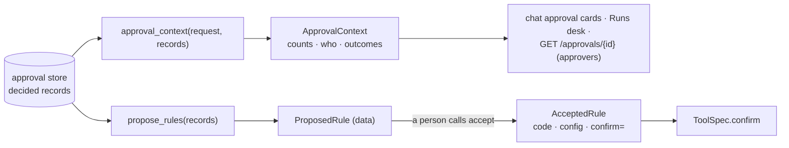

# Approval memory

Reviewers decide the same kinds of calls again and again. Approval memory shows them what
was decided before on similar requests, and can propose a confirm rule from that history.
It is advice: **nothing is ever approved from memory**. A request still waits for a
person, and a proposed rule changes nothing until a person accepts it and commits it.



| File | Does |
|---|---|
| `approval/memory.py` | `approval_context`, `argument_similarity`, `ApprovalContext`, `SimilarDecision` |
| `approval/rules.py` | `propose_rules`, `ProposedRule`, `accept`, `AcceptedRule`, `confirm_from_config` |
| `viewer/chat/approval_history.py` | chat decisions (stored turns) as records, for the cards |

## Similar decisions

```python
--8<-- "examples/approval_memory.py:context"
```

A past record counts when a person decided it (approved or denied), it is the same tool
and kind, and its arguments are similar enough (`min_similarity=0.5`):

- Arguments are compared field by field, nested up to three levels. A nested key can be
  data (an address), so a match there is named only as `field.*`.
- An equal value scores 1, the same field with another value 0.5, a field only one call
  has 0. The score is the mean over all fields.
- **Secret-named fields** (`api_key`, `password`, `token`, ...) are never compared and
  never named. The context holds no argument values at all: only counts, deciders, times,
  scores and the names of equal fields.
- Timed-out and stopped chat approvals are not decisions and do not count.

`ApprovalContext.summary()` gives the one line the cards show, such as
"3 similar: 2 approved, 1 denied (by ann)".

## Where it shows

- **Chat**: each approval card shows "Seen before: ..." under the arguments. History comes
  from this user's stored chats and the decisions of the running server.
- **Runs view**: each pending record of `--approvals PATH.db` shows its context.
- **HTTP server**: `GET /approvals/{id}` adds a `context` object, for holders of the
  approver scope only. Invokers see the record as before.

## Proposed rules

```python
--8<-- "examples/approval_memory.py:rules"
```

`propose_rules(records, min_count=5, min_deciders=2, max_denied=0, review_days=90)`
proposes one rule per tool and argument shape. A rule is a policy over **all** arguments,
bounded to what reviewers actually approved:

- Every non-secret top-level argument gets a condition: `==` for a value that never
  changed, `in` for up to 10 seen values, `lo <= field <= hi` for numbers (both bounds
  are the observed minimum and maximum, so negative amounts are not covered).
- A shape with a nested value, or a text field with more than 10 values, gets no rule.
- It needs `min_count` approvals decided as-is, by at least `min_deciders` people.
- Denials and edited approvals are counter-evidence: if more than `max_denied` of them
  fall inside the bounds, there is no rule. `evidence.denied_outside` counts the rest.

A `ProposedRule` is data. `accept(rule, accepted_by="ann")` is the explicit step: it
returns the config and the code to commit, plus the `confirm=` callable they build.

```python
--8<-- "examples/approval_memory.py:apply"
```

The callable skips asking only when the call is that tool, has exactly the covered
non-secret fields, each inside its bounds with the same type, and the review date
(`accepted_at + review_days`) has not passed. Anything else asks: a new field, a missing
one, a value never seen, a bool for a number, another tool, or any call after review.
`confirm_from_config` refuses unknown keys, secret-named fields and bad bounds.

## Security notes

- Memory never decides and never removes a request from the queue; tests check that a
  long, unanimous history still asks.
- An accepted rule skips asking for calls inside it. Read every condition before you
  accept: it is code, and a wide range you accept is a range you will not see again.
  Accept again (with fresh evidence) after the review date.
- Run `python examples/approval_memory.py` to see the whole loop offline.

Related: [Approval](approval.md), [Approval stores](approval-stores.md).
