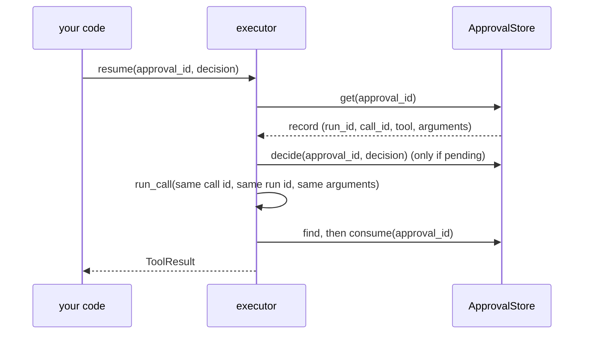

# Resume a parked call

A `confirm` tool behind `DeferredApproval` pauses with `ApprovalPending`. To run it
later you need only its approval id: `executor.resume(approval_id, ...)`.

This is `examples/hello_approval.py`. The test suite runs it.

```python
--8<-- "examples/hello_approval.py:tool"
```

```python
--8<-- "examples/hello_approval.py:flow"
```

## What resume does



The parked call runs again through the whole pipeline. The port then answers it with the
record's decision, once. The binding is the usual one ([Approval](approval.md)): same run,
same call id, same tool, same digest of the original arguments. `edited_args` in the
decision are what runs.

| `decision` | Pending record | Decided record |
|---|---|---|
| `None` (default) | `ToolUsageError`: resume never approves by itself | runs with the stored decision |
| `True`, `False` or an `ApprovalDecision` | decided so, then run | runs if it agrees; else `ApprovalAlreadyDecided` |

A resume that decides must name the reviewer: `decided_by=` (or the decision's own
`decided_by`), else `ToolUsageError`. The store records it with `decided_at`. `reason=`
fills in a `True` or `False` decision. If another reviewer decides first the same way,
the resume still runs; a different decision raises `ApprovalAlreadyDecided`. A denial comes back as
a `ToolResult` with `status="error"` and kind `approval-denied`; the tool never runs.

## Errors

| Case | Raises |
|---|---|
| unknown id | `ApprovalNotFound` |
| the decision was already used | `ApprovalAlreadyDecided(status="consumed")`; a new call asks again |
| the store holds another decision | `ApprovalAlreadyDecided` |
| the port has no store (`AutoApprove`, a callback) | `ToolUsageError` naming `DeferredApproval(store)` |
| a flow-node approval | `ToolUsageError`: use `FlowRunner.resume` |
| a record the HTTP tool server parked | `ToolUsageError`: decide it at `POST /approvals/{id}/decide` |
| a pending record and no `decision`, or no `decided_by` | `ToolUsageError`; nothing is decided |
| `ctx=` of another run | `ToolUsageError`; nothing is decided |

## Who may resume what

The HTTP tool server marks the records it parks (`metadata` keys `origin`, `principal`
or `anonymous`). It re-authorizes the invoker before it runs one
([HTTP server security](../guides/security.md#http-server)). So
`executor.resume`, `resume_sync` and queue envelopes refuse those records, by approval id
and by their run and call ids. `DeferredApproval` itself never consumes one either, so
`run_call` with the record's ids is refused too; only the server's own port may. A resume ends the run it opened, so its guard state is
freed.

## Shortcuts and mistakes

| Write | Means |
|---|---|
| `DeferredApproval.sqlite(path, *, max_records=10_000, timeout=5.0)` | `DeferredApproval(SQLiteApprovalStore(path, ...))`: one file, every process on the host |
| `aa.configure(approval=...)` | make that the default executor's port; returns the executor |
| `executor.resume_sync(...)` | the sync twin, on the shared loop |

`store.decide(id, True)` is a `ToolUsageError` that shows the fix:
`store.decide(id, ApprovalDecision(approved=True))`, or
`executor.resume(id, True, decided_by="ana")`.

`ApprovalPending` carries a traceback note on how to resume. Its message, which a model
may see, stays short.

Calling `run` again on the same tool does not resume: it is a new call with a new call
id, so it asks for a new approval. Use `resume`, or `run_call` with the same run id and
call id.
