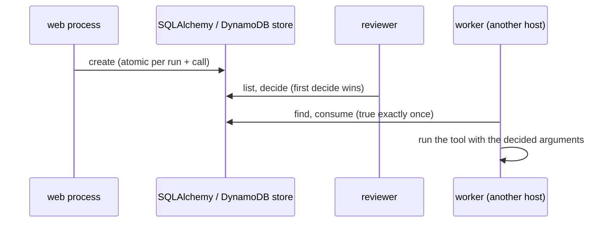

# Database approval stores

:material-check-circle:{ .status-ok } Available · `from agent_adapter.approval import SQLAlchemyApprovalStore, DynamoDBApprovalStore`

Two more [approval stores](approval-stores.md) keep parked calls in a database you
already run: **Postgres** through SQLAlchemy 2 (async), and **DynamoDB** for AWS
serverless code that has no Redis. Both pass the same shared test suite as the other
stores, and both keep the safety model: only an adapter-issued decision, consumed once,
lets a paused call run.



| Store | Install | Use when |
|---|---|---|
| `SQLAlchemyApprovalStore(engine, *, table="aa_approvals", create_schema=True)` | `agent-adapter[sqlalchemy]` plus a driver (`asyncpg`) | your service has Postgres |
| `DynamoDBApprovalStore(client_factory, *, table, ttl_s=604800)` | `agent-adapter[dynamodb]` (`aioboto3`) | Lambda or other AWS code; no Redis to run |

## SQL: Postgres through SQLAlchemy

```python
--8<-- "examples/approval_stores_sql.py:postgres"
```

The same flow runs on every store: the web process pauses, a reviewer decides, a worker
on another host resumes once.

```python
--8<-- "examples/approval_stores_sql.py:flow"
```

| Rule | Detail |
|---|---|
| `engine` | a URL (`postgresql+asyncpg://…`) or a callable returning an `AsyncEngine`; one engine per event loop (`LoopLocal`); `await store.aclose()` disposes the running loop's engine |
| Dialects | Postgres, and SQLite (`sqlite+aiosqlite://`, for tests); others raise `ConfigError` on first use |
| Schema | one table (`table`, default `aa_approvals`); ids are binary (`bytea`), so any id survives |
| First use | runs once per store and loop (concurrent first calls wait for it); `create_schema=True` runs `CREATE TABLE/INDEX IF NOT EXISTS` in one transaction (Postgres takes an advisory lock first), so racing hosts are safe; a failed `CREATE` logs a `WARNING` with the type, then the checks decide; a table without the store's columns, or without a unique index on `(run_id, call_id) WHERE consumed = 0`, raises `ConfigError` |
| Retention | rows stay until you delete them: `await store.prune(older_than_s=…)` deletes older records (a `WARNING` counts any never used) |
| Outages | database errors propagate (logged at `ERROR` with the type only); nothing is approved |

### SQL: what it runs

| Step | SQL |
|---|---|
| schema | partial unique index `aa_approvals_open` on `(run_id, call_id) WHERE consumed = 0` |
| `create` | `INSERT … ON CONFLICT DO NOTHING RETURNING seq`; on a conflict, `SELECT` the call's unconsumed row |
| `decide` | `UPDATE … WHERE approval_id = … AND status = 'pending' RETURNING seq`: one winner |
| `consume` | `UPDATE … SET consumed = 1 WHERE approval_id = … AND consumed = 0 AND status <> 'pending' RETURNING seq`: a returned row means `True` |
| `list` | `SELECT … ORDER BY seq DESC LIMIT n`, indexed by run and by status |

### Alembic

Let Alembic own the table in production: pass `create_schema=False` and add the
store's `metadata` to `target_metadata`, then autogenerate a migration.

```python
--8<-- "examples/approval_stores_sql.py:alembic"
```

## DynamoDB: AWS serverless

```python
--8<-- "examples/approval_stores_sql.py:dynamodb"
```

| Rule | Detail |
|---|---|
| Client | `client_factory()` returns an async DynamoDB client, or the context manager `session.client("dynamodb")` gives (it is entered once per event loop and exited by `aclose`) |
| Table | create it with your infrastructure code: `DynamoDBApprovalStore.table_definition(name)` returns the `CreateTable` arguments (key `pk`, GSIs `by_run` and `by_status`, on-demand billing) |
| TTL | enable DynamoDB TTL on `expires_at`; items expire `ttl_s` after **creation**; an expired item reads as absent at once, though DynamoDB deletes it later; `ttl_s=None` never expires |
| Atomic steps | `create` is one `TransactWriteItems` of two conditional puts (the record, and the call's open marker); `decide` and `consume` are conditional updates that compare the stored record |
| Consistency | `get`, `find`, `create`, `decide` and `consume` use strongly consistent reads; `list` reads a GSI, so a new record can take a moment to appear |
| Outages | client errors propagate, logged at `ERROR` with the exception type, the AWS error code and any cancellation reasons; throttling and validation errors are never retried as races |
| Lost races | only `ConditionalCheckFailed` or `TransactionConflict` (for every cancelled item) counts; it retries up to 5 times with full-jitter backoff (20 ms doubling, 0.5 s cap), then raises `ApprovalStoreCorrupt` |
| Throughput | every `create` adds 1 to the one `meta#seq` item, so creates per table are capped by one item's write rate (about 1,000 a second); `decide`, `consume` and reads are not |

| Item | Key `pk` | Holds |
|---|---|---|
| record | `rec#<id>` | the record JSON, ids, `st` (status), `consumed`, `seq`, `expires_at` |
| open marker | `open#<len>:<run>:<call>` | the id of the call's newest record |
| counter | `meta#seq` | `n`, the creation order `list` sorts by |

Pick `ttl_s` longer than your slowest review plus the resume: an expired decision is
never consumed, so the resumed call asks again (it fails closed, never runs).

## Access and permissions

Anyone who can write the table can forge an approval. Treat it like a credential store.

| Store | Do |
|---|---|
| SQLAlchemy | a database role per service with `SELECT, INSERT, UPDATE, DELETE` on the table only (plus `CREATE` while `create_schema=True`); TLS to the database |
| DynamoDB | an IAM policy on the table and its indexes only: `GetItem`, `UpdateItem`, `PutItem`, `Query`, `TransactWriteItems`; no other writer |

## Failing closed

Both stores check every row they read, as the other durable stores do: a row that is
not an `ApprovalRecord`, whose digest disagrees with its request, or whose indexed
columns disagree with the record raises `ApprovalStoreCorrupt` before anything is
consumed. A DynamoDB open marker that points at another call's record does too, in
`find` and in `create`.

## Files

| File | Does |
|---|---|
| `approval/sqlalchemy_store.py` | `SQLAlchemyApprovalStore`: statements, one-time setup per loop, `prune` |
| `approval/sqlalchemy_schema.py` | the table, its `CREATE … IF NOT EXISTS` DDL, and the column and index check |
| `approval/dynamodb_store.py` | `DynamoDBApprovalStore`: create transaction, compare-and-set, `list` paging |
| `approval/dynamodb_items.py` | item keys and attributes, `table_definition`, the per-loop client |
| `approval/persist.py` | shared with the other durable stores: record codec and row checks |
| `examples/approval_stores_sql.py` | the snippets above; runs offline on SQLite |

Data enters through `create` and `decide` and leaves through `get`, `find`, `list` and
`consume`, as for every [approval store](approval-stores.md).
