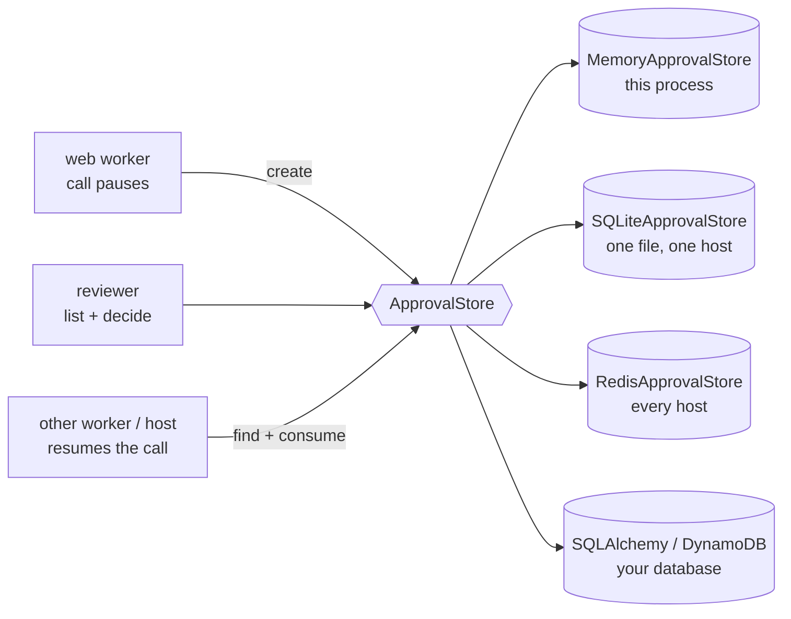

# Approval stores

:material-check-circle:{ .status-ok } Available · `from agent_adapter import SQLiteApprovalStore, RedisApprovalStore`; `from agent_adapter.approval import SQLAlchemyApprovalStore, DynamoDBApprovalStore`

A [`DeferredApproval`](approval.md#deferred-approval) parks a call in an `ApprovalStore`
until a reviewer decides. When the call pauses in one process and resumes in another
(Celery, several HTTP workers, a job re-run later), every process must see the same
records. Five stores ship; all honour the same protocol, checked by one shared test suite.



## Which store to use

| Situation | Store |
|---|---|
| tests, scripts, one process | `MemoryApprovalStore(*, max_records=10_000)` |
| several processes on **one host** (multi-worker server, local Celery, a cron job) | `SQLiteApprovalStore(path, *, max_records=10_000, timeout=5.0)` |
| several **hosts**, containers or pods | `RedisApprovalStore(client_factory, *, prefix="aa:approval:", ttl_s=604800)` (extra `redis`) |
| Postgres (or another host's SQLite) through SQLAlchemy | `SQLAlchemyApprovalStore(engine, *, table="aa_approvals")` (extra `sqlalchemy`), see [Database stores](approval-stores-db.md) |
| AWS serverless (Lambda), no Redis | `DynamoDBApprovalStore(client_factory, *, table, ttl_s=604800)` (extra `dynamodb`), see [Database stores](approval-stores-db.md) |
| another database (a Django model) | implement `ApprovalStore`; follow the [SQL recipe](#your-own-database) |

Every store: `create` is atomic per `(run_id, call_id)` and returns the call's open record
unchanged; `consume` is a test-and-set that is `True` exactly once; `find` returns only the
unconsumed record; `get`, `decide` and `consume` raise `ApprovalNotFound` for an unknown id.
The methods are on [Approval](approval.md#store).

## Memory: one process

`MemoryApprovalStore` holds one `threading.Lock` and never awaits under it, so loops in
several threads (`run_sync`) can share one store; 100 concurrent `decide` calls produce one
winner. Past `max_records` it evicts the earliest consumed record, then the oldest decided
one, then (with a `WARNING`) the oldest pending one; each eviction is O(1).

## SQLite: one file, every process on the host

```python
--8<-- "examples/approval_stores.py:sqlite"
```

The web process pauses the call and a reviewer decides it:

```python
--8<-- "examples/approval_stores.py:pause"
```

A second process opens the same file and resumes with the same run and call id:

```python
--8<-- "examples/approval_stores.py:resume"
```

| Rule | Detail |
|---|---|
| File | WAL journal mode; tables `aa_approvals` and `aa_approval_meta` (schema version 1) |
| First use | creates the schema; another version, a foreign `aa_approvals` table, or a file that cannot use WAL → `ConfigError` |
| Atomic steps | `create`, `decide`, `consume` run in `BEGIN IMMEDIATE`; a partial unique index keeps one unconsumed row per call |
| Threads and loops | each call runs in `asyncio.to_thread` on its own connection; safe across `run_sync` loops and forked processes |
| `timeout` | seconds a writer waits for the file lock, then `sqlite3.OperationalError` |
| Eviction | past `max_records`: the earliest consumed record, else the oldest decided, else the oldest pending, as `MemoryApprovalStore`; evicting a pending or a decided-but-unused record logs a `WARNING` (that call asks again) |
| File mode | a new file is created `0600`; SQLite gives `-wal` and `-shm` the same mode; an existing file keeps its mode. Windows ignores the mode: the file takes its folder's ACL |
| Not for | network file systems (WAL needs shared memory on one host); use Redis or your database |

`path` must be a file path: `""`, `":memory:"` and `file:` URIs are refused, because each
call opens its own connection.

## Redis: every host

```python
--8<-- "examples/approval_stores.py:redis"
```

| Rule | Detail |
|---|---|
| Client | `client_factory()` builds a `redis.asyncio.Redis`, once per event loop (`LoopLocal`); keep `decode_responses=False`; `await store.aclose()` closes the running loop's client |
| Keys | under `prefix`: `rec:<id>` (a hash), `open:<run>:<call>`, sorted sets `all`, `run:<run_id>`, `status:<status>`, `exp`, and the counter `seq` |
| Atomic steps | `create` is one Lua script; `decide` and `consume` compare-and-set the stored record in a script, so a lost race re-reads and never double-consumes |
| TTL | a record expires `ttl_s` seconds after it was **created** (a decision does not extend it); then `get` raises `ApprovalNotFound`, `find` returns `None`, `list` skips it, and the next `create` prunes its ids from the indexes |
| `maxmemory-policy` | `noeviction`, for every `ttl_s`: under `volatile-*` or `allkeys-*` Redis may drop records (pending or decided) early and silently, and the call asks again |
| `ttl_s=None` | records never expire |
| `prefix` | non-empty and ending in `:` (else `ConfigError`); one prefix per store, never nested in another (`"app:"` and `"app:rec:"` share keys) |
| Cluster | put a hash tag in `prefix` (`"{myapp}:approval:"`): the scripts build record keys from it, so every key must share one slot |
| Outages | Redis errors propagate (logged at `ERROR` with the type only): the HTTP server answers 500, nothing is approved |

Pick `ttl_s` longer than your slowest review plus the resume: an expired decision cannot
be consumed, so the resumed call opens a new review (it fails closed, never runs).

## Your own database

`SQLAlchemyApprovalStore` is the SQL recipe, shipped: a partial unique index on the
call's unconsumed row, `INSERT … ON CONFLICT DO NOTHING` for `create`, and a guarded
`UPDATE … RETURNING` for `decide` and `consume`. Copy it for a Django model; see
[Database stores](approval-stores-db.md#sql-what-it-runs).

## Access and permissions

The store is where approvals live. **Anyone who can write it can forge an approval** (a
consistent approved row passes every check), and anyone who can read it sees the tool
arguments. Treat it like a credential store.

| Store | Do |
|---|---|
| SQLite | put the file in a directory only the service user can open (`chmod 0700`); keep the file, `-wal` and `-shm` at `0600` (new files are); on Windows, give the folder an ACL for the service account only |
| Redis | a Redis user (ACL) per service, limited to its prefix (`~{myapp}:approval:*`) and to the commands the store and its scripts run (`+eval +hmget +get +set +exists +hset +incr +pexpire +time +zadd +zrem +zrangebyscore +zrevrange`); TLS (`rediss://`) between hosts; no other writer under the prefix |
| Every durable store | never share the store with a lower-trust component; back it up with the same protections |

## Failing closed

Every durable store checks every row it reads. A row that is not JSON, is not an
`ApprovalRecord`, has a digest that disagrees with its request, or whose indexed columns
(id, run, call, status, consumed) disagree with the record raises `ApprovalStoreCorrupt`.
It subclasses `AdapterError` (kind `internal-error`), is logged at `ERROR` without row
contents, and is raised before anything is consumed.

| Error | When |
|---|---|
| `ApprovalStoreCorrupt` | a corrupt, tampered or foreign row; a Redis record that keeps changing under a swap |
| `ToolUsageError` | a taken approval id on another call; `metadata` that JSON cannot carry; `edited_args` that are not plain JSON |
| `ConfigError` | bad constructor arguments; an unknown `status` or negative `limit` in `list`; SQLite schema problems |
| `sqlite3.Error`, `redis.RedisError`, `sqlalchemy.exc.SQLAlchemyError`, botocore `ClientError` | the backend failed; logged, then raised unchanged |

Stored records are ASCII JSON. Metadata is stored as plain JSON (a tuple comes back as a
list); arguments and `edited_args` must already be plain JSON, so what runs is exactly what
was approved.
`MemoryApprovalStore` runs the same `edited_args` check, so code that works on it never
breaks on SQLite or Redis.

## Files

| File | Does |
|---|---|
| `approval/store.py` | `ApprovalRecord`, the `ApprovalStore` protocol, `MemoryApprovalStore` |
| `approval/persist.py` | shared by the durable stores: record codec, row checks, `ApprovalStoreCorrupt` |
| `approval/sqlite_store.py` | `SQLiteApprovalStore`: schema, transactions, eviction |
| `approval/redis_store.py` | `RedisApprovalStore`: key layout, retries of lost swaps, paging for `list` |
| `approval/redis_scripts.py` | the four Lua scripts (`CREATE`, `FIND`, `SWAP`, `PAGE`) |
| `approval/sqlalchemy_store.py`, `approval/dynamodb_store.py` | the [database stores](approval-stores-db.md) |

Data enters through `create` and `decide` (from `DeferredApproval`, the HTTP server's
`/approvals/{id}/decide`, or your reviewer UI) and leaves through `get`, `find`, `list`
and `consume`.
