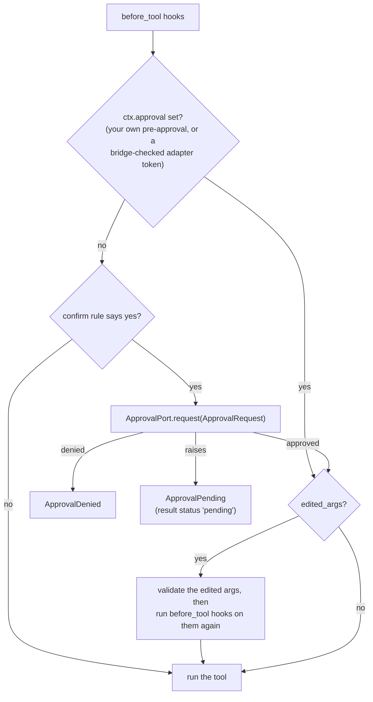
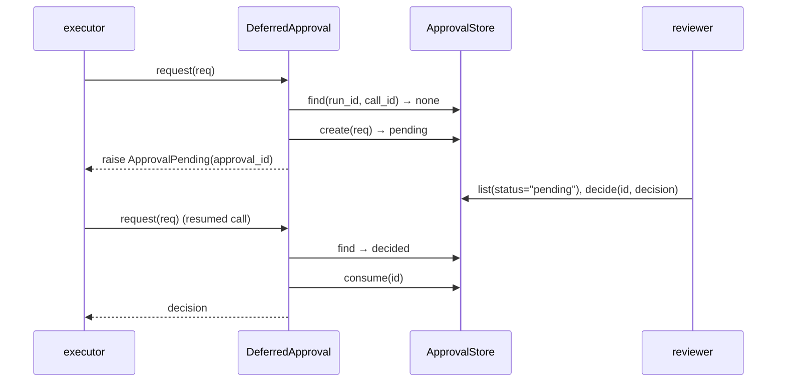

# Approval (human in the loop)

A tool with `confirm=` set asks an approval port before it runs. The port approves,
denies, edits the arguments, or says "pending" so the run can pause and resume later.



The executor runs this step; this page covers the pieces it uses. Import them from `agent_adapter`;
`ApprovalPort`, `ApprovalStore`, `ApprovalRecord` and `evaluate_confirm` come from `agent_adapter.approval`.

A framework's own "approved" never counts alone. A bridge sets `ctx.approval` only from a
one-use token the adapter issued after its own port approved. The token is bound to the run,
the native call id, the tool and an argument digest
([one-use rule](../how-to/human-in-the-loop.md#the-one-use-rule)). One opt-in exception: an MCP server built with `client_approval=True` makes the MCP client's
user the approver instead of the port ([MCP approval](../integrations/mcp.md#approval)). Leave it off where a server-side reviewer is the control.

| Rule | What it means |
|---|---|
| A pre-approval covers one call | `ctx.approval` applies only to the one call of `run` / `run_spec` / `run_call`, and only when `ctx.call_id` is empty or that call's id. `run_many`, `as_completed`, `run_plan` and `run_tool_loop` never use it: every call asks the port |
| It is used up at step 5 | the call keeps it to itself: the tool body's context has `approval=None`, so a nested call or a `run_tool_loop` inside the tool asks the port, even with the same call id |
| Edits are checked like originals | edited arguments are validated again, then the `before_tool` hooks (guardrails, budget, your own checks) run again on them. A hook that blocks stops the call; a `ShortCircuit` replaces it. An edit equal to the original arguments is not checked twice |

## Confirm rules

`confirm` is a `bool` or a function `(call, ctx) -> bool` (sync or async).

```python
--8<-- "examples/approval.py:rule"
```

`evaluate_confirm(rule, call, ctx)` returns the answer. A rule that raises is logged
(tool name and ids, never the arguments) and the error propagates; it is not retried. A
rule that returns a non-bool is a `ToolUsageError`. Pending approvals and control flow
(including types added with `register_control_flow`) propagate without a log. The
executor's step 5 calls this same function.

## Ports

| Port | `request()` returns |
|---|---|
| `AutoApprove(*, reason="auto")` | approved, `decided_by="auto"` |
| `AutoDeny(*, reason="denied by policy")` | denied, `decided_by="auto"` |
| `CallbackApproval(fn)` | `fn(request)`, sync or async; a `bool` becomes a decision by `"callback"` |
| `DeferredApproval(store)` | the stored decision, or raises `ApprovalPending` |

```python
--8<-- "examples/approval.py:ports"
```

| `ApprovalRequest` field | Meaning |
|---|---|
| `approval_id` | `apr_…`; the store fills an empty one |
| `run_id`, `call_id` | which call; the deferred resume key |
| `tool`, `arguments` | tool name and LLM-facing arguments (`node:<flow>.<node>` for flow pauses) |
| `kind`, `hint`, `metadata`, `created_at` | `"tool"` or `"node"`, reviewer hint, free data, epoch seconds |

Any object with `async def request(self, request) -> ApprovalDecision` is a port.
`Decision` is the short name of `ApprovalDecision` (the same class).

| `ApprovalDecision` field | Meaning |
|---|---|
| `approved` | the verdict |
| `edited_args` | replacement arguments; validated and run through the `before_tool` hooks again |
| `reason`, `decided_by`, `decided_at` | why (carried by `ApprovalDenied`); who; epoch seconds |

## Deferred approval

For reviews that happen elsewhere (the HTTP server, a queue, a ticket), the call pauses
and resumes with the same `(run_id, call_id)`.



```python
--8<-- "examples/approval.py:deferred"
```

A pending record answers every repeat request with the same `approval_id`. Once a
decision is consumed, the next request for that call creates a new record (a new review).
If two resumes race for one decision, one gets it and the other fails closed with
`ApprovalDenied("approval already used by a concurrent request")`. To decide a parked call
and run it once by its id, call `executor.resume(approval_id, True, decided_by="ana")`; a
pending record needs both ([Resume a parked call](approval-resume.md)).

A record answers only the call it was made for: the same `(run_id, call_id)`, and an
`args_digest` over the kind, tool and **original** arguments. Any other request fails
closed with `ToolUsageError("call id reused with different tool/arguments")`, logged at
`WARNING` without the arguments. A decision's `edited_args` are what runs; the match is
checked against the original request.

| `request_digest(request)` | Rule |
|---|---|
| covers | `kind`, `tool` and the original `arguments` |
| canonical form | `json.dumps(sort_keys=True, separators=(",", ":"), ensure_ascii=False, allow_nan=False)`, encoded UTF-8 with `surrogatepass`; SHA-256 hex |
| values | JSON only: `dict` (string keys), `list`, `str`, `int`, `float` (finite), `bool`, `None`. Anything else (bytes, tuples, sets, objects, other keys), or nesting deeper than `MAX_JSON_DEPTH` (256), is a `ToolUsageError` before the store is touched |
| trust | always recomputed from the stored request; a stored digest that disagrees makes the record invalid (`ToolUsageError`) |

## Store

`ApprovalStore` is a protocol; `MemoryApprovalStore(*, max_records=10_000)` keeps records
in process. When several processes or hosts serve one run, use a durable store:
`SQLiteApprovalStore` or `RedisApprovalStore` ([Approval stores](approval-stores.md)), or
`SQLAlchemyApprovalStore` or `DynamoDBApprovalStore` ([Database stores](approval-stores-db.md)).

| Method | Does | Raises |
|---|---|---|
| `create(request)` | **atomic per call**: stores a `pending` record, or returns the call's unconsumed record unchanged | `ToolUsageError` if another call's record has the id |
| `get(approval_id)` | the record | `ApprovalNotFound` |
| `find(run_id, call_id)` | the call's unconsumed record, or `None` | — |
| `decide(approval_id, decision)` | sets `approved` / `denied`; first decide wins | `ApprovalNotFound`, `ApprovalAlreadyDecided` |
| `consume(approval_id) -> bool` | **atomic test-and-set**: `True` only for the caller that marks a decided record used; `False` if already consumed or still pending | `ApprovalNotFound` |
| `list(*, run_id=None, status=None, limit=100)` | records, newest first | `ConfigError` on a bad status or limit |

`ApprovalRecord` is a frozen model: `request`, `status`, `decision`, `consumed`,
`args_digest` (always `request_digest(request)`, recomputed by `model_copy`) and the property
`approval_id`. Locking and eviction of the memory store:
[Approval stores](approval-stores.md#memory-one-process).

## Events

Ports and stores emit nothing. The executor alone emits `approval.requested`,
`approval.decided`, and `tool.pending` when a port raises `ApprovalPending`.

This page's code is `examples/approval.py`. The test suite runs it.
