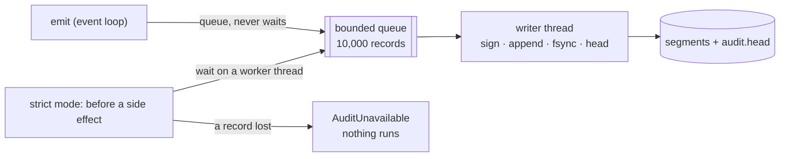

# Audit log in production

How the [audit log](audit.md) behaves under load and failure, what strict mode stops, and
what the log cannot prove on its own.



## Lenient or strict

| Mode | A record cannot be stored |
|---|---|
| `audit(..., fail_closed=False)` (default) | logged at ERROR, counted in `sink.failures`; calls go on |
| `audit(..., fail_closed=True)` | the next gated step waits until earlier records are stored, then fails with `AuditUnavailable` if one was lost |

Strict mode gates exactly these steps:

- before a person is asked to approve, and after the decision;
- before every tool call runs (with or without approval), also inside flows and durable
  flows;
- before a sandbox starts;
- before a memory add, delete or export.

It does not gate model calls, retrieval or a flow node's own Python code. A record
written after a step (`approval.consumed`, `memory.exported`, `sandbox.finished`) cannot
undo that step, but its loss blocks the next gated step. A full queue counts as a loss.
A gated step waits at most 10 s for the writer; past that it fails too. Calls stay
blocked until you fix the store, `sink.stop()` it and attach it again.

## Cost

`emit` only maps the event and queues the record. The writer thread then does one append,
one `fsync` and one atomic replace of `audit.head` per record. With `BudgetHook`, every
model call emits `budget.reserved`, so expect one record per model call as well as per
approval. `fsync=False` trades crash durability for speed. In strict mode a gated step
waits for the writer, on a worker thread, never on the event loop.

## Live logs

`verify` reads the head first and then the segments, so records a running writer adds
meanwhile are fine, and so is a last line still being written. For an auditor, verify a
stopped writer, or sealed segments: a sealed segment never changes again.

A failed head write (a reader holding the file on Windows, a full disk) does not lose the
record: it is logged at WARNING, and the next write, or the next open, brings the head
up to date.

## What the log cannot prove alone

- **Rollback.** Every write rewrites the signed head, so an older copy of the folder is
  internally consistent. Keep the `anchor` (`log_id:seq:hash`) that `verify` prints
  outside the host, for example in your ticket system or CI artefacts, and run
  `agent-adapter audit verify DIR --anchor ...` later.
- **A swapped folder.** Each log has a `log_id` in its head and every segment, so mixing
  segments of two logs shows, and an anchor names the log it belongs to. Without an
  anchor, a whole other log signed with the same key verifies.
- **The key lives on the host.** `FileAuditStore` signs with an HMAC key in the agent's
  process. Whoever controls that host can forge records. To protect history from the
  host itself, ship each record to a store it cannot rewrite (below), or anchor often.
- **Retention.** The chain starts at the first record: deleting old segments makes
  `verify` fail. To keep a log bounded, start a new folder per period, verify and archive
  the old one with its final anchor.
- **What reaches the sink.** Only events the SDK emits, plus your `audit.<name>` events,
  are recorded. Code that talks to a backend directly leaves no trace.
- **TTL expiries are seen late.** A Redis or DynamoDB approval that expires is recorded as
  `approval.expired` when `executor.resume` meets it, not when the TTL runs out. SQLite
  and SQLAlchemy stores have no TTL.

## Ship records elsewhere

`CallableAuditStore(fn, key=...)` signs and chains the same way, then calls `fn(record)`
with a JSON-safe dict. Each process lifetime is one `stream`. A record `fn` fails on is
lost, but its `seq` is used, so the receiver sees the gap. `verify_records(records, key)`
checks what was received; records of several streams may interleave.

```python
--8<-- "examples/audit_ship.py:ship"
```

In production `fn` posts to your collector with a timeout, or puts the record on a
queue. For a bucket, write each record with your own client in `fn` (for example
`s3.put_object(Key=f"audit/{record['stream']}/{record['seq']:012d}.json", ...)`), or keep
the `FileAuditStore` and copy sealed segments on a schedule. A write-once bucket also
answers the rollback and key-on-host limits above.
