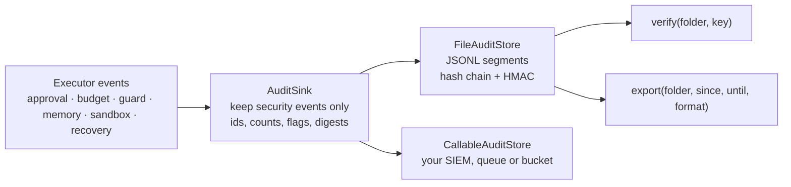

# Audit log

`agent_adapter.audit` keeps a signed, tamper-evident record of the security-relevant
things your agents did: approvals asked, decided and used, denials, guardrail blocks,
budget stops, memory adds, deletes and exports, sandbox runs and recovered runs.
It never records arguments, results, prompts or memory text. An auditor can check that
nothing was edited, removed, reordered or cut, and export a time window as CSV.



| File | Does |
|---|---|
| `audit/sink.py` | `AuditSink`, `audit(executor, folder=, key=, fail_closed=)` |
| `audit/_writer.py` | the writer thread and its bounded queue |
| `audit/_actions.py` | which events count, and what each record keeps |
| `audit/_scrub.py` | short scalars only; secrets and PII masked; identities as digests |
| `audit/_chain.py` | canonical JSON, the key, HMACs, the hash chain |
| `audit/store.py` | `FileAuditStore` and the `AuditStore` port |
| `audit/callable.py` | `CallableAuditStore`: ship each record to your function |
| `audit/verify.py` | `verify`, `read_entries`, `verify_records` (all streaming) |
| `audit/export.py` | `export`, `export_to` as JSONL or CSV |
| `audit/errors.py` | `AuditUnavailable` (strict mode) |
| `cli/audit.py` | `agent-adapter audit verify` and `audit export` |

## Attach it

```python
--8<-- "examples/audit_log.py:attach"
```

The key signs every record. Pass `key=` or set `AA_AUDIT_KEY` (16 bytes or more; keep it
in a secret manager, not in code). Without a key `audit()` refuses to start. `emit` only
queues: a writer thread stores each record, so the event loop never waits on the disk.
Strict mode, cost and limits: [Audit log in production](audit-operations.md).

## What is recorded

| Action | From | Keeps |
|---|---|---|
| `approval.requested` / `decided` / `consumed` | the approval step and the call that used it | tool, approval id, approved, `edited` (never the edited values) |
| `approval.denied` | a denial, or no approval port | tool, approval id |
| `approval.expired` | a chat approval nobody decided in time or a stopped turn; a Redis or DynamoDB TTL that ran out, seen when `executor.resume` meets it | tool (if known), approval id, outcome |
| `guardrail.blocked` | a blocked tool or model call | tool or model, stage |
| `guardrail.redacted` | a guard that rewrote a result or reply | guard, stage, count, kinds (`email`, `card`) |
| `limits.exceeded` | `RunLimits` stopping a call | tool |
| `budget.reserved` / `warning` / `exceeded` | `BudgetHook` | scope, window, amounts |
| `memory.added` / `deleted` / `exported` | any memory backend | backend, count, scope kind (`user+session`, never ids) |
| `sandbox.started` / `finished` / `failed` | any sandbox | backend, sizes, exit code |
| `checkpoint.recovered` | `recover` of a flow or tool loop | step, replayed, rerun |
| `app.<name>` | your own `ctx.emit("audit.<name>", ...)` | every key, cleaned; `source: "app"` |

Every value is cleaned: content keys are dropped, secret-named keys become `***`, emails,
phone and card numbers and API keys in text are masked, and names of people or teams
(`user_id`, `team`, `scope`, ...) become a keyed digest. With the key you can check
whether a digest belongs to a given user; without it nobody can reverse it.

Only first-party events make first-party actions, and each record carries a signed
`source` (`sdk` or `app`). Your own events always become `app.<name>`, so
`ctx.emit("audit.approval.decided")` is recorded as `app.approval.decided`, never as a
decision. Other `custom.*` events are not recorded.

## Verify and export

```python
--8<-- "examples/audit_log.py:verify"
```

```bash
export AA_AUDIT_KEY=...   # the key is read from the environment, never the command line
agent-adapter audit verify .agent_adapter/audit
agent-adapter audit export .agent_adapter/audit --since 2026-11-01 --format csv --out audit.csv
```

`verify` exits 1 when anything is wrong, and lists each problem. `export` refuses a log
that does not verify. JSONL export keeps each signed line byte for byte; CSV cells that a
spreadsheet would run as a formula are quoted.

Everything streams: `verify` reads one line at a time, and `read_entries(folder, key)` and
`export_to(out, folder, ...)` check the whole log first, then yield or write records one
segment at a time. Memory stays flat however large the log grows.

## Catch a change

```python
--8<-- "examples/audit_log.py:tamper"
```

## How tampering shows

- **Edits.** Each record carries an HMAC-SHA256 over its canonical JSON. Changing a byte,
  or re-signing without the key, fails it.
- **Deletions and reordering.** Each record has a `seq` and the SHA-256 of the record
  before it. A gap, a swap or a removed record breaks the chain.
- **Truncation.** Each segment opens with an `open` record and ends with a signed `seal`
  (record count). `audit.head` holds the signed end of the whole chain, so cutting the
  tail, or removing the last segments, shows.
- **Restart.** Opening a folder checks its last segment against the head and continues
  the chain. A folder that does not check out, or another key, is refused. One writer per
  folder (an OS lock).
- **Rollback and swaps.** An older copy of a folder still verifies on its own. Keep the
  `anchor` that `verify` prints somewhere the host cannot change, and pass it later
  (`--anchor`): a log that ends before it, or another log, fails.

Segments rotate at `max_bytes` (10 MB) and at each new UTC day.

## What auditors get

- One line per security event: what, when (UTC), which run and call, and safe details.
- Proof of integrity: `agent-adapter audit verify` passes only when every record, the
  chain, the seals and the head agree with the operator's key; with `--anchor`, also that
  the log was not rolled back or replaced.
- A CSV or JSONL export of any time window, each row still carrying its `prev` hash and
  `mac`.
- No secrets, no personal data, no prompts or tool arguments: the log can be shared with
  an auditor as it is.

Limits, strict mode and shipping records off the host: [Audit log in production](audit-operations.md).
