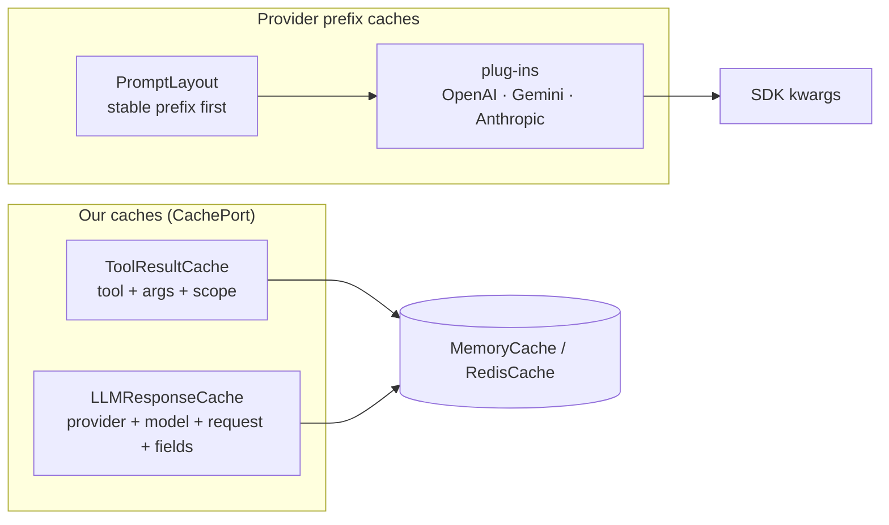

# Cache

`agent_adapter.cache` saves money and time at four layers. Backends (`CachePort`: async
`get`, `set(key, value, ttl)`, `delete`) store bytes; the typed caches put versioned JSON
envelopes in them (never pickle); the prompt layout and provider plug-ins make the
providers' own prefix caches hit.



## Backends

```python
--8<-- "examples/cache.py:memory"
```

```python
--8<-- "examples/cache.py:redis"
```

| | `MemoryCache` | `RedisCache` (extra `redis`) |
|---|---|---|
| Constructor | `(*, max_entries=10_000, clock=time.monotonic)` | `(url=None, *, client_factory=None, prefix="", socket_timeout=5.0, retries=3)` |
| Storage | LRU `OrderedDict` in this process; thread-safe | `redis.asyncio`, one client per event loop (`LoopLocal`) |
| TTL | seconds on `clock`; when full, expired entries are purged (at most once per `max_entries` sets), then LRU | `SET ... EX ceil(ttl)` |
| `ttl <= 0` (incl. `-inf`) / `inf`, `nan` | deletes the key / never expires | deletes the key / never expires |
| Failures | none | `RedisError` → `WARNING`, a miss / no-op; logs name keys by an 8-character digest, never the URL |
| Errors | `ConfigError` for `max_entries < 1` | `ConfigError` unless exactly one of `url` / `client_factory`, or for a malformed URL; `MissingDependency` without `redis` |

A URL client uses `socket_timeout` for connect and read and retries connection errors and
timeouts `retries` times with jittered backoff. `client_factory` builds your own client,
once per loop. `run_sync` closes each loop's client; `await cache.aclose()` the current one.

## LLM response cache

```python
--8<-- "examples/cache.py:llm_cache"
```

| Rule | Detail |
|---|---|
| Key | `{ns}:llm:v1:{provider}:{model}:{digest}` over the request (minus `stream`, `stage`, `response_cache`, `metadata`) and `fields` (the port's `cache_key_fields()`, incl. its plug-in options) |
| Hit | the stored `LLMResponse` with `cached=True`, `latency_ms=0` |
| Not stored | `finish_reason == "error"`, responses that are already hits, non-JSON `parsed` values |
| Opt out | `LLMRequest(response_cache=False)` is neither read nor stored |
| Failures | any backend exception → `WARNING`, a miss / not stored |

## Prompt layout

Providers cache the longest repeated prefix. `PromptLayout` keeps everything stable in the
system turn and everything per-request in the last user turn.

```python
--8<-- "examples/cache.py:layout"
```

| Member | Returns |
|---|---|
| `system_text()` | `static`, then each non-empty section, joined by blank lines |
| `messages(user=None, *, history=())` | system turn (`cache_breakpoint=True`), `history`, then `dynamic` and `user` as one user turn; empty parts are left out |
| `prefix_digest()` | `digest(system_text())`; changes exactly when the cacheable prefix changes |
| `with_static(text)`, `with_section(name, text)` | a new layout (sections keep their position when replaced) |

## Provider plug-ins

`agent_adapter.cache.providers` holds one `PromptCachePlugin` per provider caching style.
A model port calls `await plugin.apply(request, kwargs, model=..., client=...)` and sends
the returned kwargs. Plug-ins never import an SDK, never edit the kwargs in place, keep
values the kwargs already hold, and never raise for an unsupported model (they log
`DEBUG` and return the kwargs unchanged).

```python
--8<-- "examples/cache.py:plugins"
```

| Plug-in | Sets | Needs (`ModelCaps`) |
|---|---|---|
| `OpenAIPromptCache(*, key=None, retention=None, caps=None)` | `prompt_cache_key` (default: digest of the system text), `prompt_cache_retention` (`in_memory` / `24h`) | `prompt_cache_key`; `24h` also `prompt_cache_retention_24h` |
| `OpenAIPromptCacheV2(*, mode="implicit", ttl="30m", key=None, caps=None)` | `prompt_cache_options={mode, ttl}`, `prompt_cache_key`; in `explicit` mode `prompt_cache_breakpoint` on each `cache_breakpoint` message | `prompt_cache_options` |
| `GeminiExplicitCache(*, ttl_s=3600, store=None, caps=None)` | `config.cached_content`; moves `system_instruction`, `tools`, `tool_config` into the cache | `explicit_cache`, prefix ≥ `min_cache_tokens` (chars / 4) |
| `GeminiImplicitCache()` | nothing: Gemini 2.5+ caches repeated prefixes itself | — |
| `AnthropicPromptCache(*, ttl="5m", on=("system", "tools"), caps=None)` | `cache_control={"type": "ephemeral", "ttl"}` on the last system block, the last tool, and (`"breakpoints"`) each `cache_breakpoint` message | `cache_control` |

**Capabilities.** `caps` is a `Callable[[str], ModelCaps]` (`agent_adapter.models.ModelCaps`).
Without it the flags come from the packaged price table (`Prices.default().caps`); an unknown
model gets `ModelCaps()`, so every gated parameter stays off and a plug-in never sends one a
model would reject. Pass your own function or `caps=Prices.load(...).caps`. `key_fields()`
returns the constructor options (not the computed key); ports add them to the LLM cache key.

**Anthropic.** At most four `cache_control` markers per request (the API limit), counting
the host's; the latest win, as each caches the whole prefix before it. Host markers with
another TTL leave the request unchanged (longer TTLs must come first). Messages are matched
to wire blocks by content (a reply split into text blocks: the last), so turns may merge.

**OpenAI v2.** In `explicit` mode breakpoints go on user, system and tool-result text
blocks (Chat `content`, Responses `content` / `function_call_output.output`); assistant
outputs and Responses `instructions` cannot. At most four (host ones count); the latest win.
With none placed, it falls back to implicit (`mode` omitted), one `WARNING` per plug-in.

### Gemini explicit cache

```mermaid
sequenceDiagram
  participant P as port
  participant G as GeminiExplicitCache
  participant S as store (CachePort)
  participant API as client.aio.caches
  P->>G: apply(request, kwargs, model, client)
  G->>S: get {ns}:gcache:v1:{model}:{prefix_digest}
  alt name stored
    S-->>G: cachedContents/…
  else first use (one creation in flight per key; waiters share it)
    G->>API: create(model, system_instruction, tools, ttl)
    API-->>G: name, usage_metadata
    G->>S: set name (ttl_s minus a margin)
    G-->>G: ledger: api entry "{model}:cache_storage"
  end
  G-->>P: config without the prefix, cached_content=name
```

- `store` defaults to a private `MemoryCache`; a shared `RedisCache` lets processes reuse
  one cached content. Use one store (or prefix) per Gemini project / API key: names are
  only valid there. A name is forgotten `min(60 s, 10 %)` before Gemini expires it.
- Each creation records `LedgerEntry(kind="api", provider="gemini",
  model=f"{model}:cache_storage", units=tokens × ttl_s / 3600 / 1e6)` through
  `current_context().ledger` (skipped without a context or ledger). The full TTL is billed
  up front; `metadata` holds the cache name and token count.
- A failed `caches.create` logs one `WARNING`; requests go out unchanged and creation is
  not retried for `min(ttl_s, 300 s)`.

## Files

| File | Does |
|---|---|
| `cache/memory.py`, `redis.py` | `MemoryCache`, `RedisCache` (imports `redis` lazily) |
| `cache/llm_cache.py`, `layout.py` | `LLMResponseCache`, `PromptLayout` |
| `cache/providers/` | the plug-ins; `_base.py` holds caps lookup and wire-block matching |
| `cache/keys.py`, `codec.py`, `tool_cache.py` | keys, envelopes and the tool-result cache ([Runtime](runtime.md#cache-keys)) |

This page's code is `examples/cache.py`; the test suite runs it.
