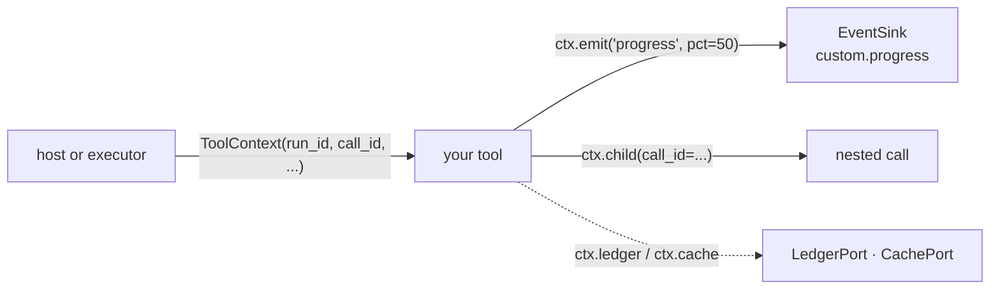

# Context, events and ports

A tool that declares a `ToolContext` parameter gets one at call time. The parameter never
appears in the schema the model sees. The context carries the run's ids and the ports the
host wired in: ledger, cache, event sink and a pre-approval.



## Fields

Order is fixed: the first four are the 0.1.0 positional fields.

| Field | Type | Holds |
|---|---|---|
| `run_id` | `str` | the run this call belongs to |
| `call_id` | `str` | this call |
| `state` | `Mapping[str, Any]` | read-mostly data the host provides |
| `extras` | `dict[str, Any]` | framework-native context; keys starting `aa.` are reserved |
| `thread_id` | `str` | conversation or session id (thread-scoped cache and budgets) |
| `ledger` | `LedgerPort \| None` | cost ledger |
| `cache` | `CachePort \| None` | byte cache |
| `sink` | `EventSink \| None` | trace events |
| `approval` | `ApprovalDecision \| None` | the caller's own decision, or an adapter-issued one-use token; it covers one call of `run` / `run_spec` / `run_call`, never nested or loop calls ([Approval](approval.md)) |

With no `ctx` passed, the tool gets an empty `ToolContext()`. The executor fills the
ports.

## In a tool

```python
--8<-- "examples/context.py:tool"
```

```python
--8<-- "examples/context.py:call"
```

| Method | Does |
|---|---|
| `emit(type, /, **data)` | sends `Event("custom.<type>", run_id, call_id, data)` to `sink`; no-op without one; a failing sink is logged, never raised |
| `child(*, call_id, **changes)` | a copy for a nested call: `extras` copied, `approval` not inherited unless passed |

## Events

Every event is an `Event(type, run_id, call_id, parent_id, ts, data)`. Types outside the
`custom.` namespace come from a fixed catalogue (`agent_adapter.tracing.EventType`);
`REQUIRED_DATA` lists the `data` keys each type must carry.

| Group | Types |
|---|---|
| Run | `run.started`, `run.finished` |
| Tool | `tool.started`, `tool.finished`, `tool.failed`, `tool.retry`, `tool.cached`, `tool.pending` |
| Approval | `approval.requested`, `approval.decided` |
| LLM | `llm.started`, `llm.finished`, `llm.cached`, `llm.failed`, `llm.fallback` |
| Embeddings | `embedding.started`, `embedding.finished`, `embedding.failed` |
| Memory | `memory.added`, `memory.searched`, `memory.deleted`, `memory.exported` ([counts only](memory.md)) |
| Retrieval | `retrieval.searched`, `retrieval.failed` (ids and counts; texts only with `capture_content`) |
| Sandbox | `sandbox.started`, `sandbox.finished`, `sandbox.failed` (sizes and exit codes; code and output only with `capture_content`) |
| Reranking | `rerank.started`, `rerank.finished`, `rerank.failed` (`CallableReranker`) |
| Context compression | `context.compressed`, `context.compress_failed` ([counts only](context-compression.md#errors-events-and-cost)) |
| Flow | `flow.started`, `flow.finished`, `node.started`, `node.finished`, `node.failed`, `node.paused`, `node.cached`; durable runs: `checkpoint.saved`, `run.recovered` |
| Budget | `budget.warning`, `budget.reserved`, `budget.exceeded` |

`make_event(type, ctx, *, call_id=None, **data)` builds one and rejects an unknown type
or missing keys (`ToolUsageError`). Given an explicit `call_id`, the context's own call
becomes `parent_id`. `tracing.emit(sink, event)` sends it and logs sink failures.

## Errors as data

`ErrorInfo.from_exception(exc)` turns an exception into a JSON-safe record. It is what
`ToolResult.error` holds and what the HTTP server returns.

```python
--8<-- "examples/context.py:error"
```

| Field | Value |
|---|---|
| `kind` | the error's stable id (`tool-error`, ...); `internal-error` for foreign exceptions |
| `message` | `str(exc)` for adapter errors; only the class name for others (no leaked values) |
| `exception` | qualified class name |
| `retryable` | the class's `retryable` flag; `True` for foreign exceptions |
| `details` | `ToolError.details`, `ToolArgsInvalid.errors`, `ApprovalPending.approval_id`, `ToolFailed.cause_type`; made JSON-safe (unknown objects become `str(obj)`) |

## Ports

Ports are `typing.Protocol`s. Any object with the methods fits; no base class needed.
Import a port from its home only to annotate or `isinstance`-check against it.

| Port | Home | Methods | Rule |
|---|---|---|---|
| `CachePort` | `agent_adapter.cache` | `get`, `set(key, value, ttl)`, `delete` (async, bytes) | backend failures log and act as a miss |
| `LedgerPort` | `agent_adapter.cost` | `record`, `total_usd(run_id, *, thread_id)`, `entries(...)` | `record` idempotent on `(run_id, entry_id)`, never raises |
| `EventSink` | `agent_adapter.tracing` | `emit(event)` | sync, quick, never raises |
| `ApprovalPort` | `agent_adapter.approval` | `request(ApprovalRequest) -> ApprovalDecision` | may raise `ApprovalPending` |
| `LLMPort` | `agent_adapter.models` | `generate`, `stream`, `cache_key_fields` | raises `ModelError` subclasses |
| `PromptCachePlugin` | `agent_adapter.models` | `key_fields`, `apply(request, kwargs, *, model, client)` | edits SDK kwargs |
| `EmbeddingPort` | `agent_adapter.embeddings` | `provider`, `model`, `embed(texts, *, ctx=None)` | raises `ModelError` subclasses |

The value types they exchange (`LedgerEntry`, `Usage`, `ApprovalRequest`,
`ApprovalDecision`, `LLMRequest`, `LLMResponse`, `Message`, `ToolDef`) are frozen pydantic
models; import them from `agent_adapter`.

This page's code is `examples/context.py`. The test suite runs it.
