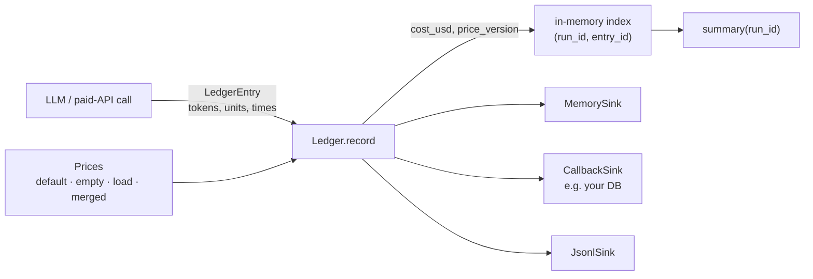

# Cost: prices and the ledger

`agent_adapter.cost` turns token usage into dollars. A versioned price table holds every
price; no call site hard-codes one. A ledger records one `LedgerEntry` per billable call,
prices it, and forwards it to sinks.



| File | Does |
|---|---|
| `cost/prices.py` | `Prices`, `ResolvedPrice`: resolve a model, price tokens and units, read caps |
| `cost/_table.py` | validates the table shape (strict: unknown keys are errors) |
| `cost/prices_default.json` | the packaged table: OpenAI, Gemini and Anthropic list prices and context windows (2026-11-05) |
| `cost/ledger.py` | `Ledger`: the `LedgerPort` implementation |
| `cost/sinks.py`, `cost/summary.py` | `MemorySink`, `CallbackSink`, `JsonlSink`, `read_jsonl`; `LedgerSummary`, `StageSummary` |

## Prices

```python
--8<-- "examples/cost.py:prices"
```

| Method | Returns |
|---|---|
| `Prices.default()` | the packaged table, loaded once per process |
| `Prices.empty(version="empty")` | a table with no models, to `merged()` your own into |
| `Prices.load(dict \| path)` | a table; `ConfigError` on a bad file, bad JSON or bad shape |
| `merged(overrides)` | a new table; each model, alias and unit in `overrides` replaces the whole entry. Version becomes `"<base>+<override>"` (`+custom` when the override has none) |
| `resolve(model)` | the key `caps()` reads: exact name, then alias, then longest match (see below); `None` if unknown. `price()` skips caps-only entries |
| `price(model, *, at, prompt_tokens)` | `ResolvedPrice` (USD per 1M tokens) for that date and prompt size, or `None` |
| `cost(model, usage, *, at, seconds=0, attempts=1)` | USD for one call, or `None` for an unknown or caps-only model |
| `unit_cost(item, units, *, at)` | USD for `"provider:model"` units, or `"provider:model:cache_storage"` (Gemini explicit-cache storage, units = 1M token-hours; 0 for a free model) |
| `caps(model)` | `ModelCaps`; defaults for an unknown model |

An unknown model, a missing unit price or a date outside every period gives `None` and
one `WARNING` per process. `at` defaults to today (UTC). `version` is read-only. A prefix
match counts only when the rest of the id is a snapshot suffix, so a variant without its
own row is unknown rather than priced at its base model's rates:

| Id | Resolves to |
|---|---|
| `gpt-4.1-2025-04-14`, `gpt-4.1-20250414`, `gpt-4-0613`-style `-NNN…` (3+ digits), `gemini-2.5-flash-001`, `-latest` | the base row |
| `gpt-5.6-luna`, `gpt-5-pro`, `gpt-5-nano`, `gpt-4.1-nano`, `gpt-5-1`, `claude-opus-4-5` (vs a `claude-opus-4` row) | not that row: unknown (no cost, no caps), or a family below |
| anything starting `claude-` | `claude-`: a caps-only key ending in `-` names a whole family. A priced family key is a `ConfigError` (in the default table, `load()` and `merged()`) |
| `acme-13b`, with an `acme-*` key | the [pattern](#your-own-models). Longest match wins; on a tie, row, then pattern, then family |

### The formula

```text
cost = ( input_tokens        · input
       + cached_input_tokens · cached_input
       + Σ cache_write_by_ttl[ttl] · cache_write_by_ttl price (else cache_write)
       + unlabelled cache writes   · cache_write
       + output_tokens       · output ) / 1e6
       + per_call · attempts + per_second · seconds
       + units · per_unit        # from units["provider:model"]; a free entry costs 0
```

`input_tokens` excludes cached and cache-write tokens, so each prompt token is billed once.
The tier is chosen by all prompt tokens: a cached prefix counts toward Gemini Pro's 200k.

### Table format

A table has `version` (required in a full table), `currency` (`"USD"`), `unit`
(`"per_1M_tokens"`), `aliases`, `models`, `units` and `note`. An override has only changes:

```python
--8<-- "examples/cost.py:override"
```

| Model field | Meaning |
|---|---|
| `provider`; `input`, `output` | required; flat prices, both needed when any flat price is set |
| `cached_input`, `cache_write`; `cache_write_by_ttl` | default to `input`; e.g. `{"5m": 3.75, "1h": 6.00}` |
| `tiers`; `periods` | prices plus `max_prompt_tokens`, ascending, the last `null` (no limit); prices or `tiers` plus `from` / `until` ISO dates (inclusive, UTC), no overlaps |
| `cache_storage_per_hour` | USD per 1M token-hours; also allowed per period |
| `per_call`, `per_second`, `free` | USD per call; per second of call time; `true`: costs 0, never warns, no other price. Also per period |
| `caps`; `source`; `note` | `ModelCaps` flags (unknown flags are errors), e.g. `{"context_window": 128000, "max_output_tokens": 16384}` for [compression](context-compression.md#the-policy); where the row was read (a URL); free text |

An entry with only `caps` is **caps-only**: it gives `caps()` but never blocks a price, so
`price()` uses the next match (e.g. your `"*"`) or returns `None`. The packaged `claude-`
entry is caps-only, for Claude ids without a row. Every other packaged row but `gpt-5.6`
has its vendor's `context_window` and `max_output_tokens`, read from the page in `source`.

## Your own models

The adapter does not care which model runs. Price yours in your own table:

```python
--8<-- "examples/cost_own_models.py:own"
```

| Rule | Detail |
|---|---|
| Pattern key | ends in `*`: `acme-gpu-*` matches any id starting `acme-gpu-`; `"*"` any id no priced key matches. `*` may only end a key; aliases are exact; an exact priced name or alias always wins |
| `units` keys | the same patterns (`"voyage:*"`, `"*"`) and `free: true` (no `per_unit`); exact first, then longest. Embeddings and rerank are priced here. A pattern model's units use the id called |
| `per_call` | × `entry.attempts` (at least 1). Model calls record 1: retries inside a provider SDK are not seen, and each fallback hop is its own entry. An entry you record with more pays per attempt |
| `per_second` | × seconds inside the port for a model call (not hooks, the response cache, or a stream consumer's pauses); `latency_ms / 1000` for an entry you record. Bad input: negative or non-finite `seconds`, or `attempts` < 1, is a `ConfigError` (only for a model priced by it); the ledger logs it and leaves the cost unknown |

```python
--8<-- "examples/cost_own_models.py:start"
```

## Ledger

```python
--8<-- "examples/cost.py:ledger"
```

`record(entry)` never raises. When `cost_usd` is `None` it prices the entry:

| `kind` | Priced with | Date |
|---|---|---|
| `llm` | `prices.cost(model, usage, seconds=latency_ms / 1000, attempts=attempts)`; a model call arrives priced with its port time; `0.0` when `cache_hit` (served from the response cache; no price looked up, so `price_version` stays empty) | `started_at` (UTC), today when 0 |
| `api` | `prices.unit_cost(f"{provider}:{model}", units)` | same |
| `tool` | not priced (the executor records `cost_usd=0.0`) | — |

A table-priced entry gets `price_version`; a given `cost_usd` is kept. The same
`(run_id, entry_id)` replaces the old entry, so a re-run node never double-counts. Runs
beyond `max_runs` (default 1000) are evicted, least recently recorded first. A failing
sink is logged at `WARNING`; the others still get it. `prices`, `sinks`, `max_runs` are read-only.

| Method | Does |
|---|---|
| `entries(run_id=None, *, thread_id=None)` | grouped by run, least recently recorded run first; first-record order within a run; both filters apply together |
| `total_usd(...)` | sum of known costs; unknown counts as 0 |
| `summary(run_id=None)`; `clear(run_id=None)` | `LedgerSummary`; forget one run or all (sinks untouched) |

## Sinks and summary

| Sink | Writes |
|---|---|
| `MemorySink()`; `CallbackSink(fn)` | appends to `.entries` (duplicates kept); calls `fn(entry)` |
| `JsonlSink(path)` | one UTF-8 JSON line per entry, flushed per write, thread-safe |
| `read_jsonl(path)` | reads it back; the last line per `(run_id, entry_id)` wins. A torn last line (crash mid-write) is skipped with a `WARNING`; a bad line elsewhere is a `ConfigError` |

| `LedgerSummary` field | Value |
|---|---|
| `total_usd`, `unknown_cost_entries`; `by_stage`, `by_kind` | known cost; entries whose cost is `None`; `StageSummary`: calls, cost, token sums, latency, errors |
| `prompt_cache_hit_rate` | Σ cached input / Σ prompt tokens, `llm` entries |
| `response_cache_hit_rate`, `tool_cache_hit_rate` | share of `llm` / `tool` entries with `cache_hit` |
| `wall_ms`; `busy_ms`, `parallelism` | last `ended_at` − first `started_at` (entries with both times); Σ `llm` + `tool` latency, `busy_ms / wall_ms` |

This page's code is `examples/cost.py` and `examples/cost_own_models.py`. The test suite runs both.
