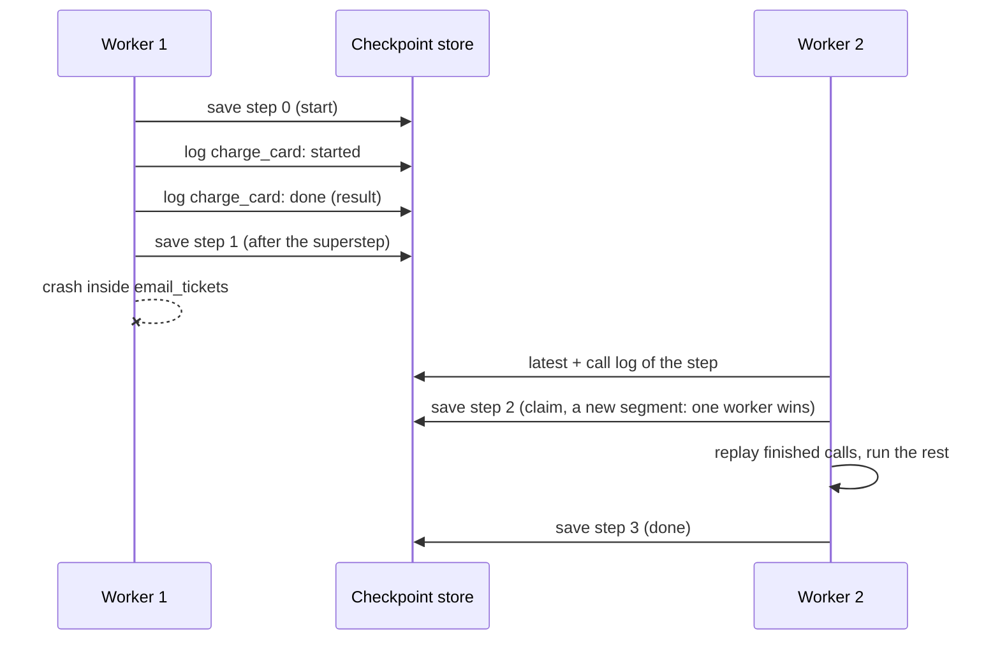

# Durable runs

A durable run survives its worker. Give `FlowRunner` (or `run_tool_loop`) a checkpoint
store. After a crash, a new worker calls `recover` and the run goes on from its last
checkpoint. Tool calls that finished before the crash are not run again: their results
replay from the store.



## A durable flow

```python
--8<-- "examples/durable_flow.py:flow"
```

```python
--8<-- "examples/durable_flow.py:recover"
```

- Every superstep ends with a checkpoint signed (HMAC) with `checkpoint_key`: state,
  frontier, visits, the graph digest, and the row's run id, step, status and segment. Use
  the same key on every worker.
- Every tool call is logged twice, each record signed and numbered: `started` before it can
  run, then `done` (its result), `pending` or `unrecordable`. A changed, forged or missing
  record (a gap in the numbers) is `CheckpointStoreCorrupt`.
- `recover(flow, run_id)` reruns the superstep that was cut short. Node code runs again, so
  keep it and the tool arguments deterministic: a call whose arguments changed does not
  replay; it runs again and `checkpoint.saved` reports it as `unreplayed`.
- The run's end user, thread and principal are signed into each checkpoint. `recover`
  without a `ctx` restores the user and thread; a `ctx` for anyone else is refused. A run
  that had a principal needs its `ctx` back (`recover_all` reports it).
- `recover_all(flow)` recovers every unfinished run of the flow, for a worker on startup.
  It maps each run id to its result or to the error that stopped it.

## Calls in doubt

A call logged `started` with no result may or may not have run. Recovery fails closed:

| The call's tool | On recovery |
|---|---|
| `idempotent=True` | runs again |
| anything else | `RecoveryNeedsDecision`, with `.calls` as `(tool, why)` pairs |

Check those calls at their system (was the mail sent? the card charged?). Then recover
with `rerun_in_doubt=True`, or fix the state by hand. A call whose result could not be
stored (an unsealable value) counts as in doubt too. A crash while a call waits on a
synchronous approval port also leaves it in doubt.

## Approvals

A run that was paused for an approval is not crashed: its checkpoint says `paused`, and
`recover` gives it back as a paused result. Resume it as usual. With a store, `resume`
checks that the checkpoint is the run's latest one, stores the decision with the next
checkpoint (one resume wins that step), and only then spends it. A crash before that save
leaves the run paused and resumable; a crash after it is recovered by spending the stored
decision then.

## Two workers

`save(run_id, step, checkpoint)` is a compare-and-set: step 0 for a new run, else exactly
one past the stored step. A recovering worker first claims the next step with a new call
log segment. If two workers race, one wins and the other gets `CheckpointConflict` before
it runs anything. A slow worker that was cut off is fenced: its next `started` write is
refused, so it starts no new call, and its next save conflicts.

A call that is already running on the cut-off worker cannot be stopped. Pass
`idempotency_key()` (from `agent_adapter.exec.checkpoints`) to any external API that takes
one, such as a payment or mail API: the key is the same for the call on every worker and
after every recovery, so the API applies it once.

## The tool loop

```python
result = await run_tool_loop(
    model, registry, messages, run_id="chat-42",
    checkpoints=store, checkpoint_key=KEY,
)
# after a crash, on any worker:
result = await recover_tool_loop(
    model, registry, "chat-42", checkpoints=store, checkpoint_key=KEY,
)
```

The history is saved after each model reply (so its tool calls are pinned) and after the
tool results. `max_steps` counts the model calls of the whole run. A loop paused for an
approval resumes through `run_tool_loop` with the same `run_id`.

## Stores

| Store | Import from `agent_adapter.exec.checkpoints` | Needs |
|---|---|---|
| memory | `MemoryCheckpointStore()` | nothing; one process only |
| SQLite | `SQLiteCheckpointStore(path)` | nothing; every process on one host |
| Redis | `RedisCheckpointStore(lambda: Redis.from_url(url))` | `agent-adapter[redis]` |
| SQL | `SQLAlchemyCheckpointStore("postgresql+asyncpg://...")` | `agent-adapter[sqlalchemy]` |

Redis keys expire `ttl_s` after a run's last write, except while it is paused. The SQL
store supports Postgres and SQLite. Give each tenant its own store, prefix or table, and
use run ids nobody can guess: a run id is the only key a shared store has.

Any other store implements the `CheckpointStore` protocol: `save`, `latest`,
`list_unfinished`, `delete`, `record_call`, `calls`. A store other than the memory one
needs `checkpoint_key=`, so another process can check what it reads.

## Errors

| Error | When |
|---|---|
| `CheckpointNotFound` | nothing is stored for the run id |
| `CheckpointConflict` | another worker holds the run, it ended, or it is another flow's |
| `CheckpointStoreCorrupt` | a row is unreadable, or the signature does not match |
| `RecoveryNeedsDecision` | a call is in doubt and its tool is not idempotent |
| `FlowError` | the flow's graph changed since the checkpoint was saved |

## Events

| Event | Data |
|---|---|
| `checkpoint.saved` | `kind` (`flow` or `loop`), `step`, `status`, and `flow` or `stage` |
| `run.recovered` | `kind`, `step`, `replayed` (calls), `rerun` (calls in doubt) |

The run viewer marks a run that has a `run.recovered` event as recovered.

## Files

| File | Does |
|---|---|
| `exec/checkpoints/` | the store port and its four backends |
| `exec/_durable.py` | the call log, replay seeds, in-doubt checks |
| `exec/_durable_seal.py` | signing: the checkpoint envelope, each call, the run's identity |
| `exec/_durable_loop.py` | tool loop checkpoints and recovery |
| `flow/_durable.py`, `flow/_recover.py` | flow checkpoints per superstep, recovery, resume |
