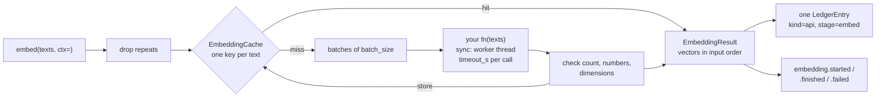

# Embeddings

`agent_adapter.embeddings` turns texts into vectors with **your** embedding model. You
write the function (local or remote, any library). The adapter adds batching, a per-text
cache, one ledger entry and trace events per call, typed errors, and logs that never hold
your texts.



| File | Does |
|---|---|
| `embeddings/port.py` | `EmbeddingPort` (the protocol) and `EmbeddingResult` |
| `embeddings/callable.py` | `CallableEmbedder`: your function as an `EmbeddingPort` |
| `embeddings/cache.py` | `EmbeddingCache` and `embed_key`: one vector per text over any `CachePort` |
| `embeddings/_record.py` | the call's ledger entry id, ledger entry and trace events |

Texts enter through `embed()`. They leave only to your `fn` and, as digests, to cache
keys. Vectors leave in the `EmbeddingResult` and the cache. Counts and costs go to the
ledger and the event sink.

## Your function

```python
--8<-- "examples/embeddings.py:fn"
```

`fn(texts)` gets a `list[str]` and may be sync or async. It returns either:

| Return | Meaning |
|---|---|
| rows of numbers (lists, tuples, or an array with `tolist()`) | one vector per text, in order |
| `EmbeddingResult(vectors=..., model=..., usage=...)` | vectors plus the model name it ran and its `Usage` |

A sync `fn` runs in a worker thread (`asyncio.to_thread`), so it does not block the
event loop. It sees the caller's contextvars, including the current `ToolContext`.

## Wire it up

```python
--8<-- "examples/embeddings.py:wire"
```

`CallableEmbedder(fn, *, model="host", provider="callable", batch_size=64, timeout_s=None,
cache=None, cache_ttl=None, namespace="aa", ledger=None, sink=None)`

| Option | Does |
|---|---|
| `model`, `provider` | name the vectors (cache key) and the ledger entry |
| `batch_size` | at most this many texts per `fn` call; batches run one after another |
| `timeout_s` | bounds each `fn` call; a timed-out thread is left to finish, not stopped |
| `cache`, `cache_ttl`, `namespace` | any `CachePort` (`MemoryCache`, `RedisCache`); TTL in seconds |
| `ledger`, `sink` | a `LedgerPort` and an `EventSink`; without them the context's are used, if any |

`embed(texts, *, ctx=None)` returns an `EmbeddingResult`:

| Field | Holds |
|---|---|
| `vectors` | tuples of finite floats, one per input text, in input order |
| `model` | the model `fn` reported, else the configured `model` |
| `usage` | `Usage` summed over the batches that ran (cache hits add nothing) |
| `cache_hits` | how many input texts came from the cache |

A repeated text is embedded once and its vector is copied to every position. An empty
`texts` returns no vectors, calls nothing and records nothing.

## Cache

| Rule | Detail |
|---|---|
| Key | `{namespace}:embed:v1:{provider}:{model}:{digest([provider, model, text])}`; the digest covers the names, so a `:` in them cannot collide |
| Value | a versioned JSON envelope (`cache.codec`), never pickle |
| Stored | after each batch is checked, so a later failure keeps what was paid for and a bad batch is never stored |
| Failures | a backend error is a `WARNING` and a miss; a bad entry is a miss |
| Model change | rename `model` when `fn` changes, or same-size old vectors are served |

The first fresh batch sets the dimension: stale cached vectors of another one are embedded
again and overwritten (`WARNING`). Any other mismatch raises `ModelOutputInvalid` unstored.

## Ledger

Each `embed()` call records **one** `LedgerEntry`, priced like any paid API:

| Field | Value |
|---|---|
| `kind`, `stage` | `"api"`, `"embed"` |
| `entry_id` | `{call or run id}:embed:{n}`, numbered per context |
| `input_tokens` | from the `fn`'s `Usage` |
| `units` | the `fn`'s `units`, else `input_tokens / 1_000_000` |
| `cost_usd` | `prices.unit_cost("provider:model", units)`; `0.0` when every text was a cache hit |
| `cache_hit` | `True` when no batch ran |
| `metadata` | `texts`, `batches`, `cache_hits` counts and `parent_call_id`; never texts |

Add a unit price (USD per 1M tokens) under `units` for `"provider:model"`, a
`"provider:*"` pattern, or `"free": true` for a model on your own box. Without one, the cost stays unknown and the
ledger warns once. The context comes from `ctx=`, else the current `ToolContext` (so an
embed inside a tool lands in that run), else a fresh run.

A failure records an entry with `ok=False` and the error kind. Cost is unknown when a
batch was already paid, else `0.0`. A cancelled call records one only after a paid batch.

## Events

Each call sends events to `sink` (else the context's), like an instrumented LLM call. The
event `call_id` is the ledger `entry_id`; `parent_id` is the context's call.

| Event | Data (counts only, never texts) |
|---|---|
| `embedding.started` | `provider`, `model`, `stage`, `texts` |
| `embedding.finished` | the above plus `cache_hits`, `batches`, `latency_ms`, `usage`, `units`, `cost_usd`, `response_model` |
| `embedding.failed` | the above `provider` … `texts` plus `error_kind` (`"cancelled"` too), `latency_ms` |

`cost_usd` is the ledger's unit price (`None` without a priced ledger, `0.0` when every
text was a cache hit). A failing sink is logged, never raised.
`OTelSink` exports each call as an `embeddings {model}` span (`gen_ai.operation.name =
"embeddings"`, input tokens, duration metric); a fully cached call has no metrics.

## Errors

```python
--8<-- "examples/embeddings.py:errors"
```

| Error | When |
|---|---|
| `ConfigError` | empty `model` / `provider`, `batch_size < 1`, `timeout_s` not finite and `> 0` |
| `ToolUsageError` | `fn` not callable; `texts` not a sequence of `str` (a lone `str` too) |
| `ModelTimeout` (retryable) | one `fn` call ran past `timeout_s`, or `fn` raised `TimeoutError` itself ("fn raised TimeoutError") |
| `ModelOutputInvalid` | wrong vector count; a value that is not an `int` or `float` (a `str` or `bool` too), NaN or infinity; an empty vector; mixed dimensions |
| `ModelError` | `fn` raised a non-adapter error; it is the `__cause__`, its text is not in the message |
| any `AdapterError` from `fn` | passes through unchanged, e.g. `ModelRateLimited` |

Import errors from `agent_adapter.errors`. Logs name the provider, model, run and counts;
the exception text stays at `DEBUG`.

## Your own port

Anything with `provider`, `model` and `async embed(texts, *, ctx=None) -> EmbeddingResult`
is an `EmbeddingPort`; `isinstance(x, EmbeddingPort)` checks the shape.
