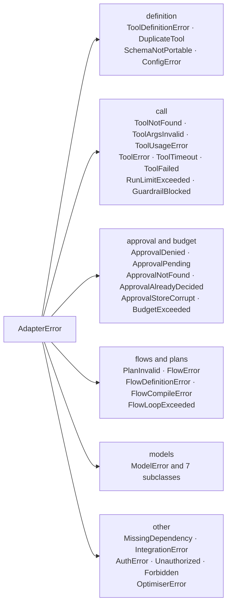

# Errors

Symptoms and fixes: [Troubleshooting](../troubleshooting.md).

Every error the adapter raises subclasses `AdapterError`. Catch the narrow type where
you can act on it. The five most caught (`AdapterError`, `ToolError`, `ApprovalDenied`,
`ApprovalPending`, `MissingDependency`) come from `agent_adapter`. Every other error, and
`ErrorInfo`, comes from `agent_adapter.errors`.



## `kind` and `retryable`

Each class has two class attributes. `kind` is a stable kebab-case id used in
`ErrorInfo`, HTTP problem types and events. `retryable` tells the executor and
`FallbackModel` that another attempt may succeed. Errors survive pickling.

| Error | `kind` | Retryable | Raised when |
|---|---|---|---|
| `AdapterError` | `internal-error` | | base class |
| `ToolDefinitionError` | `tool-definition-invalid` | | the callable or schema cannot become a tool (startup) |
| `DuplicateTool` | `duplicate-tool` | | the name is already registered (startup) |
| `SchemaNotPortable` | `schema-not-portable` | | a provider would reject the schema; `.problems`, `.tool` |
| `ToolNotFound` | `tool-not-found` | | unknown name in `get`, `remove` or `subset(names=)` |
| `ToolArgsInvalid` | `tool-args-invalid` | | the arguments fail validation; `.tool`, `.errors` |
| `ToolUsageError` (also `TypeError`) | `tool-usage-error` | | host code misused an API |
| `MissingDependency` (also `ImportError`) | `missing-dependency` | | an optional extra is missing |
| `ToolError` | `tool-error` | | raised by tool code; the message is shown to the model; `.details` |
| `ToolTimeout` (also `TimeoutError`) | `tool-timeout` | yes | a call ran past its `timeout` |
| `ToolFailed` | `tool-failed` | | a tool raised a foreign exception; `.cause_type` |
| `RunLimitExceeded` | `run-limit-exceeded` | | `once_per_run` or `max_calls` refused the call |
| `GuardrailBlocked` | `guardrail-blocked` | | a guardrail rejected args, a result or an LLM payload |
| `ApprovalDenied` / `ApprovalPending` | `approval-denied` / `approval-pending` | | a reviewer said no / will decide later |
| `ApprovalNotFound` / `ApprovalAlreadyDecided` | `approval-not-found` / `approval-already-decided` | | approval store lookups |
| `ApprovalStoreCorrupt` | `internal-error` | | a durable approval store read a corrupt or tampered row ([fails closed](approval-stores.md#failing-closed)) |
| `BudgetExceeded` | `budget-exceeded` | | spend reached the limit |
| `PlanInvalid` | `plan-invalid` | | a step plan has problems; `.problems` |
| `FlowError` and subclasses | `flow-error`, `flow-definition-invalid`, `flow-compile-failed`, `flow-loop-exceeded` | | flow runs and definitions |
| `ModelError` | `model-error` | | a provider call failed; `.provider`, `.model`, `.status_code`, `.retry_after` |
| `ModelRateLimited`, `ModelUnavailable`, `ModelTimeout` | `model-rate-limited`, `model-unavailable`, `model-timeout` | yes | 429, 5xx / overload / connection, timeout |
| `ModelAuthError`, `ModelBadRequest`, `ModelContentFiltered`, `ModelOutputInvalid` | `model-auth-failed`, `model-bad-request`, `model-content-filtered`, `model-output-invalid` | | credentials, bad request, safety filter, schema mismatch |
| `ModelContextOverflow` (a `ModelBadRequest`) | `model-context-overflow` | | too many tokens for the model; see [Context compression](context-compression.md) |
| `ConfigError` (also `ValueError`) | `config-invalid` | | invalid configuration |
| `IntegrationError` | `integration-error` | | a framework integration failed or is unknown |
| `AuthError`, `Unauthorized`, `Forbidden` | `auth-error`, `unauthorized`, `forbidden` | | HTTP server authentication |
| `OptimiserError` | `optimiser-error` | | the optimiser could not complete |

**Retry rule.** An exception is retried when it is not control flow and either is not an
`AdapterError` or its class has `retryable = True`.

## Who raises what

| Errors | Raised by |
|---|---|
| `ToolTimeout`, `ToolFailed`, `RunLimitExceeded`, `ApprovalDenied`, `ApprovalPending`, `PlanInvalid` | executor |
| `BudgetExceeded`, `GuardrailBlocked`, approval store errors | built-in hooks, approval stores |
| `ModelError` family | model ports |
| `FlowError` family | flow runner and the LangGraph / ADK compilers |
| `AuthError` family | HTTP server |

## Send argument errors back to the model

`ToolArgsInvalid.errors` is a list of JSON-safe dicts with `type`, `loc`, `msg` and,
when present, a stringified `ctx`. Input values are never kept, so it is safe to log and
safe to return to the model so it can retry.

```python
--8<-- "examples/errors.py:args"
```

```json
{"tool": "add", "errors": [
  {"type": "int_parsing", "loc": ["b"], "msg": "Input should be a valid integer, unable to parse string as an integer"},
  {"type": "extra_forbidden", "loc": ["c"], "msg": "Extra inputs are not permitted"}
]}
```

`ErrorInfo.from_exception(exc)` gives the same safety for any error; see
[Context](context.md#errors-as-data).

## Fail at startup, not mid-request

```python
--8<-- "examples/errors.py:startup"
```

```text
tag_counts ['$.counts: open map (dict) is not portable']
tool 'no_docstring' needs a description or a docstring
```

## Catch by category

```python
--8<-- "examples/errors.py:base"
```

`ToolUsageError` is also a `TypeError`, `MissingDependency` an `ImportError`,
`ToolTimeout` a `TimeoutError` and `ConfigError` a `ValueError`, so existing handlers for
those keep working.

## Logging

The adapter logs with the standard `logging` module, under `agent_adapter.*` loggers.
It never configures handlers; your app does.
Failures are logged with the exception type at `WARNING` / `ERROR`; exception text,
guardrail reasons and tracebacks only at `DEBUG`. A test scans the source for this rule. To see why a plugin failed to load, enable `DEBUG` on
`agent_adapter.integrations.discovery`.

| Logger | Level | When |
|---|---|---|
| `agent_adapter.core.registry` | `DEBUG` | a tool is registered or removed |
| `agent_adapter.core.tool` | `WARNING` | pydantic cannot describe a return type, so `result_schema()` is `None` |
| `agent_adapter.core.imported` | `DEBUG` | an imported schema is not portable |
| `agent_adapter.core.context`, `agent_adapter.tracing.events` | `WARNING` | an event sink raised |
| `agent_adapter.hooks.dispatch` | `ERROR` | a hook raised (it is re-raised) |
| `agent_adapter.integrations.discovery` | `WARNING` | a plugin entry point failed to load (skipped) |
| `agent_adapter.cache.tool_cache` | `WARNING` | a cache backend failed (treated as a miss) |
| `agent_adapter.runtime.loop_local` | `WARNING` | closing a loop-local value failed |

This page's code is `examples/errors.py`. The test suite runs it.
