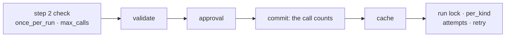

# Executor policies

What the [Executor](executor.md) enforces on every call: approval, run guards, retries and
timeouts, the tool cache, the ledger and events.



## Approval

```python
--8<-- "examples/executor.py:approval"
```

| Situation | Result |
|---|---|
| `ctx.approval` set (your own trusted pre-approval, or a bridge's adapter-issued one-use token) | used as the decision; the port is not asked. A framework's own "approved" never sets it |
| `confirm` is `True`, or a `(call, ctx)` rule returns true | `ApprovalRequest` to the port; `approval.requested` / `approval.decided` events |
| no port configured | `ApprovalDenied(reason="no approval port configured")`, one `WARNING` |
| denied | `ApprovalDenied` with the reviewer's reason |
| `edited_args` | validated again and run through the `before_tool` hooks again (guardrails, budget), then used (also for the cache key) |
| port raises `ApprovalPending` | pending result, `tool.pending`, no ledger entry |

A pre-approval covers only the one call of `run` / `run_spec` / `run_call` it is passed
to (when `ctx.call_id` is empty or that call's id). Batches (`run_many`, `as_completed`,
`run_plan`, `run_tool_loop`) never use it. The tool body's context carries no approval,
so nested calls ask the port even when they reuse the call id. A call
that went pending keeps its approval id: the resumed request reuses it, so `approval.requested`,
`tool.pending` and `approval.decided` share one id when the port keeps the request's id.

## Runs and guards

| Rule | Behaviour |
|---|---|
| `ctx=None` | a fresh run per call (`run`, `run_call`) or per batch; ended afterwards |
| `ctx.run_id == ""` | treated as a fresh run the same way |
| `once_per_run`, `RunLimits.max_calls` | checked at step 2, counted only once the call will execute (args valid, approval granted); a repeat of the same call id, tool and arguments (approval resume, LangGraph re-run, HTTP replay) is not a new call |
| `parallel_safe=False` | takes the run's exclusive lock: nothing else of the run runs meanwhile, except below |
| `RunLimits.per_kind={"search": 2}` | at most two concurrent `search` calls per run |
| nested call (its parent is a running call of the same run) | skips the run lock and the caps of kinds its ancestors hold; other capped kinds still wait (see the caveat below) |
| `run_scope(**context_kwargs)` | `run.started` / `run.finished`, then `end_run` |
| `end_run(run_id)` | forgets the run's guards and locks; old runs are also evicted past `max_tracked_runs` |

!!! warning "Nesting capped kinds in both directions can deadlock"
    With `per_kind={"A": 1, "B": 1}`, an `A` tool that calls a `B` tool while a `B` tool calls
    an `A` tool waits forever: each holds the slot the other needs. Cap only leaf kinds (tools
    that call no other capped kind), or nest capped kinds in one direction only.

Exclusivity has two gaps: an exclusive tool nested under a parallel-safe parent runs beside
the parent's siblings, and calls of one run on two event loops do not exclude each other.
Guard counters are shared across threads (`threading.Lock`); the run lock and `per_kind`
semaphores exist per event loop (`LoopLocal`), so one executor serves several `run_sync`
loops at once:

```python
--8<-- "examples/executor.py:sync"
```

## Retry, timeout and control flow

Attempts are `1..retries+1`, each under `asyncio.timeout(spec.timeout)` (a sync tool keeps
running in its thread after a timeout). Retried: foreign exceptions and `AdapterError`s with
`retryable = True` (`ToolTimeout`, `ModelRateLimited`, ...), with `Backoff(base_s=0.5,
max_s=30, multiplier=2, jitter=0.25)`. The final error is `ToolTimeout`, a non-retryable
`AdapterError` as is, or `ToolFailed` raised from the cause. Control flow
(`CancelledError`, any class named `GraphBubbleUp`, `register_control_flow` types) is never
retried, hooked, turned into a `ToolResult` or recorded as a failure.

## Cache, ledger and events

The tool cache is used when the tool has `cache_ttl` and the call has a cache (`ctx.cache`,
else the executor's). Backend errors are misses; only ok, JSON-encodable values from a real
run are stored. The stored value is the tool's own result, before `after_tool` hooks: a hook
that redacts results does not redact the cache (mind `cache_scope="global"`). Global keys
include a digest of the tool's schema. Each finished call records one `LedgerEntry(kind="tool", entry_id=call_id,
cost_usd=0.0, ...)`. Events follow the [catalogue](context.md#events); `parent_id` is the
enclosing call. Ports on the caller's `ctx` win; the executor fills the gaps.
