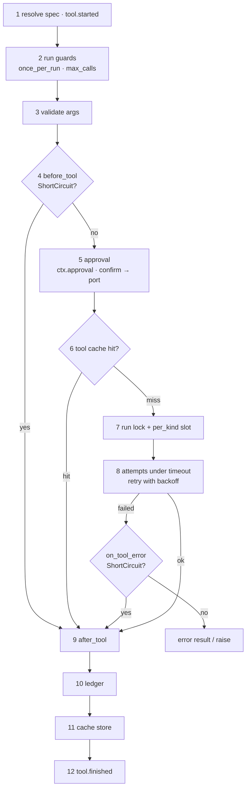

# Executor

`Executor` (`from agent_adapter import Executor`) runs tools. Every call, from every API
and every framework integration, goes through one fixed pipeline: guards, validation,
hooks, approval, cache, timeout and retry, ledger, events. Each policy is on
[Executor policies](executor-policies.md).

```python
--8<-- "examples/executor.py:setup"
```

## One call



```python
--8<-- "examples/executor.py:run"
```

| Method | Returns | On failure |
|---|---|---|
| `run(tool, args, ctx, *, call_id=None)` | the value | raises (`ToolNotFound`, `ToolArgsInvalid`, `ApprovalDenied`, `ApprovalPending`, `ToolTimeout`, `ToolFailed`, `ToolError`, `RunLimitExceeded`, a hook's error) |
| `run_spec(spec, args, ctx, *, call_id=None)` | the value | as `run`; the spec need not be registered |
| `run_call(call, ctx, *, registry=None)` | `ToolResult` | `status="error"` or `"pending"`; never raises except control flow |

`call_id` is `call.id`, else the `call_id=` keyword, else a new `call_…` id; `registry=`
resolves names in another registry.

`run` takes the tool's name, its `ToolSpec`, or the function itself (`@tool` or
`registry.wrap`). The function must be in this executor's registry, so nothing runs
around the pipeline. Anything else is a `ToolUsageError` that says how to register it.

## Sync code

Each async entry point has a blocking twin (`SyncTwins`). All twins run on one
long-lived loop per process (a `runtime.LoopRunner`), so clients, semaphores and other
loop-bound state stay valid across calls. Inside async code, await the async method.

| Twin | Same as |
|---|---|
| `run_sync(tool, args, ctx, *, call_id=None, timeout=None)` | `run` |
| `run_call_sync(call, ctx, *, registry=None, timeout=None)` | `run_call` |
| `run_many_sync(calls, ctx, *, concurrency, on_error, registry, timeout)` | `run_many` |
| `resume_sync(approval_id, decision=None, ctx=None, *, decided_by, reason, timeout)` | `resume` ([Resume](approval-resume.md)); a pending record needs `decision` and `decided_by` |

A twin called from a tool that already runs on the shared loop raises `ToolUsageError`
(it would deadlock): await instead.

## Batches

```python
--8<-- "examples/executor.py:run_many"
```

| Method | Behaviour |
|---|---|
| `run_many(calls, ctx, *, concurrency, on_error, registry)` | results in input order |
| `as_completed(calls, ctx, *, concurrency, registry)` | async iterator in completion order; leaving early cancels the rest (use `contextlib.aclosing`) |
| `run_plan(steps, ctx, *, concurrency, on_error, registry)` | `{step.id: ToolResult}` in step order |
| `parallel(*work, concurrency, timeout, retries, on_error="fail_fast")` | non-tool work (e.g. LLM calls), results in input order |

`concurrency` defaults to `RunLimits.max_concurrency` (8). `on_error="collect"` keeps
failures in their `ToolResult` (`ApprovalPending` → `status="pending"`); `"fail_fast"`
cancels the siblings and raises the first error. No batch raises an `ExceptionGroup`: the
first escaping exception (control flow in every mode) is re-raised as itself. A batch may
not repeat a non-empty call id (`ToolUsageError`).

## Plans

```python
--8<-- "examples/executor.py:run_plan"
```

The plan is checked first: duplicate ids, unknown dependencies and cycles all go into one
`PlanInvalid(problems)`. Steps run in waves: each wave holds every step whose dependencies are done, in step
order, and runs as one `run_many`.
A callable `args` gets `{dep_id: ToolResult}` for its own dependencies. A step whose
dependency failed is not run: its error kind is `dependency-failed`. Step call ids are
`f"{run_id}:{step.id}"`, so running the same plan again in the same run (after an approval
was decided) resumes its steps instead of starting new calls.

## Non-tool work

```python
--8<-- "examples/executor.py:parallel"
```

Items are coroutine functions or awaitables (not retryable). Expiry of `timeout` is
`ToolTimeout(tool="parallel[i]")`; `collect` keeps exceptions in place.

## Defaults and copies

`Executor()` with no registry uses the default registry, the one `@tool` and `wrap`
fill; a registry you pass always wins. `default_executor()` is a process-wide
`Executor()` made on first use; `set_default_executor(ex)` replaces it,
`reset_default_executor()` (from `agent_adapter.exec`) drops it so the next use makes a
fresh one (use it between tests that call `configure`), and `runner_for(executor)` returns
`executor` or the default. `ex.replace(**changes)` builds a new executor with some
constructor arguments changed; it shares the run table.

The default registry holds every `@tool` of every imported module, your libraries' too.
An executor on it can run any of them by name, and so can a model in a tool loop. So
servers, tool loops and queue workers should pass an explicit `Registry`. `Executor()`
logs at INFO when it falls back to the default registry.

| Shortcut | Does |
|---|---|
| `configure(registry=None, **options)` | `set_default_executor(Executor(registry, **options))`, returns it |
| `call(tool, /, **args)` | `run_sync` on the default executor; returns the value |
| `acall(tool, /, **args)` | `await run(...)` on the default executor |

A `registry` that is not a `Registry` or an `approval` that is not a port (`True`, a
string) is a `ToolUsageError` naming the fix.

An integration given `executor=None` reads the default when:

| What | Reads the default |
|---|---|
| exported tools, `tool_node`, `tool_task`, MCP servers | at each call: `set_default_executor` after export applies |
| `compile_flow` (LangGraph, ADK) | once, at compile: set the default first, or pass `executor=` |
| `mcp_server(client_approval=True)` | also at build, for its approval store and port warning |

## Files

| File | Holds |
|---|---|
| `exec/executor.py` | `Executor`: the public methods |
| `exec/pipeline.py` | steps 1–12 for one call |
| `exec/_approve.py` | step 5: confirm rule, port, edited args |
| `exec/guards.py` | `RunLimits`, run table, run lock, `per_kind` slots |
| `exec/retry.py` | `Backoff`, the retry rule, the attempt loop |
| `exec/parallel.py` | batches without `ExceptionGroup`, `parallel` |
| `exec/plan.py` | `Step`, plan validation, waves |
| `exec/control.py` | `register_control_flow`, `is_control_flow` (re-exported from `core/control.py`, shared with approval and hooks) |
| `exec/defaults.py` | `default_executor`, `set_default_executor`, `reset_default_executor`, `runner_for`, `configure`, `call`, `acall` |
| `exec/_sync_twins.py` | `SyncTwins`: the blocking twins |
| `exec/_sugar.py` | run by function, the shared sync loop, `resume` binding, constructor checks |
