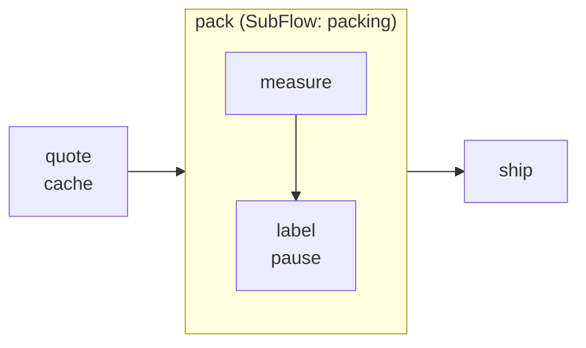
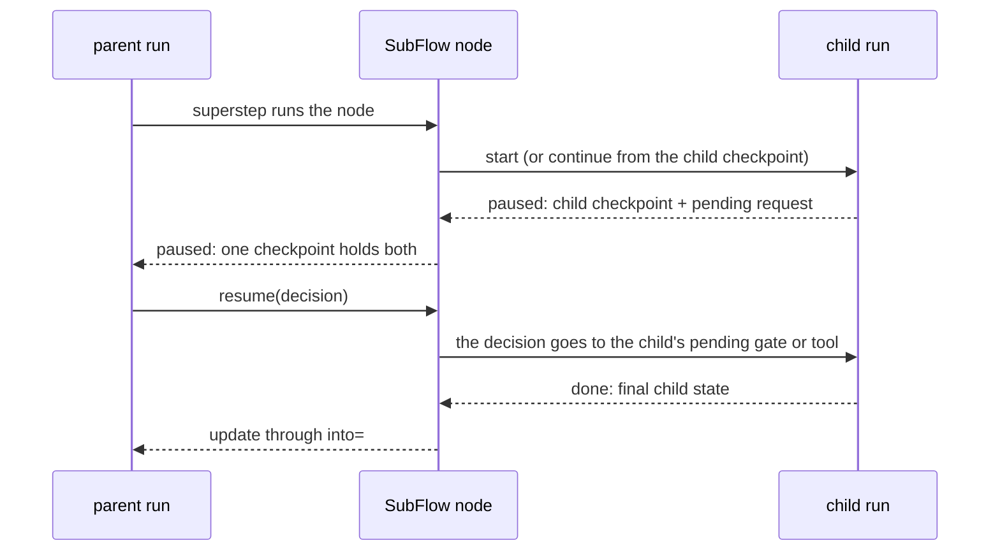

# Sub-flows and the node cache

A `SubFlow` node runs another `Flow` as one node of its parent. A `NodeCache` lets a node
reuse its updates when it sees the same inputs again. Both work with the local
[`FlowRunner`](flows.md); this page builds on the [Flows](flows.md) page.



## A sub-flow

```python
--8<-- "examples/flow_subflows.py:state"
```

```python
--8<-- "examples/flow_subflows.py:child"
```

```python
--8<-- "examples/flow_subflows.py:parent"
```

`SubFlow(flow, *, input=None, into=None)`:

| Option | Form | Means |
|---|---|---|
| `input` | `None` | copy same-named fields from the parent |
| | `{"child_field": "parent_field"}` | copy these fields |
| | `fn(parent_state)` | a mapping (or a child state) to start from |
| `into` | `None` | write back same-named fields the child changed |
| | `{"parent_field": "child_field"}` | write back these fields, if the child changed them |
| | `"field"` | the child's final state into one parent field |
| | `fn(child_state)` | the parent update |

The child's result is one update of the SubFlow node, so the parent's
[merge rules](flows.md#state-and-merge-rules) apply as for any node. Fields with
`Merge.append`, `Merge.sum` or any rule with `additive = True` are not copied in by default:
they start empty in the child, so what the child adds is added to the parent once. The child validates its own
start state; a bad mapping raises `FlowError(node=<SubFlow node>)`.

## Checks

`validate()` checks the child flow too and reports its problems under the SubFlow node.

| Checked | |
|---|---|
| the child | it is a `Flow` and valid |
| cycles | a flow that contains itself, directly or through other sub-flows |
| field maps | every named field exists in its model |
| types | mapped (and same-named) fields have the same annotation, or `Any` |
| `into="field"` | the field can hold the child's state model |
| double counting | an `append` / `sum` field mapped in and back out |

The checkpoint's graph digest covers the child graph and the maps, so a checkpoint from
another version of a child refuses to resume.

## Pause and resume inside a child

A pause gate or a tool approval inside the child pauses the whole run. The pending
request keeps the child's tool and arguments; its metadata names the SubFlow node and
holds the child's own under `subflow`:

```python
--8<-- "examples/flow_subflows.py:run"
```



- Child call ids sit under the SubFlow node's visit: `order:pack:1/packing:label:1`, and
  tool calls `…:<i>`. Two SubFlow nodes may use the same child flow.
- The child continues where it paused: finished child supersteps do not run again, and a
  paused child node replays what it finished, as in [pause and resume](flow-resume.md).
- `dump_checkpoint` / `load_checkpoint` carry the child's position; the parent's seal
  covers it, and a checkpoint resumes once.
- A denied gate in a child ends the run `denied`, with `denied_at="<node>/<child node>"`.
  A denied tool fails the child node, so the SubFlow node fails.
- The child uses the runner's gate port, hooks, `max_steps`, `concurrency` and model.

Events: the child's `flow.started` / `flow.finished` carry `parent_flow` and
`parent_node`; every child event has the SubFlow node's visit as `parent_id`, and child node
events add `scope`. The [run viewer](../how-to/see-your-runs.md) shows a SubFlow node with
`⊞ open`: click it (or focus the node and press `o`) to see the child graph with its own
state, and `‹ up` (or `u`) to go back.

The LangGraph and ADK compilers do not support `SubFlow` nodes yet: `compile_flow` raises
`FlowCompileError` naming them. Run those flows with `FlowRunner`.

## Node cache

`cache=NodeCache(ttl=None, *, key=None, reads=None, scope="run")` on `Flow.node` looks
the node up in the executor's cache port before it runs. A hit skips the node's action
(its hooks still run) and returns the stored updates.

| Option | Default | Meaning |
|---|---|---|
| `reads` | the whole state | the state fields the key is made from |
| `key` | none | `key(state)` gives the key instead (a JSON-able value) |
| `ttl` | `None` | seconds an entry lives; `None` leaves it to the backend |
| `scope` | `"run"` | who shares entries: `"run"`, `"thread"` (needs a thread id) or `"global"` |

- The key is the flow, the node, its action (function or tool identity), what its code
  captured (closure values, defaults, `partial` arguments, a bound or callable object's
  attributes, static `Call` arguments) and the
  inputs. Captured values with no canonical form mean no caching (`WARNING`), unless your
  `key=` covers them.
  Inputs with no canonical form, or no cache port on the executor, mean no caching (the
  missing port is logged once).
- Entries are canonical JSON signed, with their key, by the runner's `checkpoint_key`; an
  entry that does not verify (or was copied to another key) is a miss. Give every process that shares a cache the same key.
- Backend failures are misses, logged at `WARNING`; a failing `key` function fails the
  node.
- A hit emits `node.cached`; its `node.finished` has `cached: true`.

Safe by default, a node is never cached when it could need an approval:

| Refused at | When |
|---|---|
| `validate()` | the node has `pause=`, its `Call` / `Map` tool needs approval, or its sub-flow has gates or such tools |
| `FlowRunner.run` | a cached node names, by string, a registered tool that needs approval |
| each visit | the visit asked for any approval: its result is not stored (`WARNING`) |

## Files

| File | Holds |
|---|---|
| `flow/actions.py` | `SubFlow`, `NodeCache` |
| `flow/_subcheck.py` | sub-flow and cache checks, cycle detection |
| `flow/_subflow.py`, `_nested.py` | running a child graph, its pause and denial |
| `flow/_loop.py` | the superstep loop the runner and sub-flows share |
| `flow/_cache.py` | cache keys, signed entries, the approval watch |
