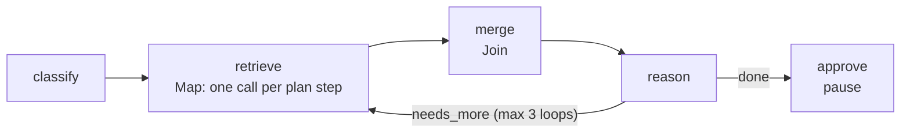
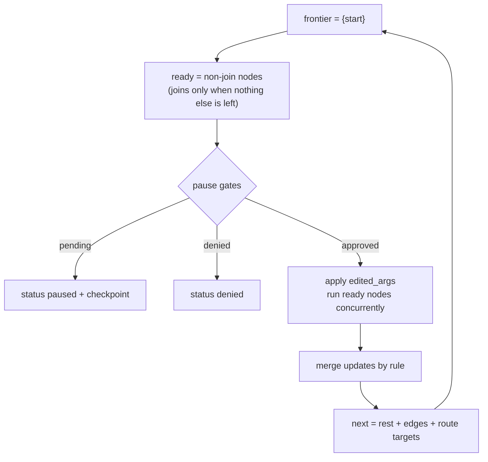

# Flows

A flow is a graph of nodes over one pydantic state. You write it once with `Flow`. The
local `FlowRunner` runs it on the [executor](executor.md); the
[LangGraph](../integrations/langgraph.md) and [ADK](../integrations/adk.md) compilers consume
the same validated graph.



## State and merge rules

```python
--8<-- "examples/flow_research.py:state"
```

Each field declares how several writes in one superstep combine (unannotated: `replace`).

| Rule | Several updates in one superstep |
|---|---|
| `Merge.replace` | equal values → that value; different values → `FlowError("conflicting writes to <field>")` |
| `Merge.append` | list concatenation in update order |
| `Merge.sum` | added onto the current value |
| `Merge.keyed(by)` | a later item with the same key replaces the earlier one; first-seen order kept |

`append` and `keyed` extend with the elements when a value is a list, else add the value
itself. Update order is node **name** order (LangGraph's task order), then `Map` item
index, so with `keyed` the node whose name sorts last wins a shared key. Unknown keys raise
`FlowError`; the merged state is validated again with the model. Nodes of one superstep all
read the same input state: treat it as read-only and return updates.

## Nodes

```python
--8<-- "examples/flow_research.py:nodes"
```

| Action | Runs | Writes |
|---|---|---|
| `fn(state)` / `fn(state, ctx)` | sync (in a worker thread) or async | the mapping it returns (or nothing for `None`) |
| `Call(tool, args=…, into=…)` | `executor.run_spec`; `args` may be `fn(state)` | `{into: value}` |
| `Map(over, tool= / tool_from= / fn=, into=…)` | one call per item of the list field `over` | one `{into: value}` per item |
| `Join(sources, fn=None)` | once nothing else is pending (fan-in) | what `fn` returns |
| `SubFlow(flow, input=…, into=…)` | another flow, as one node ([sub-flows](flow-subflows.md)) | the child's result, mapped by `into` |

`Map(tool=…)` passes the item (or `args_fn(item)`); `tool_from="tool"` reads the tool name
from each item, arguments from `item[args_from]` (else the rest of the item); `fn(item,
state, ctx)` maps without a tool. `on_error="fail"` fails on the first failed item in item
order, `"skip"` drops it with a `WARNING`. Node options: `concurrency` (Map), `timeout`,
`retries` (executor backoff), `pause`, `prompt`, `cache` ([node cache](flow-subflows.md#node-cache)).

## Building and validating

```python
--8<-- "examples/flow_research.py:flow"
```

`edge(src, [a, b])` runs `a` and `b` in one superstep; `Route(fn, targets)` picks nodes by
label (names, or `label → node`). `validate()` returns the `FlowGraph`, or one
`FlowDefinitionError` listing **every** problem:

| Checked | |
|---|---|
| names | the flow and every node match `^[A-Za-z_][A-Za-z0-9_]{0,63}$` |
| endpoints | every edge, route target, `start`, `end` and `on_exhausted` exists |
| exits | static edges **or** one route, not both; end nodes have no exit, others do |
| reachability | every node is reachable from `start` (default: the first node) |
| joins | each source is a predecessor |
| cycles | every cycle passes through a route with `max_loops` |
| state | `Map.over`, `Map` / `Call` targets are fields; `aa_loop_counts`, `aa_visits` are reserved |

## Running

```python
--8<-- "examples/flow_research.py:run"
```



A route sees the superstep's input plus its **own** node's updates (not a sibling's).
Picking its own node, or a node visited before this superstep, counts a loop; past
`max_loops` it goes to `on_exhausted` or raises `FlowLoopExceeded`, as does `max_steps`.

| `FlowRunner(executor, *, …)` | Default | Meaning |
|---|---|---|
| `approval` | the executor's | port asked by `pause` gates |
| `hooks`, `sink` | `()`, the executor's | node hooks (after the executor's), event sink |
| `max_steps` | `100` | supersteps per run |
| `concurrency` | none | cap on nodes per superstep |
| `model` | `None` | given to nodes through `node_model(ctx)` |
| `checkpoint_key` | per process | key that seals checkpoints (bytes, 16+) |
| `seal_encoder`, `seal_decoder` | `None` | seal (and load) state values of custom types: see [Flow pause and resume](flow-resume.md) |
| `trace_state` | `False` | `node.finished` also carries `updates` (each changed field's value, JSON, 2 KB cap); the run viewer keeps them for that run |

## Pause and resume

A `pause` node asks the port with `ApprovalRequest(kind="node", tool="node:<flow>.<node>",
arguments=pause(state) or {})` before its superstep; nothing in that superstep runs first.

| Port answer | Result |
|---|---|
| approved | the node runs with `ctx.approval` set; `edited_args` is a state update applied first |
| denied (or no port) | `status="denied"`, `denied_at=<node>` |
| `ApprovalPending` | `status="paused"`, `pending`, `checkpoint`; nothing in that superstep ran |

`ApprovalPending` from inside a node also pauses the flow. Resuming re-runs only the paused
node, replays what it finished, and is sealed and single-use ([details](flow-resume.md)).

## Inside a node

| Read | Gives |
|---|---|
| `ctx.call_id` | `"<flow>:<node>:<visit>"`; its tool calls are `"…:<i>"` |
| `node_prompt(ctx)` | the node's `prompt` (optimisers edit them with `flow.with_prompts`) |
| `node_model(ctx)` | the runner's model, instrumented by the executor (`executor.model(model).bind(ctx)`; an `InstrumentedModel` is only bound, so each call is billed once) |
| `current_context()` | the node context while the node runs |

Events: `flow.started`, `flow.finished` (`status`: `done`, `paused`, `denied`, `failed` or
`cancelled`; `steps`), `node.started`, `node.finished` (`changed`: the field names it set),
`node.failed` (`error_kind`), `node.paused` (`approval_id`), `run.started` / `run.finished`
when the runner made the run.
A node error becomes `FlowError(node=…)` raised from the original; control flow passes
through. With `trace_state` the [run recorder](../how-to/see-your-runs.md) keeps state values
(secret-named keys masked, 2 KB each) without `capture_content`; compiled flows keep names.

## Files

| File | Holds |
|---|---|
| `flow/spec.py`, `actions.py` | `Flow` builder; `Call`, `Map`, `Join`, `Route`, `node_prompt`, `node_model` |
| `flow/state.py` | merge rules, `merge_rules`, `apply_updates` |
| `flow/graph.py` | `FlowGraph`, `NodeSpec`, `RouteSpec`, validation |
| `flow/runner.py`, `_loop.py` | `FlowRunner`, `FlowResult`, `FlowCheckpoint`; the superstep loop |
| `flow/_nodes.py`, `_gates.py`, `_step.py`, `_invoke.py` | node visit, gates and resume answer, merge and routes, user code |
