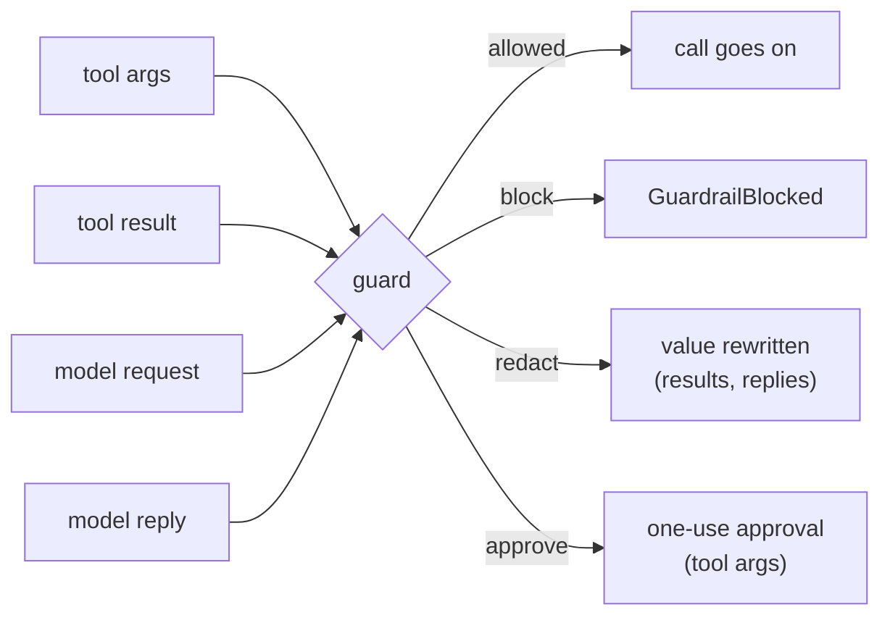

# Guardrails

A guard is a hook that looks at what goes into and out of your agent: tool arguments,
tool results, model requests and model replies. When it says no, it **blocks**,
**redacts** or asks for **approval**. Guards are hooks, so every integration, the tool
loop, flows and the HTTP server get them through the one executor.



| Guard | Needs | Finds |
|---|---|---|
| `PIIGuard` | nothing | emails, phone numbers, cards (Luhn-checked), IBANs (mod-97), API keys and secrets |
| `CallableGuard(fn)` | your function | whatever your guard service says |
| `PresidioGuard` | `agent-adapter[presidio]` | Presidio's entity types |
| `NemoGuard` | `agent-adapter[nemo]` | what your NeMo Guardrails rails block or rewrite |

All four import from `agent_adapter.hooks`.

## Built-in PII and secret checks

```python
--8<-- "examples/guardrails.py:guards"
```

- `kinds` picks from `email`, `phone`, `card`, `iban` and `secret` (all by default).
- `patterns={"ticket": r"TK-\d+"}` adds named regexes of your own.
- `on` picks the stages: `args`, `result`, `llm_request`, `llm_response`. The default is
  `("args", "result", "llm_response")`.
- A phone number needs a leading `+` or separators: a bare run of digits is not flagged.
- Cards and IBANs are found inside longer runs (a card followed by its CVV, an IBAN in
  any case or followed by a code).
- Keys are checked too: an email used as a key is found. With the `secret` kind, every
  value at any depth below a secret-named key (`password`, `api_key`, `auth`, `passcode`,
  `pin`) is flagged, and so is the value of a pair: `["Authorization", "..."]` or
  `{"name": "X-Api-Key", "value": "..."}`.
- Redaction swaps each finding for `[EMAIL]`, `[CARD]` and so on (`placeholder=`).

## Actions

| Action | Stages | Does |
|---|---|---|
| `block` (default) | all | raises `GuardrailBlocked`; the model sees the reason |
| `redact` | `result`, `llm_response` | rewrites the value before anyone else sees it |
| `approve` | `args` | sends the call to the executor's approval port |

Arguments and requests cannot be rewritten by a hook, so `redact` refuses those stages
with a `ConfigError`. Redaction rewrites each flagged string or key where it sits, inside
mappings, lists, tuples, sets, pydantic models and dataclasses; an equal string elsewhere
stays. Two keys redacted to the same text stay apart (`[EMAIL]`, `[EMAIL]#2`). Lists,
tuples, sets, models and dataclasses keep their types; other mappings become plain dicts.
Each redaction sends a `guardrail.redacted` event: the guard, the stage, how many texts
and which kinds (`email`, `card`; `GuardVerdict(kinds=, count=)` for your own guard), never
the values. The [audit log](audit.md) keeps it.

A model reply is checked in full: its text, `parsed`, the tool-call arguments and the
provider's `raw` items, which ports send back on the next turn. A redacted reply has its
text, assistant message, `parsed`, tool-call arguments and raw items rewritten in place,
so the original never goes back to the provider. Raw items with nothing flagged, such as
thinking blocks and thought signatures, are kept as they were. If a flagged text sits
inside a signed block, the rewrite breaks its signature and the provider refuses the next
request: the call fails, nothing leaks. Raw items are checked by their text only, since
their key names (`signature`) are the provider's. Requests are read the same way.

### Approval for flagged calls

`approve` uses the normal one-use approval path. Give the guarded tools the guard's
`confirm` rule:

```python
--8<-- "examples/guardrails.py:approve"
```

Clean calls run without asking. A flagged call goes to the approval port: with no port it
is denied. A tool without `confirm=guard.confirm` (or `confirm=True`) is blocked, never
let through.

## Any guard service

`CallableGuard(fn)` wraps your moderation endpoint, policy engine or classifier.
`fn(stage, payload)` may be sync or async. A sync `fn` runs in a worker thread.

```python
--8<-- "examples/guardrails.py:callable"
```

It returns `True` (pass), `False` or a reason string (no), or a `GuardVerdict`. To redact,
return `GuardVerdict(False, reason, replacement=new_payload)`.

## Presidio

```python
from agent_adapter.hooks import PresidioGuard

guard = PresidioGuard(entities=["EMAIL_ADDRESS", "PERSON"], threshold=0.6, action="redact",
                      on=("result", "llm_response"))
```

The analyzer finds entities and the anonymizer replaces them (`<PERSON>`). Pass your own
`analyzer=` and `anonymizer=` engines to reuse configured ones. Presidio runs in a
worker thread. Presidio's default analyzer also needs a spaCy model, such as
`en_core_web_lg`.

## NeMo Guardrails

```python
from agent_adapter.hooks import NemoGuard

guard = NemoGuard(config="./rails", on=("args", "llm_response"))  # or NemoGuard(rails)
```

Each text goes to `check_async` (NeMo Guardrails 0.24 or newer). Arguments and requests
go as the user's turn (input rails), results and replies as the assistant's turn (output
rails). `BLOCKED` says
no; `MODIFIED` says no and carries the rewrite, which `redact` uses. For a guardrails
server, call it from a `CallableGuard`.

## Safe by default

- **Fail closed.** A guard that raises or returns something unexpected blocks
  the payload with the reason `guard failed`.
- **No content in logs.** Guards log the stage, the tool and the exception type. Built-in
  reasons name the kinds found (`found email, card`), never the text.
- Text guards see each distinct string once per payload. A model request is checked in
  full on every step, so a flagged message in the history blocks later steps too.

## Writing your own

Subclass `TextGuard` and implement `review(text, stage) -> GuardVerdict`, or subclass
`ContentGuard` and implement `inspect(stage, payload)`. For a plain pass or fail check,
the simpler `GuardrailHook(check)` from [Hooks](hooks.md#guardrailhook) still works.

See also: [Approval](approval.md), [Errors](errors.md), [Security](../guides/security.md).
