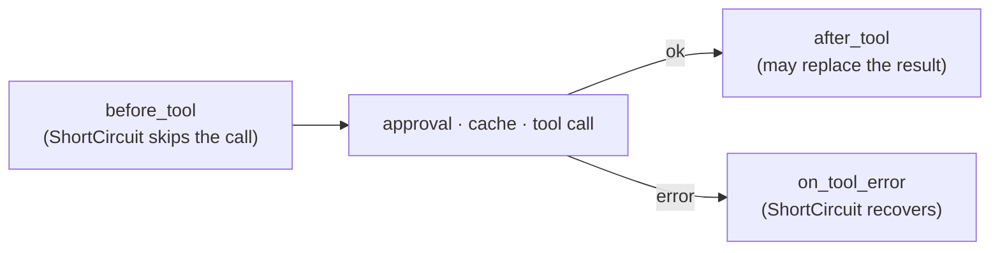
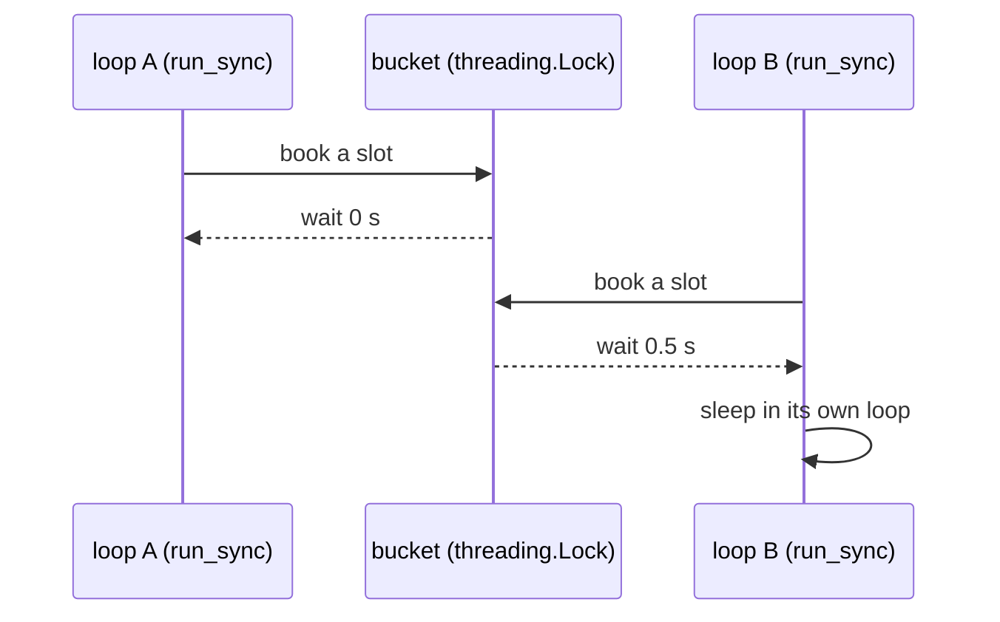

# Hooks

A hook is middleware around every tool call, model call and flow node. Subclass `Hook`,
override the phases you need, and pass the list to the executor. Four built-ins cover
logging, spend caps, guardrails and rate limits.



The same three phases exist for `llm` (`before_llm`, …) and `node` (`before_node`, …).
Hooks run in registration order; the first `ShortCircuit` wins. A hook that raises is
logged and the error propagates unchanged: a hook bug at `ERROR` (type only), control
flow not at all. A policy outcome (`BudgetExceeded`, `GuardrailBlocked`, an approval or
run-limit error) is only a `DEBUG` line in dispatch: the hook that decided it logs its own
`WARNING`. When an approval edits the arguments,
`before_tool` runs again on the edited call, so guardrails and budget check what
actually runs. To a hook it is a second `before_tool` call, so every side effect in
`before_tool` happens twice: `LoggingHook` logs a second `tool.start`, `RateLimitHook`
books a second slot, and a custom counter counts twice. Dispatch details:
[Runtime → Hooks](runtime.md#hooks).

## Writing a hook

```python
--8<-- "examples/hooks.py:custom"
```

| Phase | Gets | Return |
|---|---|---|
| `before_*` | the invocation | `None`, or `ShortCircuit(value)` to skip the call |
| `after_*` | the invocation and the result | `None` (keep), or a replacement |
| `on_*_error` | the invocation and the error | `None` (re-raise), or `ShortCircuit(value)` to recover |

`ToolInvocation(spec, call, ctx)` carries validated arguments (LLM-facing names).
`LLMInvocation(request, provider, model, ctx)`, `NodeInvocation(flow, node, state, ctx)`.

## Built-ins

```python
--8<-- "examples/hooks.py:builtins"
```

| Hook | Phases | Does |
|---|---|---|
| `LoggingHook(*, logger=None, level=INFO, redact=DEFAULT_REDACT)` | all nine | one structured line per start, finish and error |
| `BudgetHook(max_usd, *, on_exceed="stop", scope="run")` | `before_tool`, `before_llm` | stops (or warns) once spend reaches `max_usd` |
| `GuardrailHook(check, *, on=("args",))` | tool and LLM phases | blocks payloads `check` rejects |
| `RateLimitHook(per_kind, *, clock, sleep)` | `before_tool`, `before_llm` | waits for a token; never fails |

Import these from `agent_adapter`; `Rate`, `ShortCircuit`, `redact` and the dispatchers come
from `agent_adapter.hooks`.

## `LoggingHook`

Each record has the message `"<event> <json>"` plus `aa_event` and `aa_fields`
attributes for structured handlers. Events: `tool.start`, `tool.finish`, `tool.error`,
`llm.*`, `node.*`. Every line carries `run_id` (tool lines also `call_id`). Errors log
at `WARNING` or higher.

| Logged | Never logged |
|---|---|
| tool, kind, run and call ids, redacted args | arguments of `confirm` tools (`args_withheld: true`) |
| status, attempts, cached, latency, error kind | result values, exception messages |
| provider, model, stage, token counts, finish reason | message content |
| flow, node, the keys a node updated | state values |

Redaction replaces the value of any mapping key that contains a pattern
(case-insensitive), at any depth:

```python
--8<-- "examples/hooks.py:redact"
```

| Default pattern | Hides keys like |
|---|---|
| `key` | `api_key`, `x-api-key` |
| `token` | `access_token` |
| `secret` | `client_secret` |
| `password` | `password` |
| `authorization` | `Authorization` |
| `cookie` | `Set-Cookie` |

## `BudgetHook`

Before each tool and model call it reads `ctx.ledger`:

| `scope` | Reads | Notes |
|---|---|---|
| `run` | `total_usd(ctx.run_id)` | default |
| `thread` | `total_usd(thread_id=ctx.thread_id)` | an empty `thread_id` falls back to `run` |
| `global` | `total_usd()` | everything the ledger holds |

At or over the limit, `on_exceed="stop"` raises `BudgetExceeded(limit_usd, spent_usd,
scope=, run_id=)`; `"warn"` logs once per run and emits `budget.warning` (`limit_usd`,
`spent_usd`, `scope`). Without a ledger the hook does nothing and warns once.

```python
--8<-- "examples/hooks.py:budget"
```

`config()`, `config_schema()` and `with_config({...})` expose `max_usd`, `on_exceed` and
`scope` to the optimiser; unknown keys raise `ConfigError`.

## `GuardrailHook`

`check(stage, payload)` may be sync or async. `True` passes; `False` or a reason string
raises `GuardrailBlocked(reason, tool=, stage=)`. Any other return is a `ToolUsageError`.
A block logs the stage and tool at `WARNING`; the reason can quote the payload, so it is
logged only at `DEBUG`.

| Stage | Phase | Payload |
|---|---|---|
| `args` | `before_tool` | validated arguments (dict) |
| `result` | `after_tool` | the value of an ok result (failed results are skipped) |
| `llm_request` | `before_llm` | the `LLMRequest` |
| `llm_response` | `after_llm` | the `LLMResponse` |

## `RateLimitHook`

`Rate(calls, per)` allows bursts of `calls` and refills at `calls / per` per second.
Tool calls use the bucket of `spec.kind`; model calls use `"llm"`. Kinds without a rate
never wait.



One bucket per kind is shared by every thread and loop. A caller books its slot under
the lock (GCRA: the bucket keeps the time the latest booking frees), then sleeps in its
own loop, so no asyncio primitive crosses loops. A cancelled wait gives its slot back only
when it was the latest booking, so no slot is handed out twice. `clock` and `sleep` are
injectable for tests.

This page's code is `examples/hooks.py`. The test suite runs it.
