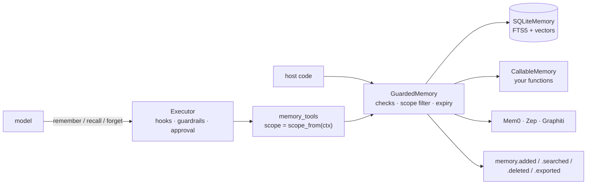

# Memory

`agent_adapter.memory` lets an agent remember facts across turns and chats. One small
port, `MemoryPort`, has a built-in SQLite backend, a `CallableMemory` for any store, and
lazy Mem0, Zep and Graphiti adapters. `memory_tools` gives the model `remember`, `recall`
and `forget` tools. The scope always comes from the context, so the model can never reach
another user's memory.



| File | Does |
|---|---|
| `memory/records.py` | `MemoryScope`, `MemoryRecord`, `MemoryHit` and the shared input checks |
| `memory/port.py` | `MemoryPort`: `add`, `search`, `get`, `delete`, `export` |
| `memory/_base.py` | `GuardedMemory`: the checks, scope and expiry filters, events and `*_sync` twins every backend shares |
| `memory/sqlite.py`, `_sqlite_sql.py` | `SQLiteMemory`: one SQLite file, keyword and vector search |
| `memory/callable.py` | `CallableMemory`: your own functions as a backend |
| `memory/mem0.py`, `zep.py`, `graphiti.py` | the third-party adapters (optional extras) |
| `memory/tools.py` | `memory_tools`, `scope_from_context`, `user_scope` |

Texts enter through `add` (or the `remember` tool) and leave through `search`, `get` and
`export`. Events carry counts, never texts.

## Give an agent memory

```python
--8<-- "examples/memory_quickstart.py:wire"
```

The host sets `ctx.user_id` (the signed-in end user) and `ctx.thread_id` (the chat).
Without a user id, `scope_from_context` uses the host's `principal` (set by the HTTP server,
MCP, A2A and AG-UI). An anonymous call fails: memory is off unless the host opts in with
`scope_from=thread_scope`, which is safe only when thread ids are unguessable. The
principal must be the end user: one service token for a whole front end shares one memory.

| Tool | Does | Effects |
|---|---|---|
| `remember(text)` | saves one fact in the caller's scope | additive; asks for approval with `confirm_writes=True` |
| `recall(query)` | the `k` best facts; an empty query lists the newest | read only |
| `forget(id)` | deletes one of the caller's facts | destructive; `forget=False` leaves it out |

With `across_sessions=True` (the default), `recall` and `forget` see all of the user's
chats. With `thread_scope`, a context without a user id only ever sees its own thread.

The tools run through the executor like any other tool. Guardrails see `remember`'s text
before it is stored (a `PIIGuard` can block it) and `recall`'s results before the model
does (a redacting guard can mask them).

## Scopes

A `MemoryScope` has a `user_id`, a `session_id` and an `agent_id`; at least one is set. A
query scope covers a record when:

- the user ids are equal (both may be empty), and
- the session and agent ids are equal wherever the query sets them.

So `MemoryScope(user_id="ann")` sees all of Ann's sessions, and never Ben's. Every
backend's output passes this check again, so a backend bug cannot leak another scope's
records: they are dropped and a WARNING is logged.

## Use it from code

```python
--8<-- "examples/memory_quickstart.py:direct"
```

Each method is async and has a blocking twin (`add_sync`, `search_sync`, `get_sync`,
`delete_sync`, `export_sync`, `purge_sync`). Pass `ctx=` to bill embeddings to that run
and send events (counts and the scope kind such as `user+session`, never ids) to its sink.

## SQLiteMemory

`SQLiteMemory(path, embedder=None, retention_days=None)` keeps everything in one file
(WAL, owner-only on POSIX). Calls run in worker threads on their own connections, so one
file is safe across threads, event loops and processes.

- **Keyword search** uses FTS5 with BM25 ranking and word stems. A SQLite build without
  FTS5 falls back to `LIKE` (a WARNING when the file is created).
- **Vectors.** With an `EmbeddingPort` (such as `CallableEmbedder`), each record is
  embedded on `add`. Search then ranks by cosine similarity too, and fuses both rankings.
  A failing embedder fails `add`; search goes on keyword-only, with a WARNING.
- **Filters.** `search(..., filters={"kind": "visit"})` matches metadata exactly.

## Retention and privacy

```python
--8<-- "examples/memory_privacy.py:retention"
```

- `expires_at` on a record, or `retention_days` on the backend, hides a record once it
  is past due. SQLite also deletes such records on every write and on `purge()`.
- `export(scope)` returns every live record in a scope, oldest first: the answer to a
  data request.
- `delete(scope=MemoryScope(user_id=...))` erases a user: all their sessions, nobody else.
- SQLite erases for real: `secure_delete` zeroes deleted rows, FTS5 `secure-delete` (or an
  index merge on SQLite before 3.42) drops their words, and the WAL is checkpointed. A
  reader in a transaction can block the checkpoint (a WARNING says so).
- A `created_at` in the future is refused, so it cannot outlive retention.

```python
--8<-- "examples/memory_privacy.py:privacy"
```

## Any backend

`CallableMemory(add=, search=, get=None, delete=None, export=None)` wraps your functions
(sync or async). `search` may return records, `MemoryHit`s or `(record, score)` pairs.
Failures become `IntegrationError`; the logs carry only the error type.

## Mem0, Zep and Graphiti

| Backend | Install | Scope |
|---|---|---|
| `Mem0Memory(client)` | `agent-adapter[mem0]` (mem0ai 2.x) | user, session (Mem0 `run_id`) and agent |
| `ZepMemory(client)` | `agent-adapter[zep]` (zep-cloud 4.x) | user only; no metadata or filters |
| `GraphitiMemory(graphiti)` | `agent-adapter[graphiti]` | user only; search returns extracted facts |

- **`user_only`.** Zep and Graphiti set `user_only = True` (every other backend: False).
  Their scopes must be `MemoryScope(user_id=...)` and records carry no metadata;
  `memory_tools` then uses `user_scope` by itself. They do not keep `expires_at`; use
  `retention_days`.
- **Mem0.** `infer=False` (the default) stores each text as given. Erasing a user calls
  `delete_all` and checks that nothing is left. Mem0 itself keeps old texts in its history
  database; set its `history_db_path` where you can erase it, or call its `reset()`.
- **Zep.** Each user becomes a Zep user of its own, named by a hash of the user id, and is
  created on the first write. Erasing a user deletes that Zep user.
- **Graphiti.** The group id is a hash of the user id; erasing clears the group.

`agent-adapter doctor` reports which are installed.

## Events

| Event | Data |
|---|---|
| `memory.added` | `backend`, `count`, `latency_ms` |
| `memory.searched` | `backend`, `count`, `latency_ms`, `k`, `mode` (`keyword`, `vector`, `hybrid`, `recent`, `backend`) |
| `memory.deleted`, `memory.exported` | `backend`, `count`, `latency_ms` |

With `capture_content=True` on the backend, texts ride under the `arguments` and `result`
keys, which sinks drop unless they capture content too.
