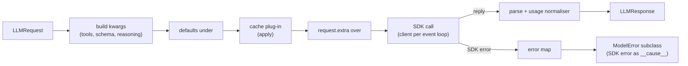

# Model ports

A model port turns one provider-neutral `LLMRequest` into one `LLMResponse`. Every port
implements `LLMPort`: `generate(request)`, `stream(request)` and `cache_key_fields()`.

| Port | Install | Notes |
|---|---|---|
| `OpenAIModel(model, api="responses" \| "chat")` | `agent-adapter[openai]` | Responses (default) or Chat Completions; strict tools |
| `GeminiModel(model, thinking=…)` | `agent-adapter[gemini]` | automatic function calling always off; thought signatures echoed |
| `AnthropicModel(model, max_tokens=4096)` | `agent-adapter[anthropic]` | tools, `output_config`, thinking blocks echoed |
| `CallableModel(fn)` | core | your own model function, sync or async (sync runs in a thread); see [Bring your own model](../how-to/bring-your-own-model.md) |
| `FallbackModel([a, b])` | core | next port after rate limits, 5xx or timeouts |



## Your own LLM function

```python
--8<-- "examples/models.py:callable"
```

`fn` returns the reply text, an `LLMResponse`, or a mapping of `LLMResponse` fields
(`provider`, `model` and `message` are filled in). Errors it raises pass through unchanged.

## Provider ports

```python
--8<-- "examples/models.py:providers"
```

- No `client`: one SDK client per event loop (`LoopLocal`), so a port works across
  `run_sync` calls; a `client` you pass is used as is. A missing SDK raises `MissingDependency`.
- `request.model or port.model` is sent. `defaults` sit under the request fields, the cache
  plug-in runs next, `request.extra` merges last (Gemini: `GenerateContentConfig` fields).

| `LLMRequest` | OpenAI Chat | OpenAI Responses | Gemini `config` | Anthropic |
|---|---|---|---|---|
| system messages | `system` messages | `system` input items | `system_instruction` | `system` blocks |
| `tools` | nested `function`, `strict` | flat, `strict` | `function_declarations` + `parameters_json_schema` | `input_schema` |
| `tool_choice` | `auto` / `none` / `required` / function | same | `AUTO` / `NONE` / `ANY` (+ allowed names) | `auto` / `none` / `any` / `tool` |
| `output_schema` | `response_format` json_schema | `text.format` | `response_mime_type` + `response_json_schema` | `output_config.format` (objects closed, other constraints described) |
| `reasoning` | `reasoning_effort` | `reasoning.effort` | `thinking_config.thinking_level` | `output_config.effort` (`minimal` → `low`) |
| `max_output_tokens` | `max_completion_tokens` | `max_output_tokens` | `max_output_tokens` | `max_tokens` |
| `seed`, `stop` | sent | dropped (one `WARNING`) | sent | `stop_sequences`; seed dropped |
| `temperature`, `top_p` | sent | sent | sent | dropped (one `WARNING`), see below |

Anthropic sampling: API version `2026-10-21` (sent by anthropic 2.3) removed `temperature`,
`top_p`, `top_k` (a 400 on every model). For an older family on an older API version pass them
yourself: `client_kwargs={"default_headers": {"anthropic-version": "2023-06-01"}}`, `extra={"extra_body": {"temperature": 0.2}}`.

Strict tools need `ToolDef.strict` and the port's `strict_tools`. Assistant messages keep provider
items in `Message.raw` (Responses reasoning items, Gemini parts with `thought_signature`, Anthropic
thinking blocks); the same provider echoes them back. Responses reasoning items replay only when stored
(`store=True`, the default) or, with `store=False`, with `include=["reasoning.encrypted_content"]` (via `defaults` or `extra`).

Structured output: a `stop` reply with no tool calls is parsed into `parsed`; text that
is not JSON raises `ModelOutputInvalid`. Truncated or filtered replies keep `parsed=None`.

## Streaming

`stream()` yields `TextDelta` and `ToolCallDelta`, then one `StreamDone` with the full
response. `ToolCallDelta.index` is the call's position in `response.tool_calls`.
`generate()` with `request.stream=True` streams and returns the assembled response.
Argument fragments are keyed by the call `index` (OpenAI Chat), by `item_id` (Responses)
or per `tool_use` block (Anthropic `input_json_delta`); Gemini sends each call whole.

## Fallback and retries

```python
--8<-- "examples/models.py:fallback"
```

`FallbackModel` tries ports in order. On a `fall_on` error (default `ModelRateLimited`,
`ModelUnavailable`, `ModelTimeout`) it logs a `WARNING` with the ledger call id, emits
`llm.fallback` and moves on; ports after the first get `model=None`. Other errors raise
at once; when every port fails, the last error is raised. A stream falls over only before
its first event. With `metadata["call_id"]`, every hop (hop 0 too) gets `{call_id}:hop{i}`.

Ports keep the SDK's own retries (`max_retries=2` for OpenAI and Anthropic, genai's default
`HttpRetryOptions`), so a hop happens after those. For fast failover pass
`client_kwargs={"max_retries": 0}` (Gemini: `http_options` with `HttpRetryOptions(attempts=1)`).

## Errors

| `ModelError` subclass ([Errors](errors.md)) | OpenAI | Anthropic | Gemini |
|---|---|---|---|
| `ModelRateLimited` | 429 | 429 | `ClientError` 429 |
| `ModelUnavailable` | ≥ 500, connection error | ≥ 500, 529 overloaded, connection error | `ServerError`, `httpx.TransportError` |
| `ModelTimeout` | `APITimeoutError`, 408 | `APITimeoutError`, `DeadlineExceededError`, 408 | `ClientError` 408, `httpx.TimeoutException` |
| `ModelAuthError` | 401, 403, missing key | 401, 403, missing key | `ClientError` 401 / 403, missing key, google-auth errors |
| `ModelBadRequest` | other 4xx, response validation | other 4xx (incl. 413) | other `ClientError` |
| `ModelContextOverflow` (a bad request) | `context_length_exceeded` | "prompt is too long" | "input token count … exceeds" |
| `ModelContentFiltered` / `ModelOutputInvalid` | `.parse()` helper errors | — | — |

No raw SDK exception leaves a port. Errors sent inside a stream (OpenAI `APIError`, Anthropic
`error` events) are typed by body: `rate_limit*` → rate limited; `server_error`, `api_error`,
`overloaded_error` → unavailable; `invalid_request_error` → bad request; `authentication_error`,
`permission_error` and a missing key → auth; other SDK errors → `ModelError`, so
`FallbackModel` can hop before the first delta. Bad `client_kwargs` keep their `TypeError`,
non-SDK exceptions propagate, `CancelledError` is never caught. `models.errors` is public for
your own port. `status_code`, `retry_after` and `request_id` are always copied.

## Usage

```python
--8<-- "examples/models.py:usage"
```

`models.usage` turns each provider's usage block (SDK object, full response or dict) into
`Usage`. `input_tokens` is the uncached, non-write input: cached reads and cache writes are excluded.

| Provider | `input_tokens` | cache writes | `cache_write_by_ttl` |
|---|---|---|---|
| OpenAI (both APIs) | total − cached − cache writes | `cache_write_tokens` | `ttl_30m_tokens` / `ttl_12h_tokens`, else the request's `prompt_cache_options.ttl` |
| Gemini | `prompt_token_count − cached_content_token_count + tool_use_prompt_token_count` | 0 (storage is billed per hour) | — |
| Anthropic | `input_tokens` | `cache_creation_input_tokens` | `ephemeral_5m` / `ephemeral_1h` |

**OpenAI cache writes are inside the prompt total**: `input_tokens = total − cached − cache_write`,
writes priced at the row's write rate (default: input). OpenAI's prompt-caching guide works
12000 / 4000 / 7000 into "1,000 input tokens are ordinary input"; openai 3.41's usage API agrees.

## Known limitations

The ports are verified against vendor docs and SDKs, not yet against live APIs: the OpenAI
cache-write formula above, whether Anthropic structured output needs `additionalProperties: false`
and the snake_case keys `google-genai` sends to Gemini.

## Windows notes

CPython's WMI queries behind `platform.uname()` / `platform.platform()` can kill the process on
Windows ([cpython#125315](https://github.com/python/cpython/issues/125315)). `OpenAIModel` and
`AnthropicModel` fill those caches once per process without WMI, before the SDKs read them.

## Files

| File | Role |
|---|---|
| `models/openai.py`, `gemini.py`, `anthropic.py` | port classes, SDK calls, `map_*_error` (SDKs imported lazily) |
| `models/_openai_chat.py`, `_openai_responses.py`, `_gemini_convert.py`, `_anthropic_convert.py`, `_anthropic_schema.py` | SDK-free request builders, parsers, stream assemblers; a mirror of `anthropic.transform_schema` |
| `models/_port.py` | shared port skeleton: clients per loop, kwargs order, error wrapping, streaming |
| `models/usage.py`, `errors.py`, `_convert.py` | usage normalisers, error helpers, shared JSON helpers |
| `models/callable.py`, `fallback.py` | `CallableModel`, `FallbackModel` |
| `models/instrument.py`, `_llm_call.py` | `InstrumentedModel`: hooks, response cache, ledger, events ([Instrumented models](tool-loop.md)) |
