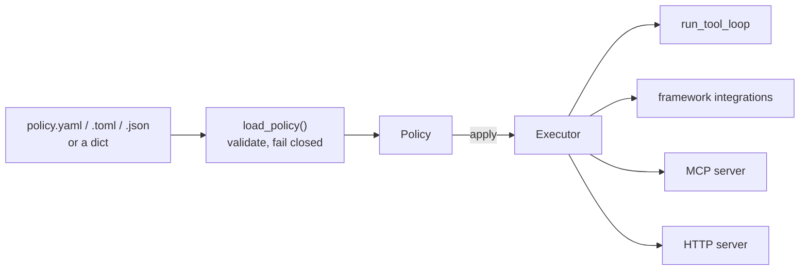

# Policy file

A policy is one file that says, per tool, per team or user and per environment, which
tools may run, which need a person's approval, which guards check them, and what budgets
and rate limits apply. You apply it to an executor. Every call goes through that executor,
so the same rules hold in the tool loop, flows, all framework integrations, MCP and the
HTTP server.



## A policy

```toml
--8<-- "examples/policy_shop.py:file"
```

The same file in YAML (needs `pyyaml`):

```yaml
environments: [dev, prod]
default: {dev: allow, prod: deny}
rules:
  - tools: ["lookup_*", "send_note"]
    allow: true
  - tools: refund
    allow: true
    teams: support
    confirm: "amount > 100"
```

## Apply it

```python
--8<-- "examples/policy_shop.py:apply"
```

`apply` returns a new executor; the old one is unchanged. Pass the new one to
`run_tool_loop`, `create_app(registry, executor=...)`, `mcp_server(registry, executor=...)`
or any integration.

## What it can set

| Key | Sets | Built from |
|---|---|---|
| `default` | `allow` or `deny` for tools no rule names; may differ per environment | access check |
| `rules` | `allow`, and `confirm: true` or a condition | the tool's `confirm` rule |
| `guards` | `pii`, `presidio` or a guard passed in `guards=`, with `on` and `action` | content guards |
| `budgets` | `max_usd`, `scope`, `per`, `on_exceed`, `store` | `BudgetHook` |
| `rate_limits` | `calls` per `per` seconds for one tool kind, or `llm` | `RateLimitHook` |
| `limits` | `max_calls` per run | `RunLimits` |
| `memory` | `retention_days`; `save: allow, confirm, deny` for `remember` | memory backends |
| `sandbox` | `require_isolated`, `deny_network` | sandbox checks |

Each rule and guard picks its calls with `tools` (globs), `kinds`, `tags`, `envs`,
`teams` and `users`. Every list given must match.
A guard on some tools only watches their arguments and results; the model stages
(`llm_request`, `llm_response`) need a guard on every tool.

- **Access.** A matching `allow: false` always wins. With `default: deny`, only tools a
  rule allows may run. A refused call fails with `PolicyDenied`, a kind of
  `ApprovalDenied`, so HTTP answers 403 and the model sees the reason.
- **Teams.** The team is `ctx.extras["team"]`, else the principal's `claims["team"]`
  (`team_key:` renames it). Pass `team_of=` for your own. Users are the principal's id,
  else `ctx.user_id`. Hosts set these, never the model.
- **Budgets.** `store` is `memory`, `sqlite:PATH` (relative to the file), or a name from
  `stores=` (Redis, SQL).
- **Memory and sandboxes.** Call `policy.apply_memory(memory)` and
  `policy.check_sandbox(sandbox)` where you build them.

## Conditions

A `confirm` condition reads the tool's arguments: `amount > 100`,
`country in ["FR", "DE"]`, `order.total >= 50 and not express`. It allows comparisons,
`in`, `and`, `or`, `not`, numbers, strings, `true`, `false` and `null`. It cannot call
anything, and it cannot read a secret-named argument such as `api_key`. It is never passed
to `eval`. The whole condition must be a comparison, or several joined by `and`, `or`
and `not`. When a value is missing or cannot be compared (a number against a string),
the call asks for approval. Arguments named `true`, `false` or `null` cannot be read.
Explanations show string literals as `'...'`; still, keep personal data out of them.

## Safe by default

- **Stricter only.** A policy adds approvals and never removes one: `confirm: false` is
  refused, and a tool with `confirm=True` in code always asks.
- **Relaxations.** Two settings may loosen code: `limits.max_calls` above the executor's,
  and a longer `memory.retention_days`. Each must be listed under `relax:`, and the file
  loaded with `allow_relax=True`.
- **Fail closed.** An unknown key, a bad value, an unknown guard, YAML anchors and
  aliases, or nesting over 32 levels fail at load. The
  error names the file, line and key, never the value.
- **Environments.** When rules name environments, list them in `environments`. The
  environment comes from `env=` or `AA_ENV`; a missing or unknown one fails at load.
- **Kept by the executor.** The policy is an executor setting, not a hook: its access
  check, guards, budgets, approvals and limits stay after any `replace(...)`, such as
  `replace(hooks=[])`. Only `replace(policy=None)` removes it.
- **Caches.** Under a policy, flow node caches are skipped: a cached node would skip
  the per-caller checks. Tool and model caches run after them.
- **Listings.** The HTTP catalogue (`requires_approval`) and MCP tool hints show the
  approvals the executor's policy adds. Framework approval flags show the code's
  settings. Enforcement does not depend on any listing; pass `policy.tools(registry)`
  to hide tools denied to everyone.
- **Stacking.** Applying a second policy keeps the first: both must allow a call, and
  either may ask for approval.

## Debugging

```python
--8<-- "examples/policy_shop.py:explain"
```

`explain(tool, ctx)` lists the rules for one tool. Without a context, rules for some
teams or users say so. The viewer's Tools tab shows the same lines for each tool when you
record a policy executor. User ids are counted, never shown.

From the command line:

```bash
agent-adapter policy check policy.yaml --env prod --tool refund
```

It exits 0 for a valid file and prints the effective rules, or exits 2 with the line and
key that are wrong.

## Files

| File | Does |
|---|---|
| `policy/__init__.py` | `load_policy` |
| `policy/model.py` | the schema: pydantic models that refuse unknown keys |
| `policy/condition.py` | the condition language |
| `policy/policy.py` | `Policy`: `apply`, `explain`, `tools`, memory and sandbox checks |
| `policy/_hooks.py` | the access gate, scoped guards and the added `confirm` rule |
| `policy/_build.py` | builds guards, budgets and rate limits from entries |
| `policy/_load.py` | reads YAML, TOML and JSON with line numbers |
| `cli/policy.py` | `agent-adapter policy check` |
