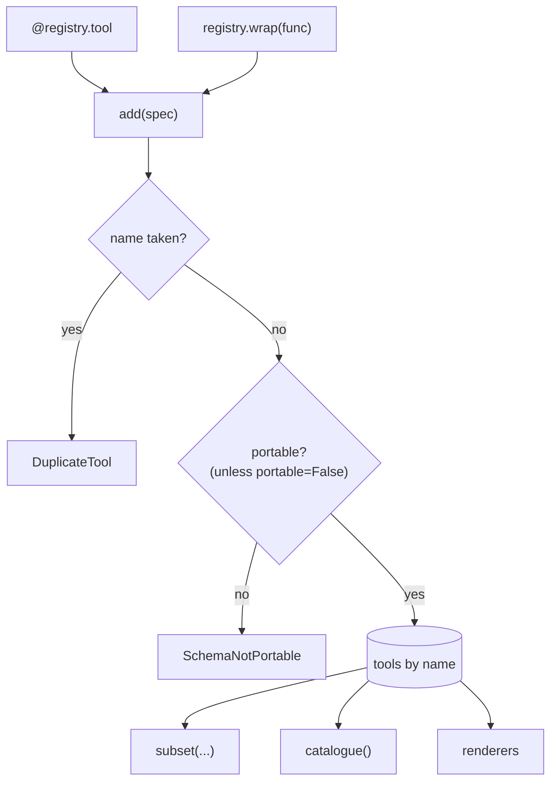

# Registry

A `Registry` holds tools by name, in registration order. Renderers and the executor read
from it. It is the one place an app defines what tools exist.



## Methods

| Method | Does | Raises |
|---|---|---|
| `tool(func)` / `tool(**options)` | decorator: build, add, return the function | `ToolDefinitionError`, `DuplicateTool`, `SchemaNotPortable` |
| `wrap(func, **options)` | build and add; return the `ToolSpec` | same |
| `add(spec)` | register a built spec | `DuplicateTool`, `SchemaNotPortable` |
| `add_many(specs)` | register several, all or nothing: every name and schema is checked first | same; nothing is registered |
| `get(name)` | the spec | `ToolNotFound` (lists known names) |
| `remove(name)` | unregister and return the spec | `ToolNotFound` |
| `subset(names=, tags=, kinds=)` | a new registry; filters combine with AND | `ToolNotFound` for an unknown name |
| `for_target(target)` | a new registry with the tools exported to `target` | — |
| `names()` | names in registration order | — |
| `catalogue()` | Markdown tool list for prompts | — |
| `len(r)`, `name in r`, `for spec in r` | size, membership, iteration in order | — |

## Views per agent

Give each agent only the tools it needs. `subset` returns a new registry that shares the
same `ToolSpec` objects; the original is unchanged.

```python
--8<-- "examples/registry_views.py:views"
```

| Filter | Keeps a tool when |
|---|---|
| `names=[...]` | its name is listed |
| `tags=[...]` | it has at least one listed tag |
| `kinds=[...]` | its `kind` is listed |

Given several filters, a tool must match all of them.

## Targets

A tool goes to every target unless its `targets=` option names some. Renderers and
exporters render `registry.for_target(<their name>)`: `openai`, `gemini`, `anthropic`,
`mcp`, `http`, `langchain`, ... (any non-empty string works for your own targets).

```python
--8<-- "examples/imported_tools.py:targets"
```

```text
['remote_search']
['remote_search', 'legacy_lookup']
['remote_search']
```

`legacy_lookup` has `targets=["anthropic"]`, so only the Anthropic renderer lists it.
Rendering it alone with an OpenAI single-tool function raises `ToolUsageError`.

## Prompt catalogue

`catalogue()` renders Markdown for a planner prompt. It is built from the same schema
the model gets, so it cannot drift. With the two tools above it starts:

```markdown
### search
Search articles.
When to use: First step for any query.
Arguments:
- `query` (required): Search text.
- `top_k` (optional): How many hits.
```

## The default registry

`agent_adapter.tool` and `agent_adapter.wrap` are the `tool` and `wrap` methods of
`agent_adapter.default_registry`. Use your own `Registry()` in libraries and tests, so
two modules cannot clash on a name.

This page's code is `examples/registry_views.py` and `examples/imported_tools.py`. The test
suite runs both.
