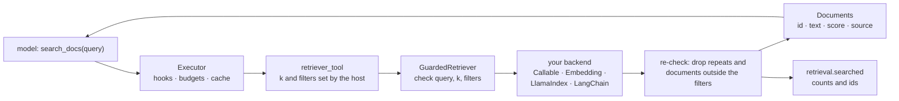

# Retrieval (RAG)

`agent_adapter.retrieval` lets a model search **your** documents and answer with
citations. You bring the search (a vector database, a search API, LlamaIndex, LangChain,
or a small in-memory corpus). The adapter adds input checks, filter enforcement, typed
errors, trace events and a registry tool that runs through the executor like any other.



| File | Does |
|---|---|
| `retrieval/port.py` | `RetrieverPort`: `retrieve(query, *, k, filters, ctx) -> list[Document]` |
| `retrieval/documents.py` | `Document`, `Source`, `Filters` and the shared checks |
| `retrieval/_base.py` | `GuardedRetriever`: checks, filter enforcement, events, `retrieve_sync` |
| `retrieval/callable.py` | `CallableRetriever`: any search function |
| `retrieval/embedding.py` | `EmbeddingRetriever`: in-memory cosine search over an `EmbeddingPort` |
| `retrieval/llamaindex.py` | `LlamaIndexRetriever`: a LlamaIndex index or retriever |
| `retrieval/langchain.py` | `LangChainRetriever`: a LangChain retriever |
| `retrieval/tool.py` | `retriever_tool`: a retriever as a registry tool |

A query enters through `retrieve()` or the tool. It leaves only to your backend. Documents
leave to the caller (the model, through the tool). Events carry counts and document ids;
the query and texts are added only with `capture_content=True`.

## A corpus

```python
--8<-- "examples/retrieval_rag.py:corpus"
```

A `Document` has an `id`, its `text`, a `score` (higher is better, or `None`), a
`source` (`uri` and `title`, for citations) and free `metadata`. Backends that return no
id get a stable one, a digest of the source and text.

`EmbeddingRetriever(embedder, documents=(), *, scope_key=None)` embeds the documents on
first use and ranks by cosine similarity. It is for demos, tests and small corpora (up to
50,000 documents). Use `add()` / `add_sync()` to grow it.

## The tool

```python
--8<-- "examples/retrieval_rag.py:tool"
```

`retriever_tool(retriever, *, name="search_docs", description=..., k=5, filters=None,
include_metadata=False, max_chars=None, cache_ttl=None, cache_scope="run", timeout=None,
tags=())` returns a `ToolSpec` of kind `"retrieval"`.

- The model sees one argument, `query`. It cannot change `k` or the filters.
- `filters` is a fixed mapping, or `fn(ctx)` that computes it per call, for example from
  `ctx.user_id`. A blank str value from `fn(ctx)` (an unset user id) fails the call
  with `ToolUsageError` before the backend runs.
- The tool returns `{"documents": [{"id", "text", "score", "source"}, ...]}`. The default
  description tells the model to answer only from them and to cite the source.
- `cache_ttl` caches results in the executor cache. Per-call filters refuse
  `cache_scope="global"`, since the cache key holds only the query.

## In a tool loop

```python
--8<-- "examples/retrieval_rag.py:loop"
```

Each search emits `retrieval.searched` inside the tool call, with `retriever`, `backend`,
`k`, `count`, `ids`, `dropped` and `latency_ms`. A failure emits `retrieval.failed` with
`error_kind`.

## Any search service

```python
--8<-- "examples/retrieval_rag.py:callable"
```

`CallableRetriever(fn, *, name="", timeout_s=None, capture_content=False)` calls
`fn(query, k, filters)`, sync (in a worker thread) or async. It may return `Document`s,
strings, or mappings with `text` (plus `id`, `score`, `source`, `metadata`).

## LlamaIndex and LangChain

| Adapter | Calls | `k` and filters |
|---|---|---|
| `LlamaIndexRetriever(index)` | `index.as_retriever(similarity_top_k=k, filters=...)` | native: `MetadataFilters`, or your `native_filters(filters)` |
| `LlamaIndexRetriever(retriever)` | `aretrieve(query)` or `retrieve(query)` | the retriever's own; results re-checked |
| `LangChainRetriever(retriever)` | `ainvoke(query, **search_kwargs(k, filters))` | none by default; pass `search_kwargs` |

Install the framework with `pip install "agent-adapter[llamaindex]"` or
`"agent-adapter[langchain]"`. A vector-store retriever in LangChain takes
`search_kwargs=lambda k, f: {"k": k, "filter": f}`.

## Scope and tenant isolation

Filters are exact matches on metadata (`str`, `int`, `float` or `bool`; a bool matches only
a bool). Every result is re-checked: a document whose metadata does not match is dropped
and a warning is logged. A backend that ignores filters returns fewer results, never
another scope's.

Isolation itself is the **backend's** job: use its own filters, namespaces or collections
per tenant, so the right documents reach the top `k`. The exception is
`EmbeddingRetriever(..., scope_key="museum")`: every document needs a non-empty str under
that metadata key, and every search must filter on one, or it raises `ToolUsageError`.

## Errors

| Error | When |
|---|---|
| `ToolUsageError` | a bad query (empty, over 8,000 characters), `k` (1 to 100) or filters; a result that is not a document; an unscoped search on a scoped corpus |
| `IntegrationError` | the backend raised or ran past `timeout_s`; the cause is chained, the log holds only its type |
| `ConfigError` | bad options; an embedder whose vector size changed |
| `MissingDependency` | LlamaIndex filters without `llama-index-core` |

## Sync code

`retriever.retrieve_sync(query, k=5, filters=None, timeout=None)` and
`EmbeddingRetriever.add_sync(documents)` block on the process-wide loop the executor's sync
methods use.
