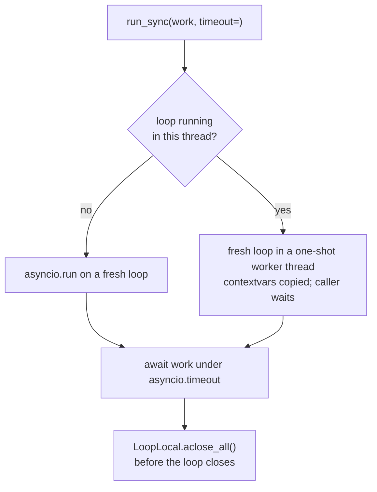

# Runtime

`agent_adapter.runtime` holds the pieces every async API leans on: a sync facade, values
kept per event loop, the current context and ids. This page also covers the two building
blocks the executor uses: hooks and cache keys.

## `run_sync`: async tools from sync code

```python
--8<-- "examples/runtime.py:run_sync"
```



| Input | Meaning |
|---|---|
| `work` | an awaitable, or a zero-argument callable returning one (called inside the new loop) |
| `timeout` | seconds; on expiry the work is cancelled and `TimeoutError` raised. In the worker-thread case the caller also gives up `CALLER_GRACE_S` (5 s) later if the work blocks its loop |

A worker thread abandoned that way (work stuck past `timeout` plus the grace) is not a
daemon thread: it still blocks interpreter exit until the work returns.

## `LoopRunner`: one warm loop for a long-lived process

`run_sync` builds and closes a loop per call, so `LoopLocal` clients (httpx, Redis) are
rebuilt each time. In a process that stays warm, keep one `LoopRunner` at module level.

```python
--8<-- "examples/backend_loop_runner.py:runner"
```

| Pick | When |
|---|---|
| `await executor.run(...)` | you are already in async code (FastAPI, aiohttp, Gradio, Arq) |
| `LoopRunner().run(...)` | sync code in a warm process: Lambda, Cloud Run functions, Azure sync functions, Modal, Dramatiq, gRPC sync servicers, Streamlit (`st.cache_resource`) |
| `run_sync(...)` | one-off scripts, cron, tests, a Celery prefork task |

- The loop starts in a daemon thread on the first `run()`, never at import, so a
  module-level runner is safe before `fork()`. A forked child starts its own loop.
- `run(work, timeout=)` takes the same inputs as `run_sync` and copies the caller's
  contextvars. Many threads may call it at once; sync tools share the loop's default
  thread pool (`min(32, cpu + 4)` threads).
- `close(timeout=30)` lets in-flight work finish, cancels the rest (their callers get
  `ToolUsageError`), awaits `LoopLocal.aclose_all()` and stops the loop. It also runs at
  interpreter exit and at the end of a `with` block.
- Calling `run()` or `close()` from inside the runner's own loop raises `ToolUsageError`
  (it would deadlock): `await` there instead.

Never uses `nest_asyncio`. A non-awaitable `work`, or a `timeout` that is not a positive
number, raises `ToolUsageError`.

## `LoopLocal`: one client per loop

SDK clients (httpx, redis) and asyncio primitives (`Lock`, `Semaphore`, `Event`) break
when used from a loop other than the one that made them. Every `run_sync` call runs a new
loop, so keep such objects in a `LoopLocal`. After `fork()` a child forgets every value
(they belong to the parent) and builds its own.

```python
--8<-- "examples/runtime.py:loop_local"
```

| Method | Does |
|---|---|
| `LoopLocal(factory, *, close=None)` | `factory()` runs on first `get()` in each loop |
| `get()` | this loop's value; `ToolUsageError` outside a loop; thread-safe |
| `aclose()` | forget this loop's value and `await close(value)` |
| `LoopLocal.aclose_all()` | close every instance bound to the running loop; a failing close is logged and the rest still close |

Values are held per loop. `run_sync` closes them before its loop ends. If you run your
own loops, `await LoopLocal.aclose_all()` before closing one; otherwise its values are
only dropped (not closed) on the next `get()`, because a value that references its loop,
such as a contended `Lock` or a client, would keep it alive.

## Current context

```python
--8<-- "examples/runtime.py:current"
```

`use_context(ctx)` sets a `ContextVar` for the block; `current_context()` reads it.
Child tasks see the parent's value. Writes in a child never flow back up.

`new_id(prefix)` returns `prefix + uuid4().hex`. Prefixes in use: `run_`, `call_`, `apr_`,
`evt_`, `opt_`.

## Hooks

`Hook` (`from agent_adapter import Hook`) has nine async methods, all returning `None` by default:
`before_*`, `after_*` and `on_*_error` for `tool`, `llm` and `node`. The executor
calls them through three dispatchers.

| Dispatcher | Rule |
|---|---|
| `run_before(hooks, method, inv)` | registration order; the first `ShortCircuit(value)` wins and skips the call |
| `run_after(hooks, method, inv, value)` | threads the value through each hook; `None` keeps it |
| `run_on_error(hooks, method, inv, error)` | the first `ShortCircuit` recovers from the error |

A hook that raises is re-raised unchanged and logged with its name: a policy outcome
(`BudgetExceeded`, `GuardrailBlocked`, `ApprovalDenied`, `ApprovalPending`,
`RunLimitExceeded`) only at `DEBUG` (the deciding hook logs its own `WARNING`), any other
error at `ERROR` by type, control flow (`is_control_flow`) not at all. Returning
anything but `ShortCircuit` or `None` from a `before_*` / `on_*_error` hook is a
`ToolUsageError`. Invocations are frozen records: `ToolInvocation(spec, call, ctx)`,
`LLMInvocation(request, provider, model, ctx)`, `NodeInvocation(flow, node, state, ctx)`.

## Cache keys

`agent_adapter.cache` builds keys and envelopes; backends, the LLM response cache and
provider plug-ins are on the [Cache](cache.md) page.

| Key | Format |
|---|---|
| tool, scope `run` | `{ns}:tool:v1:run={run_id}:{tool}:{digest(args)}` |
| tool, scope `thread` | `{ns}:tool:v1:thread={thread_id}:{tool}:{digest(args)}` |
| tool, scope `global` | `{ns}:tool:v1:global:{tool}:{digest(args)}` |
| LLM response | `{ns}:llm:v1:{provider}:{model}:{digest(payload)}` |
| Gemini explicit cache | `{ns}:gcache:v1:{model}:{prefix_digest}` |

`digest` is the first 32 hex characters of SHA-256 over canonical JSON (sorted keys, no
spaces). A run- or thread-scoped call without that id is not cached. Entries are
versioned UTF-8 JSON envelopes `{"v": 1, "kind", "stored_at", "payload"}`, never pickle;
a bad, foreign or old entry decodes to a miss. `ToolResultCache(port)` wraps any
`CachePort` and treats backend errors as misses (logged at `WARNING`).

This page's code is `examples/runtime.py` and `examples/backend_loop_runner.py`. The test
suite runs both.
