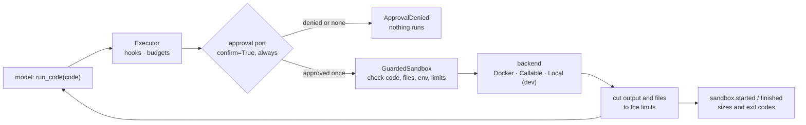

# Sandboxed code

`agent_adapter.sandbox` lets a model write code and run it somewhere it can do no harm.
You pick where: a locked-down Docker container, a hosted sandbox (E2B, Modal, Daytona or
your own service) or, for development only, a local process. The adapter adds input
checks, hard limits on time and output, typed errors, trace events and a registry tool
that **always** asks a person before it runs anything.



| File | Does |
|---|---|
| `sandbox/port.py` | `SandboxPort`, `SandboxResult`, `SandboxFile` |
| `sandbox/_checks.py` | the shared checks, `Limits`, `SandboxRequest` |
| `sandbox/_base.py` | `GuardedSandbox`: checks, limits re-applied, events, `run_sync` |
| `sandbox/docker.py` | `DockerSandbox`, `docker_status` |
| `sandbox/callable.py` | `CallableSandbox`: any code-execution service |
| `sandbox/local.py` | `LocalSubprocessSandbox`: DEVELOPMENT ONLY |
| `sandbox/_bootstrap.py` | the runner inside the sandbox: writes files, runs, reports JSON |
| `sandbox/tool.py` | `code_tool`: a sandbox as a registry tool |

Code enters through `run()` or the tool. It leaves only to the backend. Results leave to
the caller. Events carry sizes, counts and exit codes; the code and output are added only
with `capture_content=True`.

## The tool

```python
--8<-- "examples/sandbox_code_tool.py:sandbox"
--8<-- "examples/sandbox_code_tool.py:tool"
```

`code_tool(sandbox, *, name="run_code", languages=("python",), timeout_s=30,
max_output_bytes=64_000, network=False, env=None, files=None, on_result=None)`:

- `confirm=True` is fixed. There is no option to turn it off: with no approval port the
  executor denies the call, and each approval is used once, by the call it answers.
- The model chooses only `code` (and `language` when you offer more than one). Limits,
  network, env and input files are yours.
- It returns `ok`, `exit_code`, `timed_out`, `stdout`, `stderr`, the `*_truncated` flags
  and the names and sizes of files the code wrote. `on_result(result, ctx)` gets the full
  `SandboxResult`, for example to keep a chart the code drew. Files with unsafe or
  repeated names are dropped (`files_truncated=True`), but names still come from the code:
  never join one to a host path without checking it again.
- A timeout is a result (`timed_out=True`, `exit_code=-1`), not an error, so the model can
  try again with faster code.

```python
--8<-- "examples/sandbox_code_tool.py:approval"
--8<-- "examples/sandbox_code_tool.py:loop"
```

The reviewer sees the exact code in `request.arguments["code"]`. The example's reviewer
approves everything: that is for the example only. "Always confirms" is only as strong as
the approval port, so never pair `code_tool` with `AutoApprove`. In production, use
`DeferredApproval` so a person decides in the viewer, a chat or over HTTP.

## Docker

```python
--8<-- "examples/sandbox_docker.py:docker"
```

Each run starts a fresh container with `docker run --rm`: `--network none`,
`--read-only`, `--cap-drop ALL`, `no-new-privileges`, a non-root user (`65534:65534`;
root is refused), `--pids-limit`, `--memory` with no swap, `--cpus`, `--ipc none`, and
`noexec` tmpfs folders for `/work` and `/tmp`. Code, files and env go in on stdin, never on
the command line. On a timeout the container is force-removed. The image is never pulled
at run time; pull it first. `runtime="runsc"` adds gVisor when it is installed.
`docker_status()` says whether Docker can run Linux containers here; so does
`agent-adapter doctor`. `network=True` uses Docker's `bridge` network: egress is open,
including cloud metadata addresses and services on the host. If you need it, run on a
custom Docker network with egress rules instead.

## Hosted sandboxes

`CallableSandbox(fn)` wraps `fn(request) -> SandboxResult` (or a mapping of its fields).
Two short recipes, passed the real SDK in your code:

```python
--8<-- "examples/sandbox_hosted.py:e2b"
--8<-- "examples/sandbox_hosted.py:modal"
--8<-- "examples/sandbox_hosted.py:use"
```

## Development only: the local process

`LocalSubprocessSandbox(allow_unsafe_local=True)` runs Python as a plain child process in
a temporary folder, with a time limit, output caps and a minimal environment. It refuses
to start without the flag and logs a WARNING on every run, and the tool's description
tells the model and the reviewer that nothing is isolated. On Windows, processes the code
starts in the background keep running after it exits. Never give it untrusted code.

## Security

| Backend | Isolates | Does not isolate |
|---|---|---|
| `DockerSandbox` | network (off; `network=True` is open egress), host files, root filesystem (read-only), capabilities, process count, memory, CPU, other processes | the host kernel (containers share it; add `runtime="runsc"` or a VM for hostile code); a daemon you expose to it |
| `CallableSandbox` | whatever your service isolates | the adapter cannot check it: your service must honour `request.network` and `request.timeout_s` |
| `LocalSubprocessSandbox` | nothing but the environment variables | files, network, processes, memory: it runs as you |

Whatever the backend, the adapter enforces:

- approval before every run of `code_tool`;
- checked inputs: code size, safe relative file names, plain env names;
- produced file names checked the same way (no `..`, absolute, drive or device names);
- output and files cut to the limits, even if a backend ignores them (fail closed);
- a backstop timeout of `timeout_s + grace_s`;
- no code or output in logs, and in events only with `capture_content=True`.

Output is untrusted: the model wrote the code, so treat `stdout` like any model text.

## Errors

| Error | When |
|---|---|
| `ToolUsageError` | bad code, language, file names or env |
| `ConfigError` | bad limits or settings, network asked of a sandbox that does not allow it, the local sandbox without `allow_unsafe_local=True` |
| `IntegrationError` | the backend failed: Docker could not start, no readable result |
| `ApprovalDenied` | the run was not approved |
