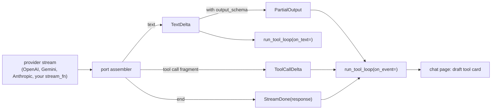

# Streaming

A model port's `stream(request)` yields events while the reply arrives. The tool loop and the
chat page use them to show text, tool arguments and structured answers early.



## The events

| Event | Carries | When |
|---|---|---|
| `TextDelta` | `text` | a piece of the answer text |
| `ToolCallDelta` | `index`, `id`, `name`, `arguments_delta` | a piece of one tool call |
| `PartialOutput` | `value` | the structured output parsed so far |
| `StreamDone` | `response` | last; the full `LLMResponse` |

- `ToolCallDelta.index` is the call's position in `response.tool_calls`. The first delta
  of a call carries its `id` and `name`; later ones only add `arguments_delta`.
- Argument fragments are keyed by the call `index` (OpenAI Chat), by `item_id` (Responses)
  or per `tool_use` block (Anthropic `input_json_delta`). Gemini sends each call whole.
- `PartialOutput` comes only when the request has an `output_schema`. It follows a
  `TextDelta` whose text changed the parsed value. It is not validated: an open string
  keeps its prefix, an unfinished key or number is left out. Validate the final
  `StreamDone.response.parsed` (or `response.parse(Model)`), never a partial value.
- `generate()` with `request.stream=True` streams and returns the assembled response.

All three provider ports emit the same events. A `CallableModel` with a `stream_fn` gets
`PartialOutput` added after its text deltas, unless the `stream_fn` sends its own. A
cache hit, a hook short-circuit or a model without `stream_fn` replays the finished
response: its text, one `PartialOutput` with the parsed value, the calls, then `StreamDone`.

## In the tool loop

`run_tool_loop(on_text=...)` streams each model call and passes the text chunks.
`on_event=` gets every other event: tool-call deltas, partial output, and the
`StreamDone` that ends each model call. Either one turns streaming on; both may be async.

```python
--8<-- "examples/models_streaming.py:events"
```

It prints:

```text
tool args + {"sk
tool args + u": "MU
tool args + G-1"}
answer so far {"sku": "MU"}
answer so far {"sku": "MUG-1"}
answer so far {"sku": "MUG-1", "in_stock": 12}
```

The tool itself still runs once, with the complete, validated arguments, after
`StreamDone`. Streamed fragments are only for showing progress.

## In the chat page

With `--model`, the built-in chat agent streams. Each tool call gets a draft card as
soon as its first fragment arrives:

- The arguments parsed so far show in the card, with secret-named keys masked, cut to
  2 KB. Text that does not parse yet shows nothing.
- When the call runs, the draft card becomes that call's card in place.
- A draft whose call never runs is removed when the next model call starts or the turn
  ends. Drafts are never saved.

Your own `--agent` can do the same: yield `ToolCallDelta` objects between its text chunks.

## Files

| File | Does |
|---|---|
| `core/messages.py` | the stream event types |
| `models/_port.py` | the shared stream loop; adds `PartialOutput` |
| `core/_partial_json.py` | the lenient parser of JSON that is still arriving |
| `exec/_loop_steps.py` | `on_text` and `on_event` in the tool loop |
| `viewer/chat/live.py` | draft tool cards for one chat turn |
