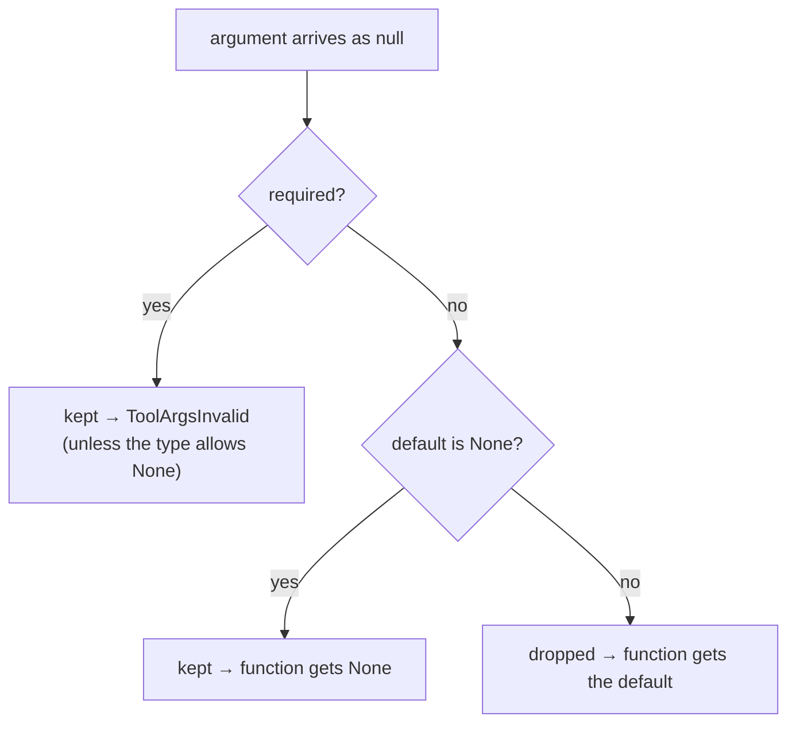

# Strict mode and nulls

OpenAI strict mode (the default for `chat_tools` and `responses_tools`) has two rules:

1. Every property is listed in `required`.
2. No object accepts extra properties.

So an optional argument cannot be left out. It becomes nullable instead, and the model
sends `null` to mean "not given". `invoke` turns that `null` back into your default.

## Example

```python
--8<-- "examples/strict_mode.py:tool"
```

Rendered for OpenAI strict mode:

```python
--8<-- "examples/strict_mode.py:render"
```

```json
{
  "additionalProperties": false,
  "properties": {
    "query": {"description": "Search text.", "type": "string"},
    "top_k": {
      "anyOf": [{"type": "integer"}, {"type": "null"}],
      "description": "How many hits. Default: 8."
    },
    "region": {
      "anyOf": [{"type": "string"}, {"type": "null"}],
      "description": "Optional region filter. Default: null."
    }
  },
  "required": ["query", "top_k", "region"],
  "type": "object"
}
```

The model sends every field. `null` stands for "use the default":

```python
--8<-- "examples/strict_mode.py:call"
```

## The rule



- It applies at any depth: nested models, and models inside lists.
- It follows aliases on nested models.
- To let the model pass `None` on purpose, make `None` the default.

## Defaults in descriptions

Strict mode removes `default` from the schema, so the model would not know it. Each
argument's default is written into its description instead: `Default: 8.` Gemini gets
the same note.

Every property gets the note, at any depth — including fields of models inside lists.
A `default` placed directly on a list item type or a union branch (which pydantic
ignores) is dropped without a note.

## Turning strict mode off

```python
--8<-- "examples/strict_mode.py:loose"
```

The schema is then the plain one: optional fields stay optional and keep `default`.
Each tool dict carries `"strict": false`.

This page's code is `examples/strict_mode.py`. The test suite runs it.
