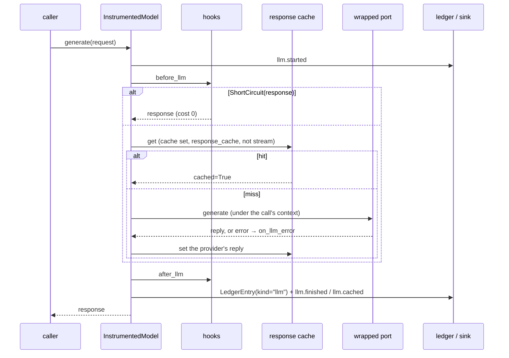
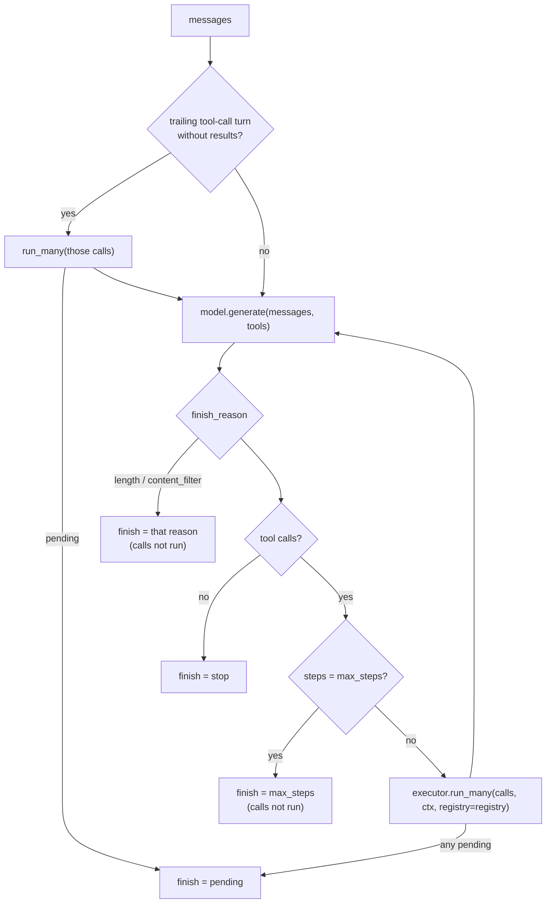

# Instrumented models and the tool loop

`InstrumentedModel` wraps any `LLMPort` with the executor's hooks, the LLM response cache,
one ledger entry per call and `llm.*` events. `executor.model(port)` builds one.
`run_tool_loop` is a minimal agent loop on top: call the model, run its tool calls through
the executor, feed the results back, until it answers.

```python
--8<-- "examples/tool_loop.py:loop"
```

## One instrumented call

```python
--8<-- "examples/tool_loop.py:instrumented"
```



| Rule | Detail |
|---|---|
| Context | the bound one (`bind(ctx)`), else `current_context()`, else a fresh `run_…` / `call_…` pair; an empty `run_id` gets a new one |
| Entry id | `request.metadata["call_id"]`, else `{call_id or run_id}:llm:{stage or "llm"}:{n}`; `n` counts per prefix in `ctx.extras["aa.llm_seq"]`, so a re-run with fresh extras reproduces the ids |
| Ports | the model's own `ledger` / `sink` win, else the context's; the response cache needs `cache=` |
| Response cache | `executor.model` passes the executor's cache, so any executor cache turns it on, with no expiry unless `cache_ttl=`; `LLMRequest(response_cache=False)` opts a request out |
| Ledger entry | `stage = request.stage or "llm"`, `provider` / `model` of the reply, tokens incl. `cache_write_by_ttl`, `cache_hit`, latency, `thread_id`; `metadata.parent_call_id` = the enclosing call |
| Cost | priced by the ledger; a cache hit or a hook's response is recorded with `cost_usd=0.0`; a failure after a reply keeps the reply's usage; a failure without one costs `0.0` |
| Events | `llm.started` → `llm.finished` (usage, `cost_usd`, `finish_reason`, `response_model`) / `llm.cached` / `llm.failed` (`error_kind`, `latency_ms`); `call_id` = entry id, `parent_id` = enclosing call |
| Hooks | `before_llm` may short-circuit with an `LLMResponse`; `on_llm_error` may recover with one; `after_llm` may replace the response (the cache keeps the provider's reply, so hooks see the same input on a hit) |
| Errors | `ModelError`s and host exceptions are recorded (`ok=False`) and re-raised unchanged; control flow (`CancelledError`, `GraphBubbleUp`) and `ApprovalPending` are never offered to `on_llm_error`, emit `llm.failed` (`"cancelled"` / `"approval-pending"`) so spans close, and record an entry only when a paid reply had already arrived |
| Stream | `stream(request)` runs the same steps without the response cache; the entry is recorded before `StreamDone` is yielded; an error after the first delta is not offered to `on_llm_error`; closing early records nothing and emits `llm.failed` (`"cancelled"`) |

The wrapped port runs under a child of the call's context whose `call_id` is the entry id,
so `FallbackModel` hops, nested instrumented calls and Gemini explicit-cache storage land in
the same run, ledger and sink, as children of the call (nested spans in OpenTelemetry).

### Fallback

| Composition | Ledger |
|---|---|
| `FallbackModel([executor.model(a), executor.model(b)])` | one entry per hop: `a` failed, `b` ok |
| `executor.model(FallbackModel([a, b]))` | one entry for the call, priced on the model that answered |
| `executor.model(FallbackModel([executor.model(a), b]))` | `a`'s failed hop and the call's own entry for `b` |
| `executor.model(FallbackModel([executor.model(a), executor.model(b)]))` | per hop only |
| `executor.model(Router(executor.model(a)))`, the router returning a copy | the inner call only |

With `metadata["call_id"]` set, `FallbackModel` sends each hop `{call_id}:hop{index}`, so
hops never overwrite each other's entry or the enclosing call's. A failed raw hop before an
instrumented hop is not counted separately in OTel durations.

**Nested calls.** An instrumented call made directly in another's port (bound or not)
reports its response, ledger and sink to the enclosing call. The enclosing reply matches one
of those responses by the first rule that holds: the same object, else the same non-empty
provider response id, else equal `model` and `usage` when at least one id is empty (two
different ids are two calls); each inner response matches once. On a match with the same
ledger the enclosing call records no entry; with the same sink its `llm.finished` carries
`nested=True`. Its `llm.failed` carries `nested=True` when the error it re-raises is a
nested call's reported failure on the same sink. `OTelSink` records no token or duration
histograms for a nested event: each provider call is billed once per ledger and counted
once per sink. Calls inside a tool the port ran are not direct children and are always billed.

## The tool loop



- Start: `executor or Executor(registry)`, `ctx or executor.context()`, and the model is
  `executor.model(model).bind(ctx)` (an `InstrumentedModel` is only bound). A loop that made
  its own run ends it (`executor.end_run`) when it returns.
- Each request: `messages`, `tools=[spec.tool_def() for spec in registry]`, `tool_choice`,
  `output_schema`, `stage`, plus `request_options` (any other `LLMRequest` field). Reserved,
  unknown or invalid keys and `metadata["call_id"]` → `ToolUsageError` before anything runs.
- Tool names resolve against `registry`; unknown names become `tool-not-found` results the
  model sees. A call without an id gets `{call_id or run_id}:{stage}:{digest of the history
  up to its turn}:{turn}:{index}`, also written into its tool message: the same on every
  resume, distinct across conversations of one run (so `once_per_run` still holds). The
  digest covers role, content, tool calls (name, arguments, id) and `tool_call_id` only, so
  a history stored without `raw` items resumes the same way.
- Entry numbers start at the count of assistant turns already in `messages`, so a resume
  with a fresh context of the same run never overwrites paid entries. Two different loops
  in one run with fresh contexts: give each loop its own `ctx.call_id` or `stage` (or reuse
  one `ctx`).
- A reply with `finish_reason="error"` and no tool calls ends with `finish="stop"` and a
  `WARNING`.
- Tool message content: a `str` value as is, other values `json.dumps(value, default=str)`,
  failures `{"error": {"kind", "message"}}`.
- `ToolLoopResult`: `messages`, `final`, `steps` (model calls in this run), `finish`,
  `tool_results`, `usage` (summed). A `ModelError` propagates.

### Pause and resume

```python
--8<-- "examples/tool_loop.py:pending"
```

On `pending`, `messages` ends with the assistant turn plus the results that did finish.
Pass a `ctx` to make a loop resumable: decide the approval, then call `run_tool_loop` again
with `paused.messages` and the same `ctx` (or one with the same `run_id`). Only the
unanswered calls run (same call ids, so the approval is found), then the loop goes on. A
loop stopped by `max_steps` continues the same way.

Prompt-cache plug-ins without `caps=` read `Prices.default().caps` (known models get their
cache parameters, unknown ones none); see [Cache](cache.md#provider-plug-ins).

| File | Role |
|---|---|
| `models/instrument.py`, `_llm_call.py` | `InstrumentedModel`; one call's ledger entry, events, nesting |
| `models/entries.py` | entry ids and their numbering per context and stage |
| `exec/executor.py`, `exec/tool_loop.py` | `Executor.model()`; `run_tool_loop`, `ToolLoopResult` |
