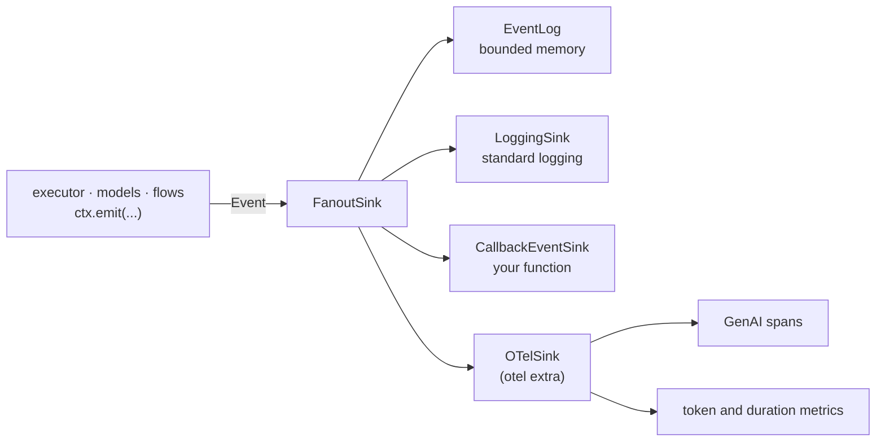
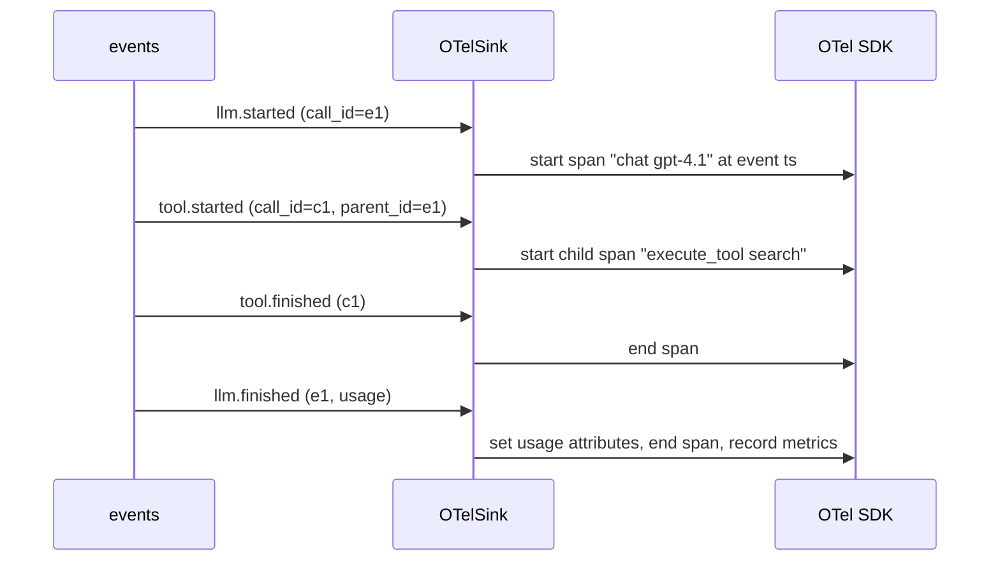

# Tracing: event sinks and OpenTelemetry

Every step emits an `Event` (catalogue in [Context, events and ports](context.md#events))
to one `EventSink`. A sink is sync, quick and never raises. `agent_adapter.tracing` ships
sinks for memory, logging, callbacks, fan-out and OpenTelemetry.



| File | Does |
|---|---|
| `tracing/events.py` | `EventType`, `REQUIRED_DATA`, `make_event`, `emit` |
| `tracing/sinks.py` | `EventLog`, `LoggingSink`, `CallbackEventSink`, `FanoutSink` |
| `tracing/semconv.py` | every OTel attribute, span-operation and metric name |
| `tracing/_genai.py` | pure mapping: event → span name and attributes (no OTel import) |
| `tracing/otel.py` | `OTelSink`: span lifecycle and metrics (imports `opentelemetry` only when built) |

## Sinks

```python
--8<-- "examples/tracing.py:sinks"
```

| Sink | Does |
|---|---|
| `EventLog(*, max_events=10_000)` | keeps the latest events in `.events`; `of_type(prefix)`; thread-safe |
| `LoggingSink(logger=None, *, level=DEBUG, capture_content=False)` | one log line per event: type, ids, data. Content keys (`arguments`, `result`, `input_messages`, `output_messages`) are left out (listed as `omitted=`) at every level, unless `capture_content=True` and `level` is `DEBUG` |
| `CallbackEventSink(fn)` | calls `fn(event)`; a failure is logged at `WARNING` |
| `FanoutSink(*sinks)` | sends to each sink in order; one failing sink does not stop the rest; `.sinks` is read-only |

## OpenTelemetry

Install the extra: `pip install "agent-adapter[otel]"`; it brings only
`opentelemetry-api`, the SDK and exporters are your choice. Without it, `OTelSink()` raises `MissingDependency`.

```python
--8<-- "examples/tracing.py:otel"
```

`OTelSink(*, tracer_provider=None, meter_provider=None, capture_content=False,
instrumentation_name="agent_adapter")` uses the global providers when none are given.



| Events | Span | Kind |
|---|---|---|
| `llm.started` → `llm.finished` / `llm.cached` / `llm.failed` | `chat {model}`; `generate_content {model}` for Gemini | `CLIENT`; `INTERNAL` for `callable` |
| `embedding.started` → `embedding.finished` / `embedding.failed` | `embeddings {model}` | `CLIENT`; `INTERNAL` for `callable` |
| `context.compressed` / `context.compress_failed` (one closing event) | `compress_context {model}` | `INTERNAL` |
| `tool.started` → `tool.finished` / `tool.failed` / `tool.pending` | `execute_tool {tool}` | `INTERNAL` |
| `flow.started` → `flow.finished` | `invoke_workflow {flow}` | `INTERNAL` |
| `node.started` → `node.finished` / `node.failed` / `node.paused` | `node {flow}.{node}` | `INTERNAL` |

Rules:

- Spans start and end at the event `ts` and are matched by `(run_id, call_id)`; flow
  spans by `(run_id, call_id)`, or `(run_id, flow)` when the flow event has no call id.
- `parent_id` picks the parent span (an open llm, tool, node or flow span). A node with no
  known parent nests under the innermost open flow of its name. With no parent, the host's
  current span is.
- A closing event with no open span still makes a span (start = `ts − latency_ms`). A
  malformed closing event still ends its span (then is logged).
- `tool.retry`, `tool.cached`, `approval.requested` and `approval.decided` become span
  events on the open tool span, carrying only `attempt`, `delay_s`, `error_kind`,
  `approval_id` and `approved` (never a reason, a decider or other free text).
- Failures set `error.type` to the error kind and the span status to `ERROR`; so does
  `flow.finished` with status `failed`, `error` or `cancelled`. Pending and paused spans end with
  `agent_adapter.approval_id` and no error.
- Spans whose end never arrives are ended once 10,000 are open.
- A bad event is logged at `WARNING`; the sink never raises.

| Attribute | From |
|---|---|
| `gen_ai.operation.name`, `gen_ai.provider.name` | provider (`gemini` → `gcp.gemini`; others unchanged) |
| `gen_ai.request.model`, `gen_ai.request.stream` | `llm.started` |
| `gen_ai.response.model`, `gen_ai.response.id` | `llm.finished` `response_model` (else `model`), `response_id` |
| `gen_ai.response.finish_reasons` | `[finish_reason]` |
| `gen_ai.usage.input_tokens` | all prompt tokens: input + cached + cache writes |
| `gen_ai.usage.output_tokens`, `…reasoning.output_tokens` | output (incl. reasoning), reasoning |
| `gen_ai.usage.cache_read.input_tokens`, `…cache_creation.input_tokens` | cached, cache-write tokens |
| `gen_ai.conversation.id` | `run_id` |
| `gen_ai.tool.name`, `gen_ai.tool.call.id`, `gen_ai.tool.type` | tool name, call id, `function` |
| `gen_ai.workflow.name` | flow name |
| `agent_adapter.*` | stage, cost, cache hit, attempts, tool kind, node, visit, flow status and steps |

Metrics: per `llm.finished`, `gen_ai.client.token.usage` (histogram, `gen_ai.token.type`
= `input` / `output`) and `gen_ai.client.operation.duration` (seconds); per `llm.failed`,
the duration with `error.type` (from `latency_ms`, else since `llm.started`). Embeddings
calls record input tokens and duration too; a call served fully from the cache records none.

### Content

Off by default (prompts and arguments may hold PII). With `capture_content=True`, event
data keys become opt-in attributes:

| Event key | Attribute |
|---|---|
| `llm.started` `input_messages` | `gen_ai.input.messages` |
| `llm.finished` `output_messages` | `gen_ai.output.messages` |
| `tool.started` `arguments` | `gen_ai.tool.call.arguments` |
| `tool.finished` `result` | `gen_ai.tool.call.result` |

Values that are not strings are JSON-encoded.

### Renames

The GenAI conventions are still in Development. Every name lives in
`tracing/semconv.py`, so a rename (for example `gen_ai.usage.cache_write.input_tokens`
or `gen_ai.client.inference.*` metrics) is a one-file change. A test checks the names
against the installed `opentelemetry-semantic-conventions` when it is present.

This page's code is `examples/tracing.py`. The test suite runs it. End to end:
[Observability](../guides/observability.md).
