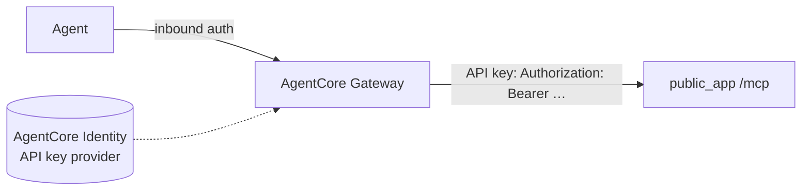

# Connect: Amazon Bedrock AgentCore Gateway

:material-check-circle:{ .status-ok } Recipe · through our public [MCP server](../cross-language/mcp.md) · their docs checked 2026-10-30

AgentCore Gateway puts our server behind one MCP endpoint for your agents. The gateway
authenticates callers on its side (inbound auth) and calls us with its own credential
(outbound auth). It speaks MCP 2026-07-28, 2025-11-25, 2025-06-18 and 2025-03-26.



## Our side

```python
--8<-- "examples/connect_server.py:public"
--8<-- "examples/connect_server.py:hosted"
```

Serve `public_app(hosted, host, agent_token, reviewer_token)`.

## Their side

1. In AgentCore Identity, create an **API key credential provider** that holds our agent
   token (same account and Region as the gateway).
2. Add an **MCP server target** (boto3 `bedrock-agentcore-control`):

```python
control.create_gateway_target(
    gatewayIdentifier=gateway_id,
    name="shop-tools",
    targetConfiguration={
        "mcp": {"mcpServer": {"endpoint": "https://tools.example.com/mcp", "listingMode": "DEFAULT"}}
    },
    credentialProviderConfigurations=[
        {
            "credentialProviderType": "API_KEY",
            "credentialProvider": {
                "apiKeyCredentialProvider": {
                    "providerArn": api_key_provider_arn,
                    "credentialParameterName": "Authorization",
                    "credentialPrefix": "Bearer ",
                    "credentialLocation": "HEADER",
                }
            },
        }
    ],
)
```

| Key | Meaning |
|---|---|
| `targetConfiguration.mcp.mcpServer.endpoint` | our `/mcp` URL (URL-encoded) |
| `listingMode` | `DEFAULT`: the gateway caches our `tools/list`; `DYNAMIC`: it asks us each time |
| `credentialProviderType: "API_KEY"` | outbound auth from an AgentCore Identity API key provider |
| `credentialParameterName`, `credentialPrefix`, `credentialLocation` | how the key is sent: header `Authorization`, value `Bearer <token>` |
| `SynchronizeGatewayTargets` | refresh the cached tool list after you change tools (`DEFAULT` mode) |

OAuth outbound (client credentials, authorization code, token exchange) also works when
`bearer_auth` is given an async verifier for your issuer's tokens.

## Their side, OpenAPI target (alternative)

The gateway also imports an OpenAPI document, but refuses `oneOf`, `anyOf` and `allOf` and
spec-level security schemes. `/openapi.json` (3.1) has unions, so give it the
`dialect="3.0-gateway"` file instead ([how](../cross-language/http-server.md#openapi-303-go-rust-api-gateways)):
3.0.3, no unions, only the `invoke_<tool>` operations, our `server_url`, no `security`.

```python
control.create_gateway_target(
    gatewayIdentifier=gateway_id,
    name="shop-tools-rest",
    targetConfiguration={"mcp": {"openApiSchema": {"inlinePayload": inline_payload}}},
    credentialProviderConfigurations=[...],  # the same API_KEY entry as step 2
)
```

| Key | Meaning |
|---|---|
| `openApiSchema.inlinePayload` | the document as JSON text (or `s3` with a bucket URI) |
| tool names | the gateway uses each `operationId`: `invoke_<tool>` |
| a `202 pending_approval` | a confirm tool runs only when a reviewer decides over REST, and the agent never sees that result: serve `hosted` here too |

## Checklist

| Check | Why |
|---|---|
| serve `hosted` | the gateway does not send our resume keys back; a confirm tool would never run |
| every gateway caller shares the target's one token | so one principal: per-user runs need token exchange and a verifier |
| call `SynchronizeGatewayTargets` after each tool change | `DEFAULT` mode serves a cached list |
| keep `client_approval` off | the gateway passes 2026-07-28 `requestState` through unchecked, and no person sees a form |
| everything on the [public-host checklist](index.md#public-host-checklist-every-page) | |

## Sources

- MCP server targets: <https://docs.aws.amazon.com/bedrock-agentcore/latest/devguide/gateway-target-MCPservers.html>
- `create_gateway_target` (boto3): <https://docs.aws.amazon.com/boto3/latest/reference/services/bedrock-agentcore-control/client/create_gateway_target.html>
- OpenAPI targets (limits, outbound auth): <https://docs.aws.amazon.com/bedrock-agentcore/latest/devguide/gateway-schema-openapi.html>
- Gateway concepts: <https://docs.aws.amazon.com/bedrock-agentcore/latest/devguide/gateway-core-concepts.html>
